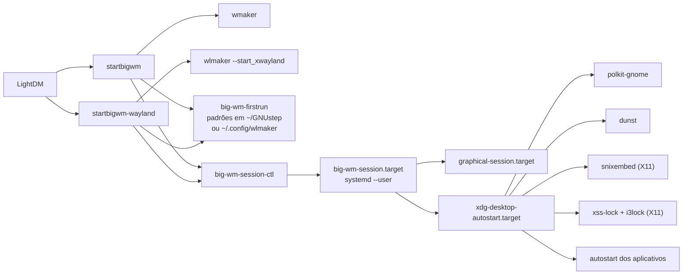

<p align="center">
  
</p>

<h1 align="center">Big WindowMaker</h1>

<p align="center">
  O desktop Window Maker do BigLinux/BigCommunity: a elegância do NeXTSTEP,<br>
  integração moderna com o sistema e duas sessões — X11 estável e Wayland nativo.
</p>

<p align="center">
  <a href="https://github.com/big-windowmaker/big-wm/actions/workflows/ci.yml"></a>
  
  
  
</p>

---

## Sessão X11 — Window Maker

<p align="center">
  
</p>

Menu raiz (clique direito na área de trabalho) com aplicativos gerados a partir
dos arquivos `.desktop`, Dock à direita com relógio, bandeja, volume, CPU,
memória e rede, Clip com os aplicativos favoritos e ícones de aplicativo na
base da tela — o fluxo clássico do Window Maker, com tudo que um desktop atual
precisa por trás.

## Sessão Wayland — wlmaker (experimental)

<p align="center">
  
</p>

Compositor Wayland **nativo** ([wlmaker](https://github.com/phkaeser/wlmaker)),
com o mesmo tema, papel de parede e atalhos da sessão X11. Aplicativos X11
rodam pelo XWayland.

> As capturas acima são do teste de integração automatizado
> ([`tests/integration/`](tests/integration/)), que instala os pacotes reais
> num contêiner e exercita as duas sessões a cada mudança.

---

## Pacotes

| Pacote | Conteúdo |
|---|---|
| `big-wm-session` | Sessão **Big WindowMaker — X11** (padrão): wrapper de sessão, configuração padrão do Window Maker, integração com systemd, notificações, polkit, bandeja e bloqueio de tela |
| `big-wm-wayland` | Sessão **Big WindowMaker — Wayland (experimental)** com o compositor wlmaker |
| `big-wm-themes` | Logo, temas e estilos do Window Maker, ícones, papéis de parede e emblemas de sessão |

Os pacotes do Window Maker, do wlmaker e dos dockapps ficam em
[big-windowmaker/packages](https://github.com/big-windowmaker/packages).

## Como a sessão funciona



### Princípios

- **Nenhum binário de outro pacote é alterado.** O `/usr/bin/wmaker` é chamado como está.
- **Nada em `/etc/skel`.** A configuração padrão é aplicada no primeiro login,
  inclusive em contas que já existiam. `big-wm-firstrun --reset x11` (ou
  `wayland`) restaura os padrões e guarda a configuração anterior em `*.bak-<data>`.
- **Convive com Plasma, XFCE e GNOME.** Todo autostart instalado aqui tem
  `OnlyShowIn=WindowMaker;` e/ou `wlmaker;`; os testes garantem isso e também
  que nada é instalado fora dos caminhos do projeto.
- **Sem scripts de instalação.** Nada roda como root ao instalar ou atualizar.
- **No idioma do usuário.** Menus em português e inglês, relógio do Dock com
  mês e dia da semana no idioma da sessão, capturas em *Imagens/Capturas de tela*.

## Atalhos

| Ação | X11 | Wayland |
|---|---|---|
| Menu raiz | clique direito na área de trabalho / F12 | F12 / Ctrl+Esc |
| Buscar aplicativos | Super+Espaço | Super+Espaço |
| Terminal | Ctrl+Alt+T | Ctrl+Alt+T / Super+Enter |
| Arquivos | Super+E | Super+E |
| Bloquear a tela | Super+L | Super+L / Ctrl+Alt+L |
| Captura da tela / janela / área | Print / Alt+Print / Shift+Print | Print / — / Shift+Print |
| Fechar janela | Alt+F4 | Alt+F4 |
| Alternar janelas | Alt+Tab | Alt+Tab |

## Recursos e estado

✅ verificado pelo teste de integração a cada mudança · 🔧 configurado, ainda sem
teste automatizado · ⚠️ funciona com restrição · ❌ não disponível

| Recurso | X11 | Wayland |
|---|---|---|
| Sessão sobe com a configuração padrão, sem avisos | ✅ | ✅ |
| Dock à direita, Clip, menu raiz, áreas de trabalho | ✅ | ✅ |
| Dockapps clássicos (relógio, CPU, memória, rede, bandeja) | ✅ | — (o wlmaker tem dockapps próprios) |
| Janelas gerenciadas, foco e atalhos globais | ✅ | 🔧 |
| Aplicativos GTK e Qt nativos | ✅ | ✅ |
| Aplicativos X11 | ✅ | ✅ via XWayland |
| Notificações (dunst) | ✅ | ✅ |
| Captura de tela | ✅ tecla Print nativa | ✅ grim (screencopy) |
| Clipboard e seleção primária | ✅ | ✅ |
| Bloqueio de tela | ✅ i3lock (via xss-lock) | ✅ swaylock (ext-session-lock) |
| Vários monitores | 🔧 RandR | ✅ wlr-output-management (2 saídas) |
| Portal de configurações (tema claro/escuro para Qt e GTK4) | ✅ | 🔧 |
| Compartilhamento de tela pelo portal | 🔧 | ⚠️ só com GPU: o portal wlr exige linux-dmabuf |
| Bandeja para apps Qt6/Electron (SNI) | 🔧 snixembed | ❌ o wlmaker ainda não tem bandeja |
| Métodos de entrada (IME), xdg-activation | 🔧 | ❌ não implementados no wlmaker 0.8 |

## Desenvolvimento

```sh
make check                       # testes estáticos (tests/run.sh)
make install DESTDIR=/tmp/teste  # instalação de teste
cd pkgbuild && BIGWM_SOURCE="git+file://$PWD/..#branch=main" makepkg   # pacotes locais
```

Os testes de integração precisam dos pacotes de
[big-windowmaker/packages](https://github.com/big-windowmaker/packages) e rodam
num contêiner Manjaro descartável:

```sh
podman run --rm -v "$PWD/tests/integration:/t:ro" -v "$PWD/pacotes:/pkgs:ro" \
  -v "$PWD/resultado:/out" docker.io/manjarolinux/base bash /t/session-test.sh /pkgs /out
```

## Licença

GPL-2.0-or-later. Veja [`LICENSE`](LICENSE) e [`CREDITS.md`](CREDITS.md).
