<p align="center">
  
</p>

<h1 align="center">Big WindowMaker</h1>

<p align="center">
  O desktop Window Maker do BigLinux/BigCommunity: a elegância do NeXTSTEP,<br>
  integração moderna com o sistema e duas sessões — X11 estável e Wayland nativo.
</p>

<p align="center">
  <a href="https://github.com/big-windowmaker/big-wm/actions/workflows/ci.yml"></a>
  
  
  
</p>

## Baixar

**Big WindowMaker Alpha** (ISO de teste, x86_64, BIOS e UEFI):
https://github.com/big-windowmaker/build-iso/releases

A ISO vem em partes `.7z` (limite de 2 GB por arquivo do GitHub). Para juntar
e conferir: `7z x bigcommunity_wmaker_*.iso.7z.001` e
`sha256sum -c SHA256SUMS --ignore-missing`. Modo live: usuário `community`,
senha `big`. É uma versão Alpha: teste primeiro numa máquina virtual.

---

## Sessão X11 — Window Maker

<p align="center">
  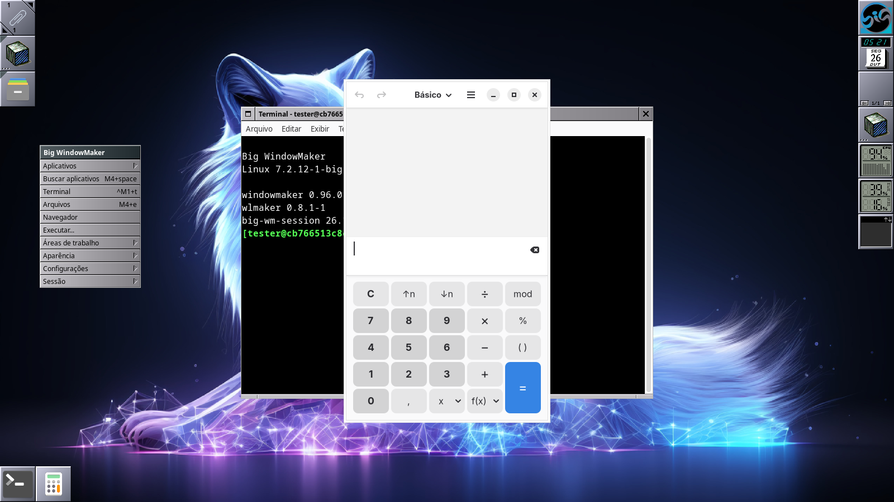
</p>

Menu raiz (clique direito na área de trabalho) com aplicativos gerados a partir
dos arquivos `.desktop`, Dock à direita com relógio, bandeja, volume, CPU,
memória e rede, Clip com os aplicativos favoritos e ícones de aplicativo na
base da tela — o fluxo clássico do Window Maker, com tudo que um desktop atual
precisa por trás.

## Sessão Wayland — wlmaker (experimental)

<p align="center">
  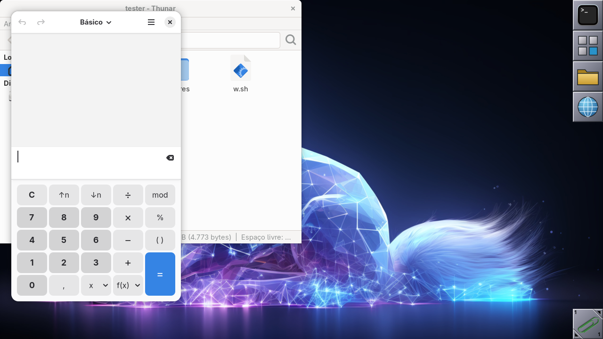
</p>

Compositor Wayland **nativo** ([wlmaker](https://github.com/phkaeser/wlmaker)),
com o mesmo tema, papel de parede e atalhos da sessão X11. Aplicativos X11
rodam pelo XWayland.

> As capturas acima são do teste de integração automatizado
> ([`tests/integration/`](tests/integration/)), que instala os pacotes reais
> num contêiner e exercita as duas sessões a cada mudança.

## Modo claro e modo escuro

<p align="center">
  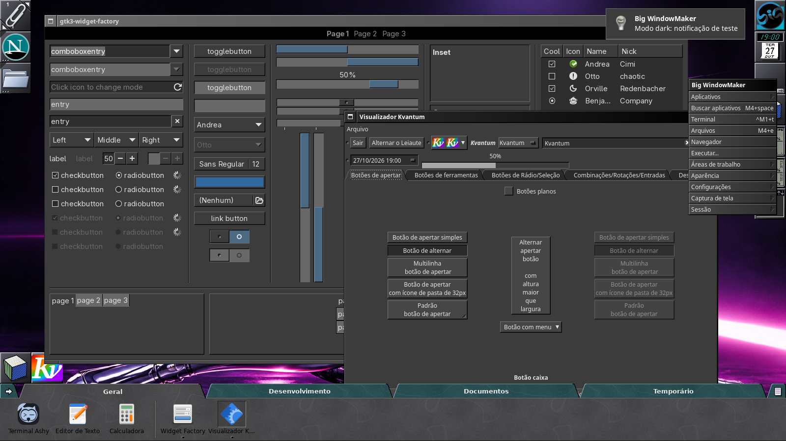
</p>

`big-wm-theme dark` (ou Aparência > Tema escuro no menu raiz) passa toda a
aparência ao modo escuro, no estilo de um NeXTSTEP em cinza-escuro: Window
Maker, wlmaker, GTK (OneStepBack-Dark), Qt (QTStepOpenStepDark), dock com
abas, Buscar aplicativos e notificações. `big-wm-theme light` volta ao modo
claro, o padrão. Detalhes: [docs/aparencia.md](docs/aparencia.md#modo-claro-e-modo-escuro).

## Dock com abas (opcional)

<p align="center">
  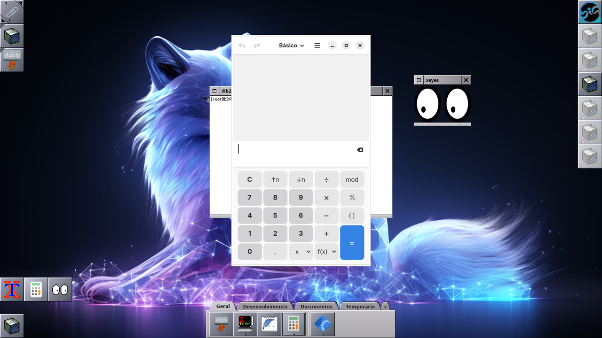
</p>

Dock horizontal com abas (Geral, Desenvolvimento, Documentos, Temporário e as
suas), em C + GTK 3, nativo nas duas sessões: janela dock com EWMH no Window
Maker, layer-shell no wlmaker. Convive com o Dock clássico ou o substitui, sem
apagar a configuração dele. Detalhes, limitações do Wayland e medições em
[docs/tabbed-dock](docs/tabbed-dock/README.md).

## Na ISO, em máquina virtual

Capturas reais da ISO de teste inicializada em QEMU/KVM (UEFI) pelo pipeline
[build-iso](https://github.com/big-windowmaker/build-iso): GRUB, assistente
do modo live e a sessão Window Maker com rede conectada, notificação e
dockapps (relógio, bandeja com rede e firewall, volume, CPU, memória e rede).

<p align="center">
  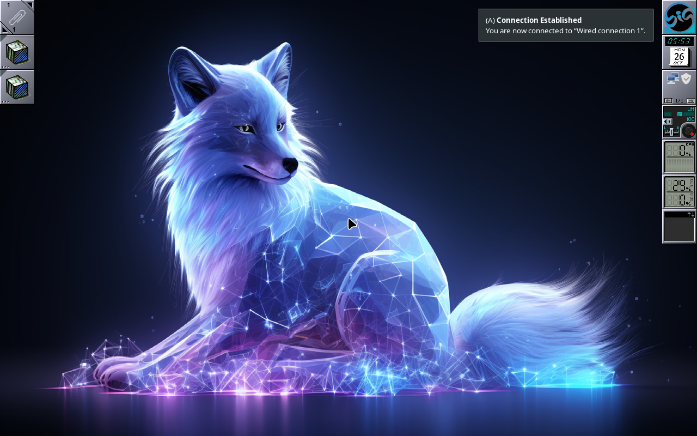
</p>

<p align="center">
  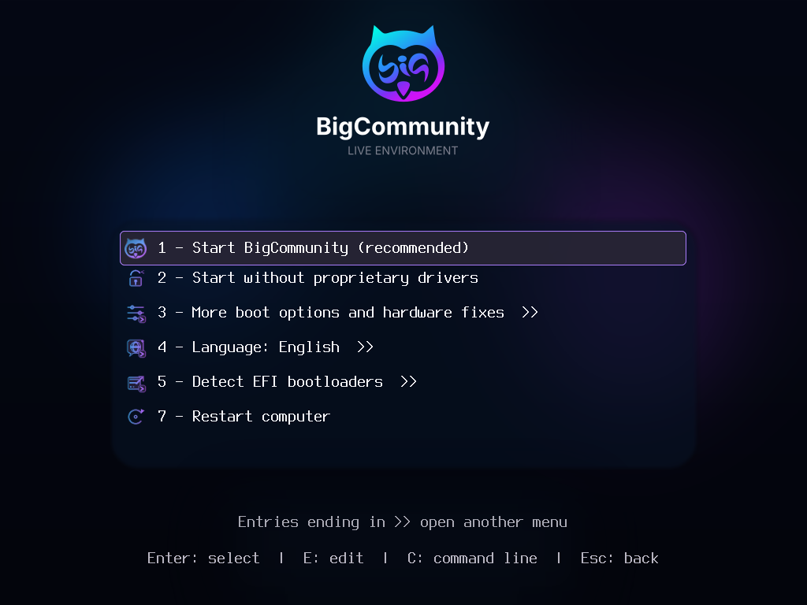
  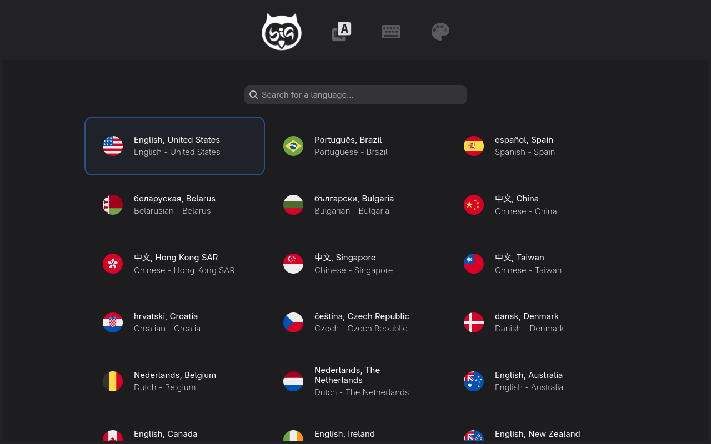
</p>

### Instalação e sistema instalado

O pipeline também instala o sistema pelo Calamares numa VM (harness openQA da
BigLinux, BIOS e UEFI), reinicia pelo disco, entra pela tela de login e
valida as sessões X11 e Wayland no sistema instalado.

<p align="center">
  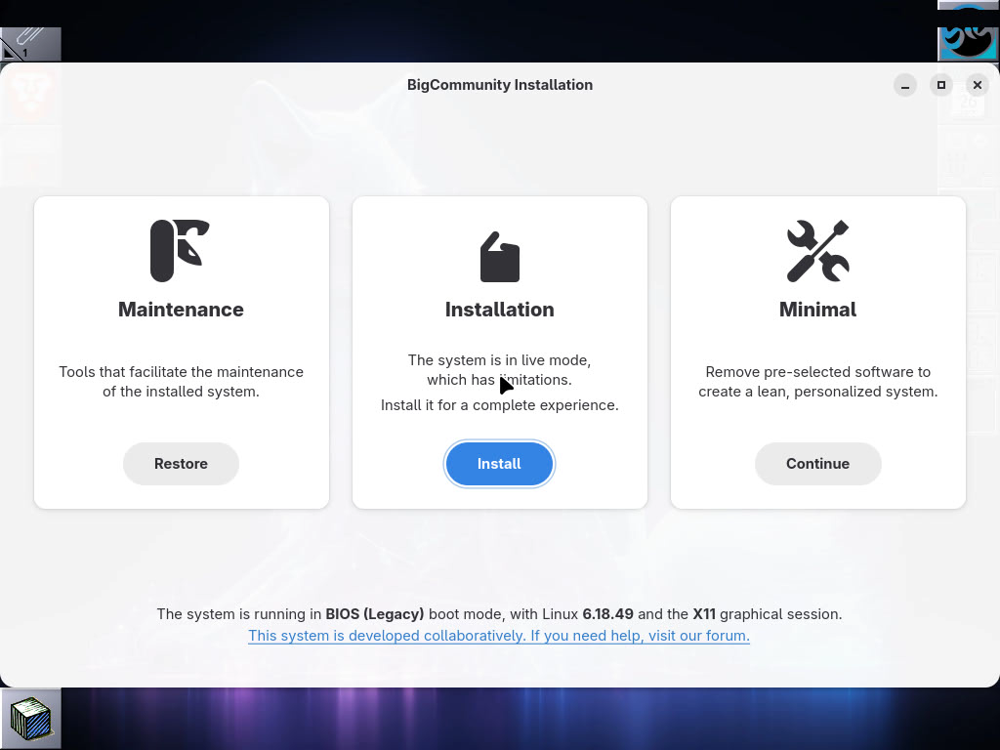
  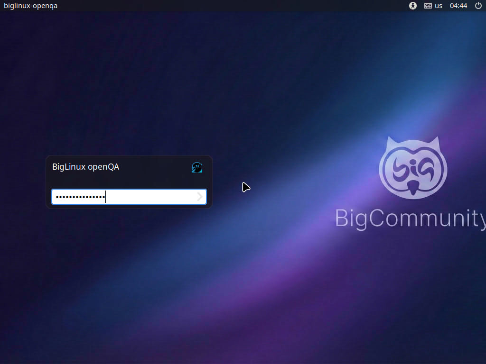
</p>

<p align="center">
  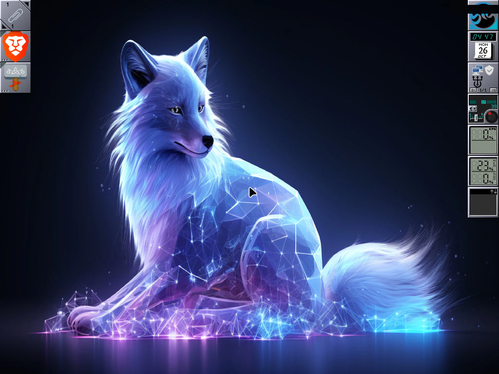
</p>

---

## Pacotes

| Pacote | Conteúdo |
|---|---|
| `big-wm-session` | Sessão **Big WindowMaker (X11)** (padrão): wrapper de sessão, configuração padrão do Window Maker, integração com systemd, notificações, polkit, bandeja e bloqueio de tela |
| `big-wm-wayland` | Sessão **Big WindowMaker (Wayland)** (experimental) com o compositor wlmaker |
| `big-wm-themes` | Logo, temas e estilos do Window Maker, ícones, papéis de parede e emblemas de sessão |
| `big-wm-tabbed-dock` | **Dock com abas** (opcional, X11 e Wayland): prateleira horizontal com abas inspirada no OPENSTEP 4.0 beta — ver [docs/tabbed-dock](docs/tabbed-dock/README.md) |
| `grub-theme-big-wm` | Tema do GRUB no estilo da tela de boot do Window Maker — ver [themes/boot](themes/boot/README.md) |
| `plymouth-theme-big-wm` | Tema do Plymouth no estilo do Window Maker |

Os pacotes do Window Maker, do wlmaker e dos dockapps ficam em
[big-windowmaker/packages](https://github.com/big-windowmaker/packages).

## Como a sessão funciona

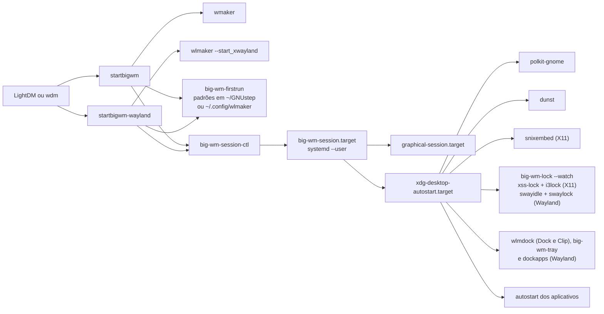

### Princípios

- **Nenhum binário de outro pacote é alterado.** O `/usr/bin/wmaker` é chamado como está.
- **Nada em `/etc/skel`.** A configuração padrão é aplicada no primeiro login,
  inclusive em contas que já existiam. `big-wm-firstrun --reset x11` (ou
  `wayland`) restaura os padrões e guarda a configuração anterior em `*.bak-<data>`.
- **Convive com Plasma, XFCE e GNOME.** Todo autostart instalado aqui tem
  `OnlyShowIn=WindowMaker;` e/ou `wlmaker;`; os testes garantem isso e também
  que nada é instalado fora dos caminhos do projeto.
- **Sem scripts de instalação.** Nada roda como root ao instalar ou atualizar.
- **Leve.** Na sessão Big WindowMaker não sobem os applets que lá não servem
  (Bluetooth sem adaptador, impressora sem fila, seletor de som duplicado);
  em VM o GTK 4 desenha por software. A sessão ocupa ~190 MB (PSS) logo
  após o login: ver [docs/memoria.md](docs/memoria.md).
- **No idioma do usuário.** Menus em português e inglês, relógio do Dock com
  mês e dia da semana no idioma da sessão, capturas em *Imagens/Capturas de tela*.

### Iniciar programas junto com a sessão

Crie um arquivo `.desktop` em `~/.config/autostart/` (vale nas duas sessões e é
o que os aplicativos usam). O script clássico
`~/GNUstep/Library/WindowMaker/autostart` também funciona na sessão X11, mas o
Big WindowMaker não instala um por padrão.

## Atalhos

| Ação | X11 | Wayland |
|---|---|---|
| Menu raiz | clique direito na área de trabalho / F12 | F12 / Ctrl+Esc |
| Buscar aplicativos | Super+Espaço | Super+Espaço |
| Terminal | Ctrl+Alt+T | Ctrl+Alt+T / Super+Enter |
| Arquivos | Super+E | Super+E |
| Bloquear a tela | Super+L (e menu Sessão) | Super+L / Ctrl+Alt+L |
| Captura da tela / janela / área | Print / Alt+Print / Shift+Print | Print / — / Shift+Print |
| Fechar janela | Alt+F4 | Alt+F4 |
| Alternar janelas | Alt+Tab | Alt+Tab |

## Recursos e estado

Comparação detalhada, com evidências e pendências: [docs/wayland-parity.md](docs/wayland-parity.md).

Aplicativos com a aparência NeXTSTEP/OpenStep (QTStep no Qt, OneStepBack no GTK,
Netscape 4 no Firefox, o navegador padrão): [docs/aparencia.md](docs/aparencia.md).

✅ verificado pelo teste de integração a cada mudança · 🔧 configurado, ainda sem
teste automatizado · ⚠️ funciona com restrição · ❌ não disponível

| Recurso | X11 | Wayland |
|---|---|---|
| Sessão sobe com a configuração padrão, sem avisos | ✅ | ✅ |
| Dock à direita, Clip, menu raiz, áreas de trabalho | ✅ | ✅ |
| Dockapps clássicos (relógio, CPU, memória, rede, volume, bandeja) | ✅ | ✅ nativos do wlmaker (relógio, CPU, memória, rede, volume, bateria) |
| Mais dockapps em Aparência > Dockapps (pclock, wmwifi, minidock, minicontrol, wmapmload, mount.app, wmcube...) | 🔧 | 🔧 só os nativos |
| Menu raiz com Aplicativos por categoria, traduzido (big-wm-appmenu) | ✅ | ✅ mesma estrutura |
| Janelas gerenciadas, foco e atalhos globais | ✅ | 🔧 |
| Aplicativos GTK e Qt nativos | ✅ | ✅ |
| Janelas GTK 3/4 e libadwaita com a barra de título do Window Maker (gtk-nocsd) | ✅ | 🔧 gtk-nocsd + protocolo de decoração do KDE (wlmaker patch 0002) |
| Aplicativos X11 | ✅ | ✅ via XWayland |
| Notificações (dunst) | ✅ | ✅ |
| Captura de tela | ✅ tecla Print nativa | ✅ grim (screencopy) |
| Clipboard e seleção primária | ✅ | ✅ |
| Bloqueio de tela | ✅ big-wm-lock (i3lock; automático via xss-lock) | ✅ big-wm-lock (swaylock, ext-session-lock, mesma imagem) |
| Vários monitores | 🔧 RandR | ✅ wlr-output-management (2 saídas) |
| Portal de configurações (tema claro/escuro para Qt e GTK4) | ✅ | 🔧 |
| Modo claro/escuro em tudo (big-wm-theme, Aparência > Tema claro/escuro) | ✅ troca na hora (Window Maker, dock, notificações) | 🔧 decoração do wlmaker no próximo login |
| Compartilhamento de tela pelo portal | 🔧 | ⚠️ só com GPU: o portal wlr exige linux-dmabuf |
| Bandeja para apps Qt6/Electron (SNI) | 🔧 snixembed | ✅ big-wm-tray (ladrilho do wmsystemtray, com paginação; dockapp do Dock: arrasta, explode, menu do Window Maker) |
| Ativação de janelas | ✅ `_NET_ACTIVE_WINDOW` | ✅ xdg-activation (wlmaker patch 0001) |
| Métodos de entrada (IME) | 🔧 | ❌ sem `text-input`/`input-method` no wlmaker |

## Desenvolvimento

```sh
make check                       # testes estáticos (tests/run.sh)
make install DESTDIR=/tmp/teste  # instalação de teste
make tabbed-dock                 # compila o dock com abas (meson; testes: meson test -C tabbed-dock/build)
cd pkgbuild && BIGWM_SOURCE="git+file://$PWD/..#branch=main" makepkg   # pacotes locais
```

Os testes de integração precisam dos pacotes de
[big-windowmaker/packages](https://github.com/big-windowmaker/packages) e rodam
num contêiner Manjaro descartável:

```sh
podman run --rm -v "$PWD/tests/integration:/t:ro" -v "$PWD/pacotes:/pkgs:ro" \
  -v "$PWD/resultado:/out" docker.io/manjarolinux/base bash /t/session-test.sh /pkgs /out
```

## Licença

GPL-2.0-or-later. Veja [`LICENSE`](LICENSE) e [`CREDITS.md`](CREDITS.md).
