<p align="center">
  
</p>

<h1 align="center">Big WindowMaker</h1>

<p align="center">
  <b>O desktop Window Maker do BigLinux/BigCommunity.</b><br>
  A elegância do NeXTSTEP, a integração de um desktop atual e duas sessões:<br>
  X11 estável e Wayland nativo.
</p>

<p align="center">
  <a href="https://github.com/big-windowmaker/big-wm/actions/workflows/ci.yml"></a>
  
  
  
  
  <a href="https://github.com/big-windowmaker/build-iso/releases"></a>
</p>

<p align="center">
  <a href="#baixar-e-instalar">Baixar</a> ·
  <a href="#capturas-de-tela">Capturas</a> ·
  <a href="#pacotes-e-dependências">Pacotes</a> ·
  <a href="#comandos">Comandos</a> ·
  <a href="#atalhos-de-teclado">Atalhos</a> ·
  <a href="#como-funciona">Como funciona</a> ·
  <a href="#desenvolvimento">Desenvolvimento</a> ·
  <a href="#documentação">Documentação</a>
</p>

<p align="center">
  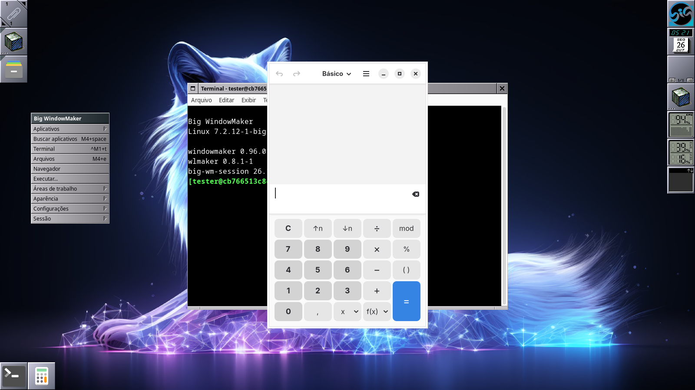
</p>

## Sobre

O Big WindowMaker leva o [Window Maker](https://www.windowmaker.org/), o
gerenciador de janelas no estilo NeXTSTEP, a um desktop completo para o dia a
dia: menu de aplicativos gerado sozinho, bandeja, notificações, bloqueio de
tela, captura de tela, modo escuro, aplicativos GTK e Qt com a mesma aparência
e uma sessão Wayland com o compositor
[wlmaker](https://github.com/phkaeser/wlmaker).

Ele não muda o Window Maker: chama o `/usr/bin/wmaker` como está e põe em
volta o que falta para um sistema atual (systemd `--user`, portais XDG, polkit,
autostart XDG), sem quebrar quem usa Plasma, XFCE ou GNOME na mesma máquina.

### Destaques

- **Duas sessões, a mesma cara.** Window Maker no X11 e wlmaker no Wayland,
  com o mesmo tema, papel de parede, menus e atalhos.
- **Pronto no primeiro login.** Dock com relógio, bandeja, volume, CPU,
  memória e rede; Clip com os favoritos; menu Aplicativos por categoria,
  traduzido.
- **Aparência NeXTSTEP em tudo.** Qt (QTStep), GTK 2/3/4 e libadwaita
  (OneStepBack + barra de título do Window Maker), Firefox (Netscape 4) e
  ícones redesenhados em SVG.
- **Modo claro e escuro** com um comando, em todos os toolkits.
- **Dock com abas** opcional, inspirado no OPENSTEP 4.0 beta, em C + GTK 3.
- **Temas de boot** do GRUB e do Plymouth no estilo da tela do Window Maker.
- **Leve.** O Window Maker em si ocupa cerca de 14 MB; a sessão inteira,
  ~250 MiB de PSS aos 5 minutos ([medições](docs/performance-benchmarks.md)).
- **Testado a cada mudança.** Testes estáticos, integração em contêiner e a
  ISO instalada numa VM (BIOS e UEFI).

---

## Baixar e instalar

### ISO de teste

**Big WindowMaker Alpha** (x86_64, BIOS e UEFI):
**<https://github.com/big-windowmaker/build-iso/releases>**

A ISO vem em partes `.7z` (o GitHub limita cada arquivo a 2 GB). Para juntar
e conferir:

```sh
7z x bigcommunity_wmaker_*.iso.7z.001
sha256sum -c SHA256SUMS --ignore-missing
```

No modo live o usuário é `community` e a senha é `big`.

> [!WARNING]
> É uma versão **Alpha**: teste primeiro numa máquina virtual.

### Pacotes num sistema BigLinux/BigCommunity

Os pacotes ainda não estão num repositório público. Para instalá-los num
sistema já existente, compile a partir deste repositório. As dependências
próprias do projeto (Window Maker, wlmaker, dockapps, temas retrô e
gtk-nocsd) vêm de [big-windowmaker/packages](https://github.com/big-windowmaker/packages)
e precisam ser compiladas antes.

```sh
git clone https://github.com/big-windowmaker/big-wm.git
cd big-wm/pkgbuild
makepkg -si                       # compila, testa e instala os 6 pacotes
```

Para compilar a sua cópia local (com mudanças ainda não publicadas):

```sh
cd pkgbuild && BIGWM_SOURCE="git+file://$PWD/..#branch=main" makepkg -si
```

Depois, escolha **Big WindowMaker** ou **Big WindowMaker (Wayland)** na tela
de login.

---

## Capturas de tela

> As capturas vêm dos testes automatizados ([`tests/integration/`](tests/integration/)
> e [build-iso](https://github.com/big-windowmaker/build-iso)), que instalam
> os pacotes reais e exercitam as duas sessões a cada mudança.

### Sessão X11: Window Maker

Clique direito na área de trabalho abre o menu raiz, com os aplicativos
gerados dos arquivos `.desktop`. O Dock fica à direita com relógio, bandeja,
volume, CPU, memória e rede, o Clip guarda os favoritos e os ícones de
aplicativo ficam na base da tela: o fluxo clássico do Window Maker, com tudo
que um desktop atual precisa por trás.

<p align="center">
  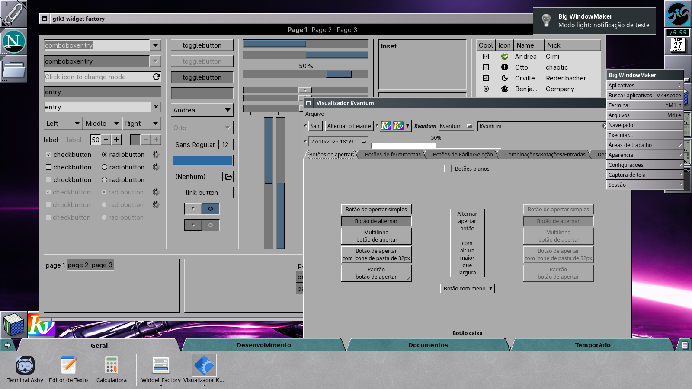
</p>

### Sessão Wayland: wlmaker (experimental)

Compositor Wayland **nativo**, com o mesmo tema, papel de parede e atalhos
da sessão X11. Aplicativos X11 rodam pelo XWayland. Dock, Clip e dockapps são
do próprio wlmaker, e a bandeja (`big-wm-tray`) entra no Dock como um dockapp.

<p align="center">
  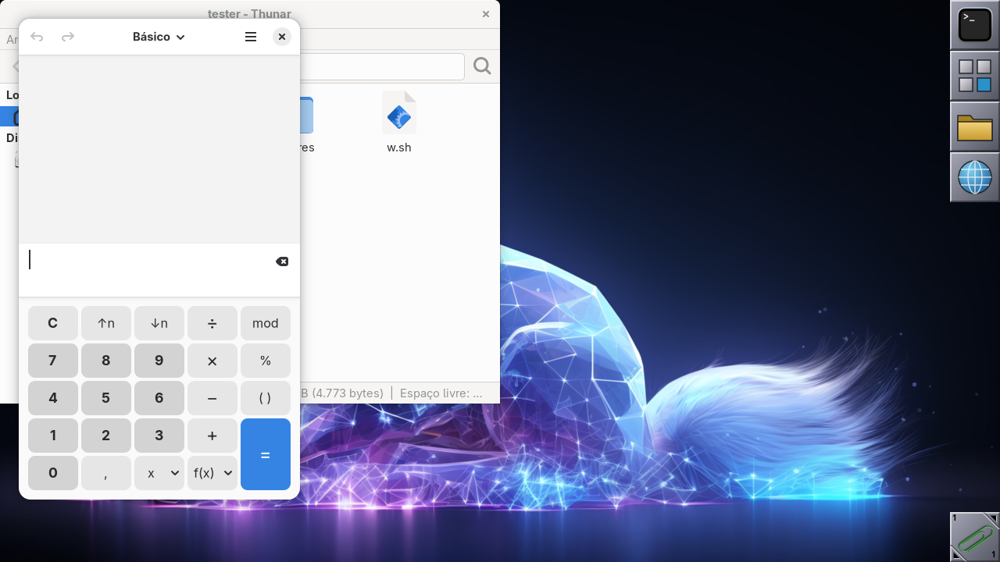
  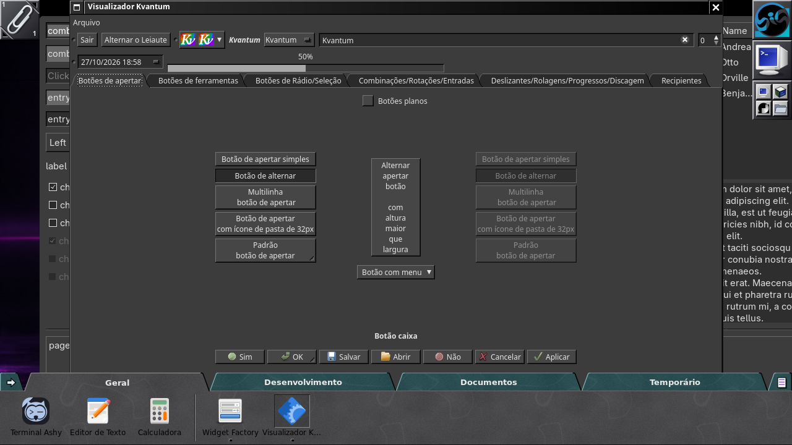
</p>

### Modo claro e modo escuro

`big-wm-theme dark` (ou **Aparência > Tema escuro** no menu raiz) passa toda a
aparência a um NeXTSTEP em cinza-escuro: Window Maker, wlmaker, GTK
(OneStepBack-Dark), Qt (QTStepOpenStepDark), dock com abas, Buscar aplicativos
e notificações. `big-wm-theme light` volta ao padrão.
Detalhes em [docs/aparencia.md](docs/aparencia.md#modo-claro-e-modo-escuro).

<p align="center">
  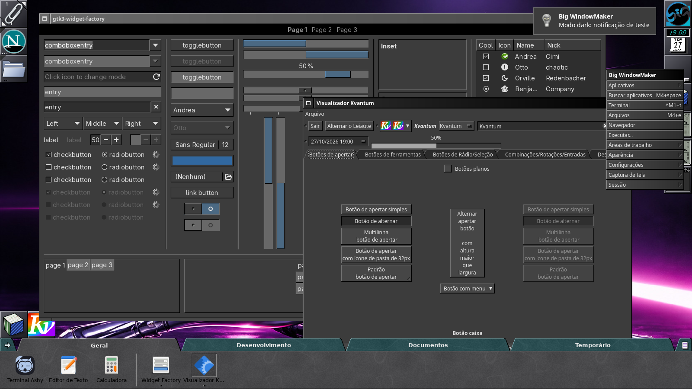
</p>

### Todos os aplicativos com a mesma aparência

GTK 2, GTK 3, GTK 4, libadwaita, Qt 5 e Qt 6 com a barra de título do
Window Maker e os controles no estilo OpenStep.

<p align="center">
  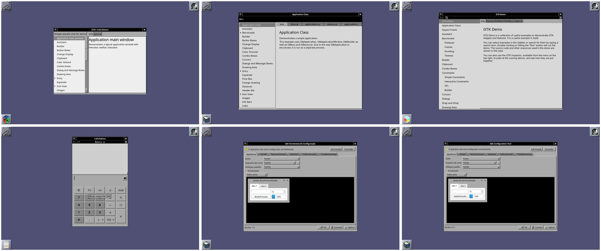
</p>

### Buscar aplicativos e dock com abas

<table>
  <tr>
    <td width="40%" align="center">
      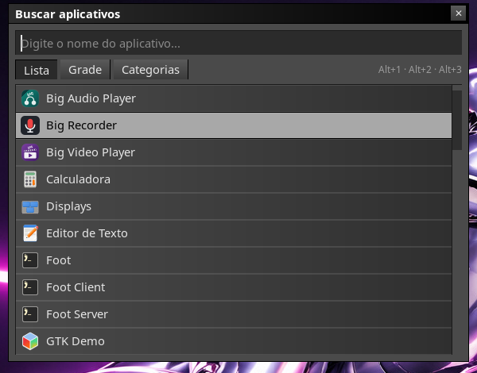<br>
      <sub><b>Buscar aplicativos</b> (Super+Espaço): Lista, Grade e Categorias</sub>
    </td>
    <td width="60%" align="center">
      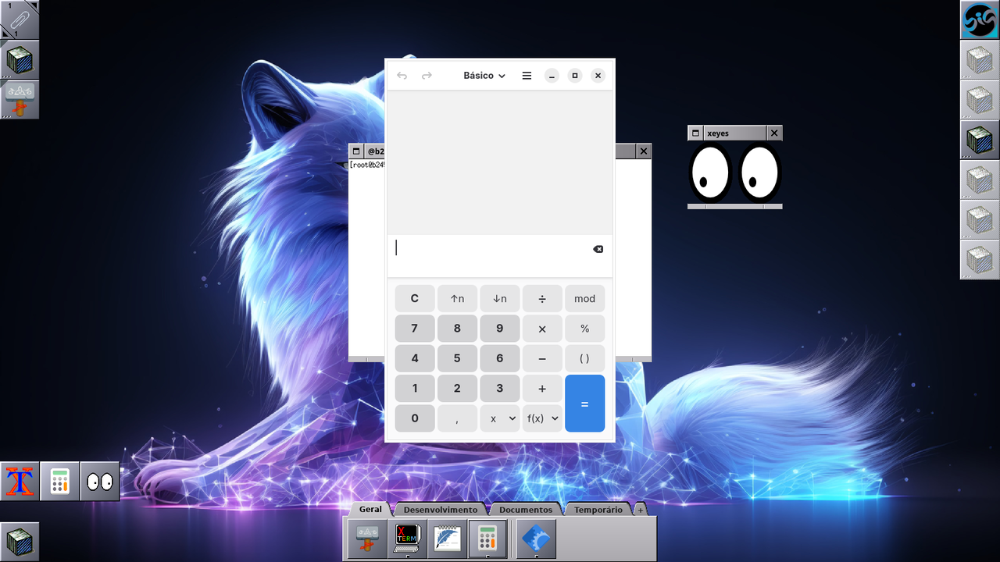<br>
      <sub><b>Dock com abas</b>: Geral, Desenvolvimento, Documentos, Temporário e as suas</sub>
    </td>
  </tr>
</table>

O dock com abas é nativo nas duas sessões (janela dock com EWMH no Window
Maker, layer-shell no wlmaker). Convive com o Dock clássico ou o substitui,
sem apagar a configuração dele. Detalhes, limitações no Wayland e medições em
[docs/tabbed-dock](docs/tabbed-dock/README.md).

### Na ISO, em máquina virtual

Capturas reais da ISO inicializada em QEMU/KVM (UEFI): GRUB, assistente do
modo live e a sessão Window Maker com rede conectada, notificação e dockapps.

<p align="center">
  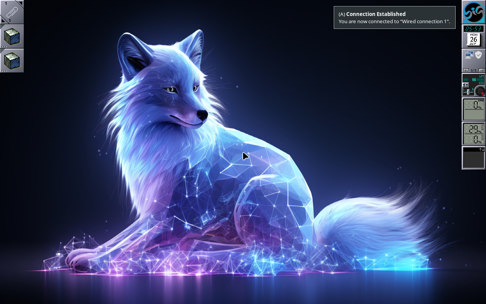
</p>

<p align="center">
  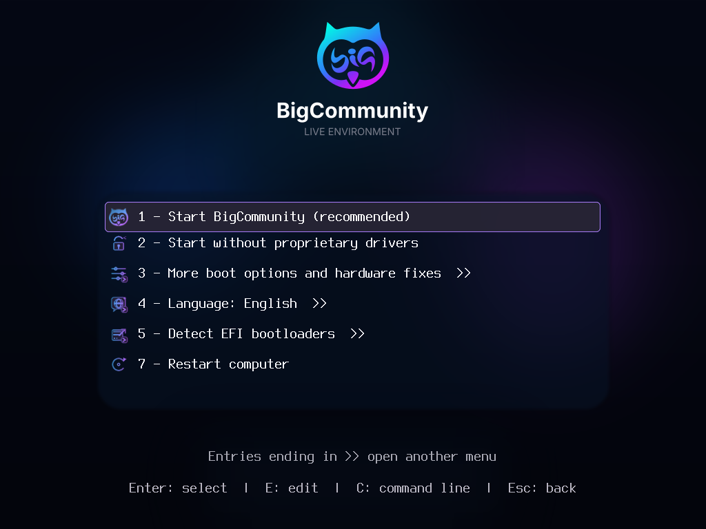
  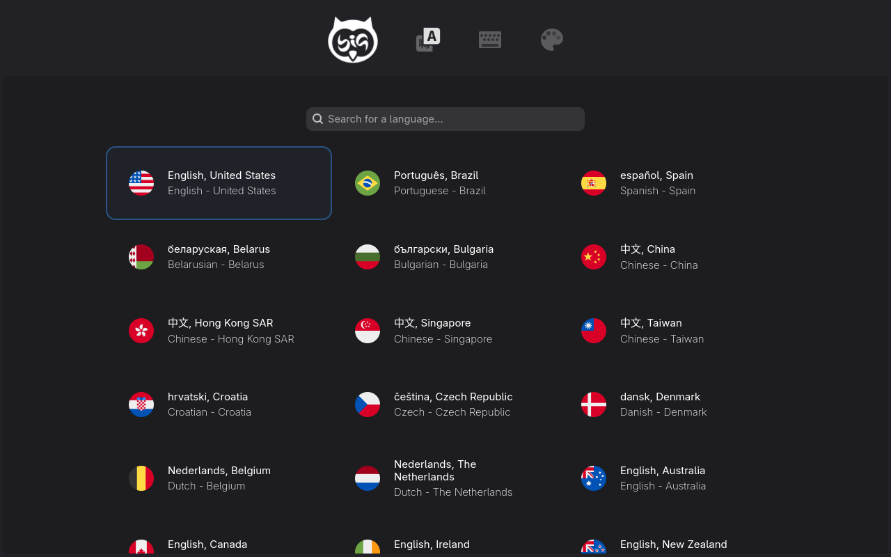
</p>

O pipeline também instala o sistema pelo Calamares numa VM (harness openQA da
BigLinux, BIOS e UEFI), reinicia pelo disco, entra pela tela de login e valida
as duas sessões no sistema instalado.

<p align="center">
  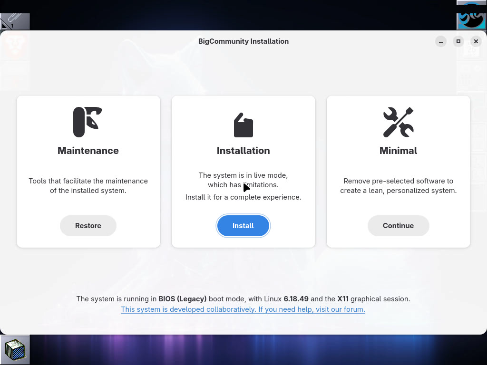
  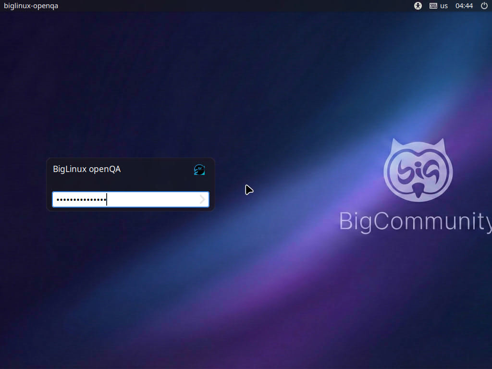
</p>

<p align="center">
  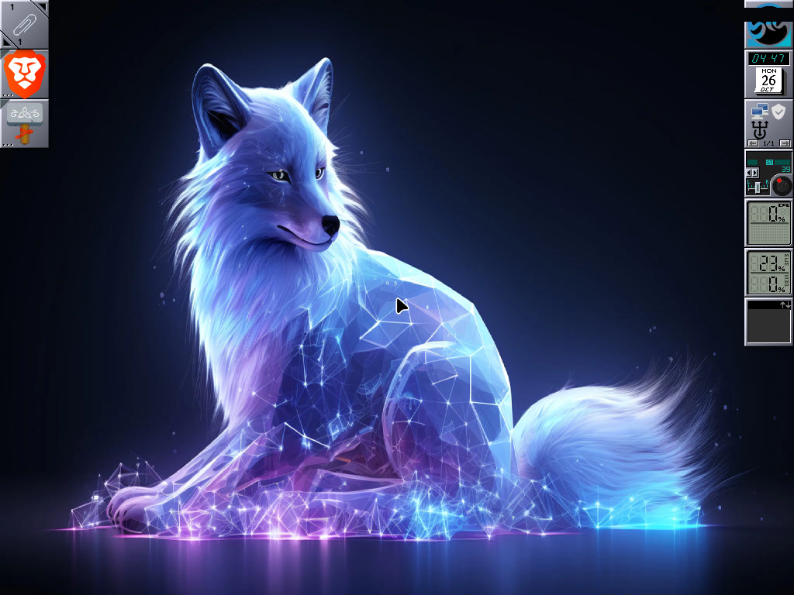
</p>

---

## Pacotes e dependências

O [`pkgbuild/PKGBUILD`](pkgbuild/PKGBUILD) gera nove pacotes. A versão segue
o padrão da BigCommunity: a data do build (`AA.MM.DD-HHMM`).

| Pacote | Arquitetura | Conteúdo |
|---|---|---|
| `big-wm-session` | any | Sessão **Big WindowMaker (X11)**, a padrão: `startbigwm`, configuração padrão do Window Maker, integração com o systemd, notificações, polkit, bandeja, bloqueio e captura de tela, menu de aplicativos e modo escuro |
| `big-wm-wayland` | any | Sessão **Big WindowMaker (Wayland)**, experimental, com o compositor wlmaker, bandeja SNI, dockapps nativos e sincronização com o WPrefs |
| `big-wm-themes` | any | Logo, temas e estilos do Window Maker, tema de ícones `BigWindowMaker`, papéis de parede e emblemas das sessões |
| `big-wm-tabbed-dock` | x86_64 | **Dock com abas** (opcional, X11 e Wayland), em C + GTK 3 |
| `big-wm-lockscreen` | x86_64 | **Tela de bloqueio OPENSTEP**: fundo desfocado (ou preto, cinza, papel de parede, imagem) e os módulos `auth_big_wm` e `saver_big_wm` do xsecurelock; a senha é conferida pelo PAM do sistema |
| `big-wm-locate-pointer` | x86_64 | Sacudir o mouse aumenta o ponteiro por um instante, para achá-lo (X11) |
| `big-wm-name` | any | Nome do sistema: "Big WindowMaker, based on BigLinux" no os-release (fastfetch, instalador), no lsb-release e no console; substitui o `bigcommunity-name` |
| `grub-theme-big-wm` | any | Tema do GRUB no estilo da tela de boot do Window Maker ([themes/boot](themes/boot/README.md)) |
| `plymouth-theme-big-wm` | any | Tema do Plymouth no estilo do Window Maker |

Os pacotes do Window Maker, do wlmaker, dos dockapps e dos temas retrô ficam em
[big-windowmaker/packages](https://github.com/big-windowmaker/packages).

<details>
<summary><b>Dependências de cada pacote</b> (clique para abrir)</summary>

### Build

| Uso | Pacotes |
|---|---|
| Geral | `git` `python` `desktop-file-utils` |
| Ícones e logo (PNG a partir dos SVG) | `librsvg` |
| Dock com abas | `meson` `gtk3` `gtk-layer-shell` `wayland` `wayland-protocols` `libx11` `gettext` |
| Fontes `.pf2` do tema do GRUB | `grub` `freetype2` `gsfonts` |
| Testes (`check()`) | `shellcheck` |

### `big-wm-session`

| Função | Pacotes |
|---|---|
| Window Maker e temas | `windowmaker>0.96.0` `big-wm-themes` |
| Sessão e systemd `--user` | `bash` `dbus` `systemd` `xdg-utils` `xdg-user-dirs` `xorg-setxkbmap` |
| Portais e terminal | `xdg-desktop-portal-gtk` `xdg-terminal-exec` `xterm` (reserva) |
| Buscar aplicativos e notificações | `rofi` `dunst` `libnotify` |
| Polkit, bandeja e bloqueio | `polkit-gnome` `snixembed` `xss-lock` `big-wm-lockscreen` `xsecurelock` `i3lock` (reserva) |
| Captura de tela e Ctrl+Alt+Esc | `scrot` `xorg-xkill` |
| Scripts Python (menu, bloqueio, repintura) | `python` `python-gobject` `python-cairo` `gtk3` `libx11` |
| Modo claro/escuro | `glib2` (gsettings) |
| Aparência NeXTSTEP | `gtk-nocsd` `kvantum` `qtstep-kvantum` `onestepback-gtk-theme` `retrothemes-firefox` |
| Dockapps padrão | `wmclock` `wmsystemtray` `wmix` `wmcpuload` `wmmemload` `wmnet` |
| Som e fontes dos dockapps | `alsa-lib` `alsa-utils` `xorg-fonts-misc` `xorg-mkfontscale` |

Opcionais: `picom`, `arandr`, `pavucontrol`, `big-system-config`,
`pamac-gtk`, `thunar`, `kvantum-qt5`, `firefox`, `big-wm-tabbed-dock`,
`indicator-sound-switcher`, `playerctl`, `network-manager-applet`, `blueman`,
`fastfetch`, `wdm`, `lightdm-slick-greeter` e os 27 dockapps do menu
**Aparência > Dockapps** (`wmcalclock`, `wmbattery`, `wmweather`, `wmcube`,
`wmwifi`, `pclock`...).

### `big-wm-wayland`

| Função | Pacotes |
|---|---|
| Compositor e sessão | `big-wm-session` `wlmaker` `xorg-xwayland` |
| Papel de parede, bloqueio e inatividade | `swaybg` `swaylock` `swayidle` |
| Portal e captura de tela | `xdg-desktop-portal-wlr` `grim` `slurp` |
| Bandeja SNI (`big-wm-tray`) | `python` `python-gobject` `python-cairo` `gtk3` `gtk-layer-shell` `libdbusmenu-gtk3` |
| Sincronização com o WPrefs | `libxkbcommon` |
| Monitores | `wdisplays` |

Opcionais: `wireplumber` (teclas de volume), `playerctl` (teclas de mídia),
`brightnessctl` (brilho), `xdotool` e `xorg-xprop` (Ctrl+Alt+Esc em janelas
do XWayland).

### Demais pacotes

| Pacote | Dependências |
|---|---|
| `big-wm-themes` | `hicolor-icon-theme` |
| `big-wm-tabbed-dock` | `glibc` `gtk3` `glib2` `gdk-pixbuf2` `cairo` `pango` `librsvg` `libx11` `wayland` `gtk-layer-shell` |
| `big-wm-locate-pointer` | `glibc` `libx11` `libxi` `libxfixes` `libxext` `libxcursor` `libxrandr` |
| `big-wm-name` | `bash` `sed` `grep` |
| `grub-theme-big-wm` | `grub` |
| `plymouth-theme-big-wm` | `plymouth` `gsfonts` `bash` |

</details>

---

## Comandos

Todos ficam em `/usr/bin` e servem às duas sessões, salvo quando indicado.

| Comando | O que faz |
|---|---|
| `big-wm-theme light\|dark\|get\|apply` | Modo claro ou escuro de toda a aparência (Window Maker, wlmaker, GTK, Qt, dock, notificações). A escolha fica em `~/.config/big-wm/theme` |
| `big-wm-firstrun x11\|wayland` | Aplica a configuração padrão na conta, sem sobrescrever nada do usuário |
| `big-wm-firstrun --reset x11\|wayland` | Guarda a configuração atual em `*.bak-<data>` e aplica os padrões de novo |
| `big-wm-wallpaper ARQUIVO` | Troca o papel de parede (`wmsetbg` no X11, `swaybg` no Wayland) e guarda a escolha |
| `big-wm-screenshot full\|window\|area` | Captura de tela em *Imagens/Capturas de tela*, com notificação |
| `big-wm-lock` | Bloqueia a tela com a janela OPENSTEP (xsecurelock no X11, gtklock no Wayland; i3lock e swaylock de reserva) |
| `big-wm-lock-settings` | Aparência > Tela de bloqueio: fundo, desfoque, escurecimento e o que a janela mostra, com prévia |
| `big-wm-launcher apps\|run` | Buscar aplicativos e Executar (rofi no visual do Window Maker) |
| `big-wm-open browser\|files\|terminal\|apps\|run\|music` | Abre o aplicativo padrão do usuário para cada função |
| `big-wm-kill` | Força o fechamento de um aplicativo travado (Ctrl+Alt+Esc) |
| `big-wm-appmenu` | Gera o menu Aplicativos por categoria (`--dockapps`, `--icons`, `--wallpapers`) |
| `big-wm-session-ctl start\|stop` | Liga e desliga a integração da sessão com o systemd `--user` |
| `big-wm-wprefs-sync [--watch]` | Wayland: leva ao wlmaker o que foi configurado no WPrefs |
| `big-wm-dockapps` | Wayland: inicia os dockapps ao lado do Clip (`~/.config/big-wm/dockapps`) |

### Iniciar programas junto com a sessão

Crie um arquivo `.desktop` em `~/.config/autostart/`: vale nas duas sessões e
é o que os aplicativos usam. O script clássico
`~/GNUstep/Library/WindowMaker/autostart` também funciona na sessão X11, mas o
Big WindowMaker não instala um por padrão.

## Atalhos de teclado

| Ação | X11 | Wayland |
|---|---|---|
| Menu raiz | clique direito na área de trabalho / F12 | F12 / Ctrl+Esc |
| Buscar aplicativos | Super+Espaço | Super+Espaço |
| Terminal | Ctrl+Alt+T | Ctrl+Alt+T / Super+Enter |
| Arquivos | Super+E | Super+E |
| Bloquear a tela | Super+L (e menu Sessão) | Super+L / Ctrl+Alt+L |
| Captura da tela / janela / área | Print / Alt+Print / Shift+Print | Print / — / Shift+Print |
| Forçar o fechamento | Ctrl+Alt+Esc | Ctrl+Alt+Esc |
| Fechar janela | Alt+F4 | Alt+F4 |
| Alternar janelas | Alt+Tab | Alt+Tab |
| Escolher a zona da janela | Super+Z | — |
| Mosaico automático liga/desliga | Super+Shift+Z | Super+Shift+Z |
| Mover a janela para a zona ao lado | Super+Ctrl+setas | Super+Ctrl+setas |
| Restaurar tamanho e posição | Super+Ctrl+0 | Super+Ctrl+0 |
| Editor de zonas | Super+Alt+Z | Super+Alt+Z |

### Organização de janelas

O [wmake-zones](https://github.com/big-windowmaker/wmake-zones) junta zonas
de encaixe e mosaico automático ao Window Maker e ao wlmaker, no feitio do
OpenStep. Vem **desligado**: as janelas continuam flutuantes até o usuário
ligar as zonas em *Áreas de trabalho > Organização de janelas*, em
*Aparência > Organização de janelas* ou no ladrilho *Aparência > Dockapps >
Organização de janelas*. Com as zonas ligadas, arrastar uma janela mostra as
regiões do layout, e soltar a encaixa; Esc durante o arrasto cancela. No X11
é um serviço de ~3 MiB que não acorda em repouso; no Wayland, o próprio
wlmaker.

---

## Como funciona

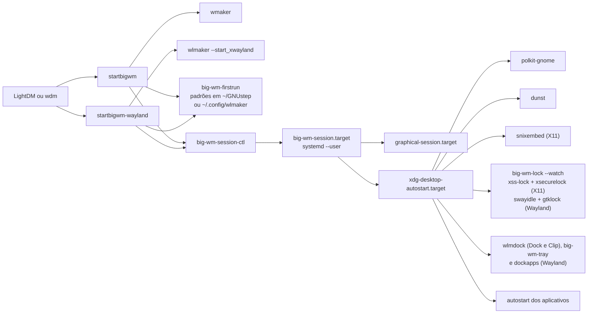

1. A tela de login inicia `startbigwm` (X11) ou `startbigwm-wayland`.
2. `big-wm-firstrun` aplica os padrões que ainda faltam na conta e reaplica o
   modo claro/escuro guardado.
3. `big-wm-session-ctl` exporta o ambiente gráfico para o systemd `--user` e
   ativa `big-wm-session.target`, que puxa `graphical-session.target` e o
   autostart XDG.
4. Os serviços da sessão sobem como unidades do systemd: notificações,
   polkit, bandeja, bloqueio e, no Wayland, Dock, Clip e dockapps.
5. Drop-ins em `/usr/lib/systemd/user/*.d/big-wm.conf` cortam, só nas sessões
   Big WindowMaker, applets que lá não servem (Bluetooth sem adaptador,
   impressora sem fila, seletor de som duplicado).

### Princípios

- **Nenhum binário de outro pacote é alterado.** O `/usr/bin/wmaker` é chamado como está.
- **Nada em `/etc/skel`.** A configuração padrão é aplicada no primeiro login,
  inclusive em contas que já existiam.
- **Convive com Plasma, XFCE e GNOME.** Todo autostart instalado aqui tem
  `OnlyShowIn=WindowMaker;` e/ou `wlmaker;`; os testes garantem isso e também
  que nada é instalado fora dos caminhos do projeto.
- **Instalar não muda o sistema.** Os pacotes da sessão não têm scripts de
  instalação; os `.install` dos temas de boot só explicam como ativá-los (quem
  escolhe é a edição ou o usuário) e, ao remover o tema do Plymouth que estava
  ativo, voltam ao tema padrão.
- **Leve.** Em VM o GTK 4 desenha por software e serviços sem hardware não
  sobem. Números e decisões em [docs/memoria.md](docs/memoria.md) e
  [docs/performance-decisions.md](docs/performance-decisions.md).
- **No idioma do usuário.** Menus em português e inglês, relógio do Dock com
  mês e dia da semana no idioma da sessão, capturas em *Imagens/Capturas de tela*.

### Onde cada coisa fica

| Caminho | Conteúdo |
|---|---|
| `/usr/bin/startbigwm`, `/usr/bin/big-wm-*` | Início das sessões e utilitários |
| `/usr/lib/big-wm/` | Bibliotecas e auxiliares dos scripts |
| `/usr/share/big-wm/` | Padrões do Window Maker (`GNUstep/Defaults`), do wlmaker, dunst, rofi, picom e fastfetch |
| `/usr/share/xsessions/big-wm.desktop` | Sessão X11 |
| `/usr/share/wayland-sessions/big-wm-wayland.desktop` | Sessão Wayland |
| `/usr/lib/systemd/user/big-wm-session.target` | Alvo da sessão no systemd `--user` |
| `/etc/xdg/autostart/big-wm-*.desktop` | Serviços da sessão (só nas sessões Big WindowMaker) |
| `/usr/share/WindowMaker/{Themes,Styles,Icons}` | Temas, estilos e ícones do Window Maker |
| `/usr/share/icons/BigWindowMaker/` | Tema de ícones XDG |
| `/usr/share/backgrounds/big-wm/` | Papéis de parede |
| `~/.config/big-wm/` | Escolhas do usuário: tema, papel de parede, dockapps |

### Medições de memória

Sistema instalado em VM, mediana de 5 boots, 5 minutos depois do login, sem
descartar o cache ([metodologia e números](docs/performance-benchmarks.md)):

| Métrica | X11 | Wayland |
|---|---|---|
| PSS da sessão (processos do usuário) | 249 MiB | 353 MiB |
| PSS de todos os processos | 416 MiB | 450 MiB |
| "Usada" do `free` | 485 MiB | 500 MiB |

---

## Recursos e estado

✅ verificado pelo teste de integração a cada mudança · 🔧 configurado, ainda sem
teste automatizado · ⚠️ funciona com restrição · ❌ não disponível

<details>
<summary><b>Tabela completa X11 × Wayland</b> (clique para abrir)</summary>

| Recurso | X11 | Wayland |
|---|---|---|
| Sessão sobe com a configuração padrão, sem avisos | ✅ | ✅ |
| Dock à direita, Clip, menu raiz, áreas de trabalho | ✅ | ✅ |
| Dockapps clássicos (relógio, CPU, memória, rede, volume, bandeja) | ✅ | ✅ nativos do wlmaker (relógio, CPU, memória, rede, volume, bateria) |
| Mais dockapps em Aparência > Dockapps (pclock, wmwifi, minidock, minicontrol, wmapmload, mount.app, wmcube...) | 🔧 | 🔧 só os nativos |
| Menu raiz com Aplicativos por categoria, traduzido (big-wm-appmenu) | ✅ | ✅ mesma estrutura |
| Janelas gerenciadas, foco e atalhos globais | ✅ | 🔧 |
| Aplicativos GTK e Qt nativos | ✅ | ✅ |
| Janelas GTK 3/4 e libadwaita com a barra de título do Window Maker (gtk-nocsd) | ✅ | 🔧 gtk-nocsd + protocolo de decoração do KDE (wlmaker patch 0002) |
| Aplicativos X11 | ✅ | ✅ via XWayland |
| Notificações (dunst) | ✅ | ✅ |
| Captura de tela | ✅ tecla Print nativa | ✅ grim (screencopy) |
| Clipboard e seleção primária | ✅ | ✅ |
| Bloqueio de tela | ✅ big-wm-lock: janela OPENSTEP no xsecurelock (PAM pelo authproto_pam; automático via xss-lock) | ✅ big-wm-lock: a mesma janela no gtklock (ext-session-lock); swaylock de reserva |
| Vários monitores | 🔧 RandR | ✅ wlr-output-management (2 saídas) |
| Portal de configurações (tema claro/escuro para Qt e GTK4) | ✅ | 🔧 |
| Modo claro/escuro em tudo (big-wm-theme, Aparência > Tema claro/escuro) | ✅ troca na hora (Window Maker, dock, notificações) | 🔧 decoração do wlmaker no próximo login |
| Compartilhamento de tela pelo portal | 🔧 | ⚠️ só com GPU: o portal wlr exige linux-dmabuf |
| Bandeja para apps Qt6/Electron (SNI) | 🔧 snixembed | ✅ big-wm-tray (ladrilho do wmsystemtray, com paginação; dockapp do Dock: arrasta, explode, menu do Window Maker) |
| Ativação de janelas | ✅ `_NET_ACTIVE_WINDOW` | ✅ xdg-activation (wlmaker patch 0001) |
| Métodos de entrada (IME) | 🔧 | ❌ sem `text-input`/`input-method` no wlmaker |

</details>

Comparação detalhada, com evidências e pendências:
[docs/wayland-parity.md](docs/wayland-parity.md).

---

## Desenvolvimento

```sh
make check                       # testes estáticos (tests/run.sh)
make install DESTDIR=/tmp/teste  # instalação de teste, sem o dock com abas
make tabbed-dock                 # compila o dock com abas (meson)
meson test -C tabbed-dock/build  # testes do dock com abas
cd pkgbuild && BIGWM_SOURCE="git+file://$PWD/..#branch=main" makepkg   # pacotes locais
```

Cada alvo do `Makefile` corresponde a um pacote: `install-session`,
`install-wayland`, `install-themes`, `install-tabbed-dock`,
`install-grub-theme` e `install-plymouth-theme`.

### Testes

| Nível | Onde | O que cobre |
|---|---|---|
| Estáticos | [`tests/run.sh`](tests/run.sh) | shellcheck, plists do Window Maker e do wlmaker, arquivos `.desktop`, `big-wm-firstrun`, `big-wm-theme`, `big-wm-appmenu`, condições de autostart e `big-wm-wprefs-sync` |
| Dock com abas | [`tabbed-dock/tests/`](tabbed-dock/tests/) | Modelo, configuração, lançamento e sessões X11/Wayland com capturas |
| Integração | [`tests/integration/`](tests/integration/) | Os pacotes reais num contêiner Manjaro, com as duas sessões |
| Desempenho | [`tests/perf/`](tests/perf/) | Memória e tempo de login no sistema instalado, em VM libvirt |
| ISO | [build-iso](https://github.com/big-windowmaker/build-iso) | Boot, instalação pelo Calamares e login, BIOS e UEFI |

Os testes de integração precisam dos pacotes de
[big-windowmaker/packages](https://github.com/big-windowmaker/packages) e rodam
num contêiner Manjaro descartável:

```sh
podman run --rm -v "$PWD/tests/integration:/t:ro" -v "$PWD/pacotes:/pkgs:ro" \
  -v "$PWD/resultado:/out" docker.io/manjarolinux/base bash /t/session-test.sh /pkgs /out
```

### Estrutura do repositório

```text
big-wm/
├── session/       scripts de sessão, utilitários, autostart e unidades do systemd
├── data/          padrões do Window Maker e do wlmaker, dunst, rofi, picom, fastfetch
├── themes/        logo, temas, estilos, ícones SVG, papéis de parede e temas de boot
├── tabbed-dock/   dock com abas (C + GTK 3, meson)
├── tests/         testes estáticos, de integração e de desempenho
├── docs/          documentação técnica e capturas de tela
└── pkgbuild/      PKGBUILD e scripts .install
```

## Documentação

| Documento | Assunto |
|---|---|
| [docs/aparencia.md](docs/aparencia.md) | Aparência retrô dos aplicativos, modo escuro, Flatpak, Firefox, ícones |
| [docs/tabbed-dock/](docs/tabbed-dock/README.md) | Dock com abas: uso, arquitetura, testes e diferenças X11/Wayland |
| [docs/wayland-parity.md](docs/wayland-parity.md) | Paridade entre as sessões X11 e Wayland |
| [docs/wayland-test-lab.md](docs/wayland-test-lab.md) | Laboratório de testes da sessão Wayland |
| [docs/memoria.md](docs/memoria.md) | Consumo de memória da sessão |
| [docs/performance-benchmarks.md](docs/performance-benchmarks.md) | Linha de base de desempenho e metodologia |
| [docs/performance-decisions.md](docs/performance-decisions.md) | Oportunidades medidas e decisões tomadas |
| [docs/performance-budget.md](docs/performance-budget.md) | Orçamento de memória por subsistema |
| [themes/boot/](themes/boot/README.md) | Temas do GRUB e do Plymouth |
| [themes/icons/](themes/icons/README.md) | Tema de ícones BigWindowMaker |

## Projetos relacionados

| Repositório | Conteúdo |
|---|---|
| [big-windowmaker/packages](https://github.com/big-windowmaker/packages) | PKGBUILDs do Window Maker, wlmaker, dockapps, temas retrô e gtk-nocsd |
| [big-windowmaker/build-iso](https://github.com/big-windowmaker/build-iso) | Pipeline da ISO e testes de instalação em VM |
| [phkaeser/wlmaker](https://github.com/phkaeser/wlmaker) | Compositor Wayland inspirado no Window Maker (upstream) |
| [window-maker/wmaker](https://github.com/window-maker/wmaker) | Window Maker (upstream) |

## Licença

GPL-2.0-or-later. Veja [`LICENSE`](LICENSE) e, para os créditos de temas,
ícones, fontes e papéis de parede, [`CREDITS.md`](CREDITS.md).
