<p align="center">
  
</p>

<h1 align="center">Big WindowMaker</h1>

<p align="center">
  <b>O desktop Window Maker do BigLinux/BigCommunity.</b><br>
  A elegância do NeXTSTEP, a integração de um desktop atual e duas sessões:<br>
  X11 estável e Wayland nativo.
</p>

<p align="center">
  <a href="https://github.com/big-windowmaker/big-wm/actions/workflows/ci.yml"></a>
  
  
  
  
  <a href="https://github.com/big-windowmaker/build-iso/releases"></a>
</p>

<p align="center">
  <a href="#capturas-de-tela">Capturas</a> ·
  <a href="#baixar-e-instalar">Instalar</a> ·
  <a href="#recursos">Recursos</a> ·
  <a href="#atalhos-de-teclado">Atalhos</a> ·
  <a href="#pacotes-e-dependências">Pacotes</a> ·
  <a href="#desenvolvimento">Desenvolvimento</a> ·
  <a href="#contribuir">Contribuir</a> ·
  <a href="#in-english">English</a>
</p>

<p align="center">
  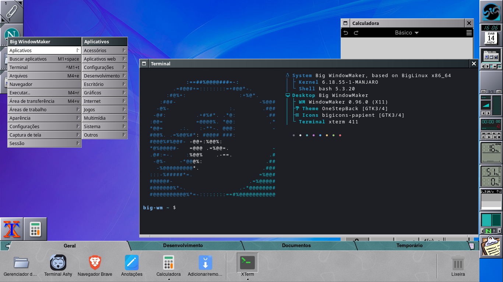
  <br><sub>Sessão X11 (Window Maker): menu raiz, Dock com os dockapps, Clip e o Dock com Abas. Captura de 14/11/2026.</sub>
</p>

## Sobre

O Big WindowMaker leva o [Window Maker](https://www.windowmaker.org/), o
gerenciador de janelas no estilo NeXTSTEP, a um desktop completo para o dia a
dia: menu de aplicativos gerado sozinho, bandeja, notificações, bloqueio de
tela, captura de tela, histórico da área de transferência, modo escuro,
aplicativos GTK e Qt com a mesma aparência e uma sessão Wayland com o
compositor [wlmaker](https://github.com/phkaeser/wlmaker).

Ele não muda o Window Maker: chama o `/usr/bin/wmaker` como está e põe em
volta o que falta para um sistema atual (systemd `--user`, portais XDG, polkit,
autostart XDG), sem quebrar quem usa Plasma, XFCE ou GNOME na mesma máquina.

### Destaques

- **Duas sessões, a mesma cara.** Window Maker no X11 e wlmaker no Wayland,
  com o mesmo tema, papel de parede, menus, Dock e atalhos.
- **Pronto no primeiro login.** Dock com relógio, bandeja, volume, música,
  CPU, memória, rede e organização de janelas; Clip com navegador e arquivos;
  menu Aplicativos por categoria, traduzido; boas-vindas com tutorial.
- **Aparência NeXTSTEP em tudo.** Qt (QTStep), GTK 2/3/4 e libadwaita
  (OneStepBack + barra de título do Window Maker), Firefox (Netscape 4) e
  ícones redesenhados em SVG.
- **Modo claro e escuro** com um comando ou pelo menu Aparência.
- **Organização de janelas**: zonas de encaixe e mosaico automático
  ([wmake-zones](https://github.com/big-windowmaker/wmake-zones)).
- **Tela de bloqueio OPENSTEP** com teclado na tela e desbloqueio por um
  controle de videogame.
- **Leve.** O Window Maker em si ocupa cerca de 14 MB; a sessão inteira,
  ~250 MiB de PSS aos 5 minutos ([medições](docs/performance-benchmarks.md)).
- **Testado a cada mudança.** Testes estáticos, integração em contêiner com as
  duas sessões e a ISO instalada numa VM (BIOS e UEFI).

## Sumário

- **[Guia do usuário](docs/guia-do-usuario.md)**: para quem usa o Big WindowMaker no dia a dia
- [Capturas de tela](#capturas-de-tela)
- [Baixar e instalar](#baixar-e-instalar)
- [Recursos](#recursos)
  - [Sessões X11 e Wayland](#sessões-x11-e-wayland)
  - [Dock, Clip e dockapps](#dock-clip-e-dockapps)
  - [Dock com Abas](#dock-com-abas)
  - [Organização de janelas (zonas e mosaico)](#organização-de-janelas-zonas-e-mosaico)
  - [Modo claro e modo escuro](#modo-claro-e-modo-escuro)
  - [Tela de bloqueio e teclado na tela](#tela-de-bloqueio-e-teclado-na-tela)
  - [Área de transferência (Super+V)](#área-de-transferência-superv)
  - [Mais ferramentas da sessão](#mais-ferramentas-da-sessão)
- [Atalhos de teclado](#atalhos-de-teclado)
- [X11 × Wayland: o que muda](#x11--wayland-o-que-muda)
- [Pacotes e dependências](#pacotes-e-dependências)
- [Comandos](#comandos)
- [Como funciona](#como-funciona)
- [Desenvolvimento](#desenvolvimento)
- [Contribuir](#contribuir)
- [Documentação](#documentação)
- [Projetos relacionados](#projetos-relacionados) · [Créditos](#créditos) · [Licença](#licença)

---

## Capturas de tela

> Capturas de 14/11/2026, feitas com os pacotes instalados (big-wm
> 26.11.14, windowmaker 0.96.0-25, wlmaker 0.8-36, wmake-zones 0.4.1,
> big-wm-tabbed-dock 0.3.0) em sessões reais num servidor X virtual: o
> Window Maker direto nele e o wlmaker aninhado, com uma conta de teste.
> A da Área de transferência é de 21/11/2026 (big-wm 26.11.21).

<table>
  <tr>
    <td width="50%" align="center">
      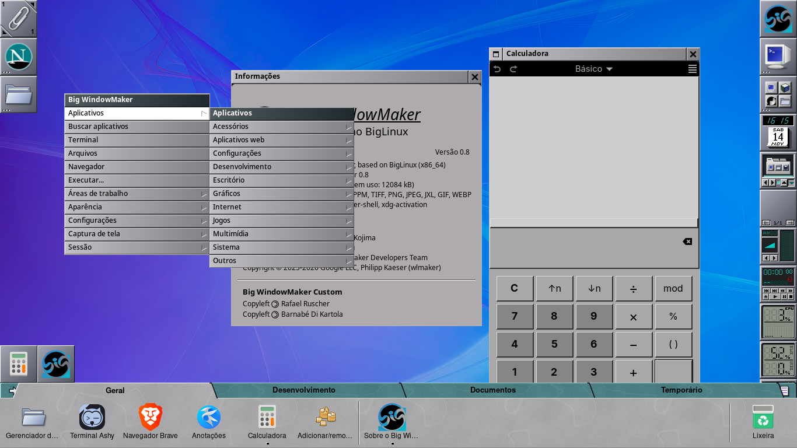<br>
      <sub><b>Sessão Wayland (wlmaker)</b>: o mesmo menu, Dock e Clip; dockapps do X11 pelo XWayland, appicons no canto de baixo e o painel Sobre</sub>
    </td>
    <td width="50%" align="center">
      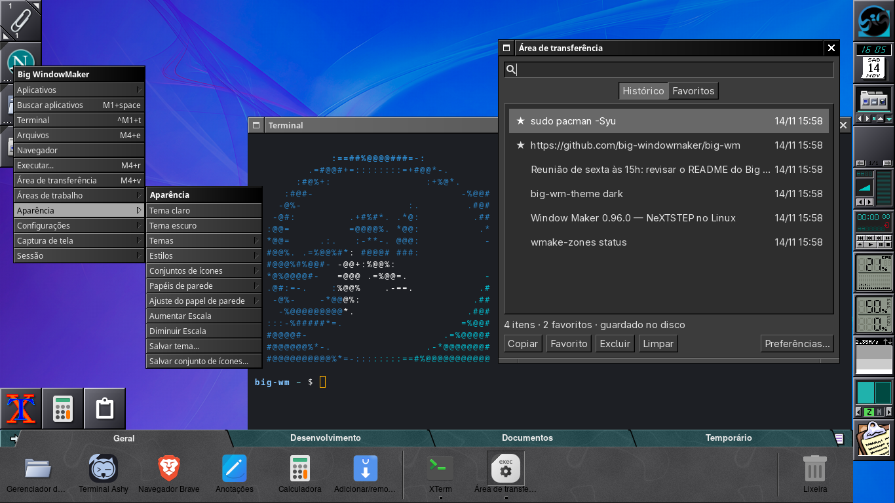<br>
      <sub><b>Modo escuro</b> (Aparência &gt; Tema escuro): Window Maker, GTK, Dock com Abas e menus</sub>
    </td>
  </tr>
  <tr>
    <td width="50%" align="center">
      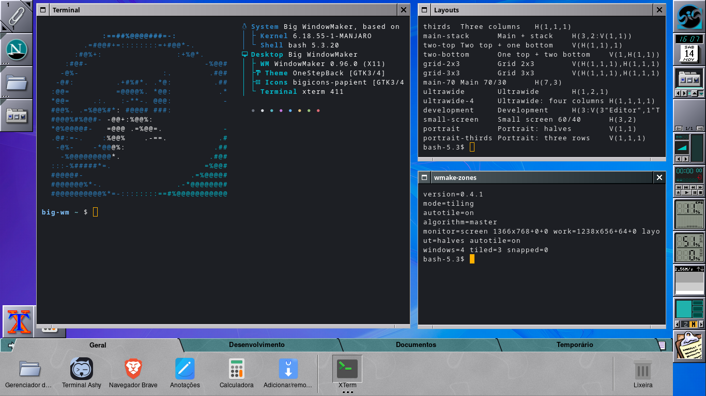<br>
      <sub><b>Mosaico automático</b> do wmake-zones (Super+Shift+Z); o ladrilho no Dock mostra o modo</sub>
    </td>
    <td width="50%" align="center">
      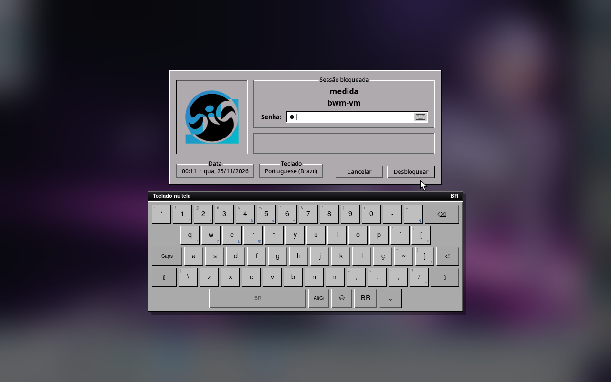<br>
      <sub><b>Tela de bloqueio</b> com o teclado na tela (X11, xsecurelock)</sub>
    </td>
  </tr>
  <tr>
    <td width="50%" align="center">
      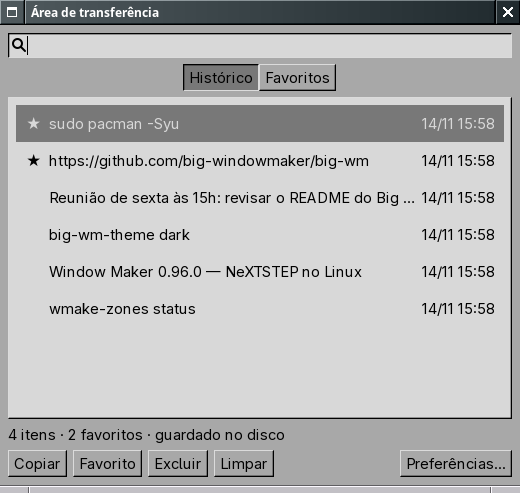<br>
      <sub><b>Área de transferência</b> (Super+V): histórico, busca, favoritos e privacidade</sub>
    </td>
    <td width="50%" align="center">
      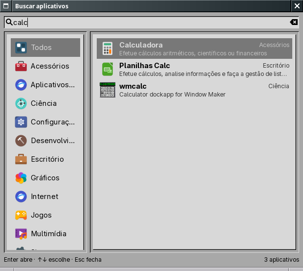<br>
      <sub><b>Buscar aplicativos</b> (Alt+Espaço): categorias, busca e Enter para abrir</sub>
    </td>
  </tr>
  <tr>
    <td width="50%" align="center">
      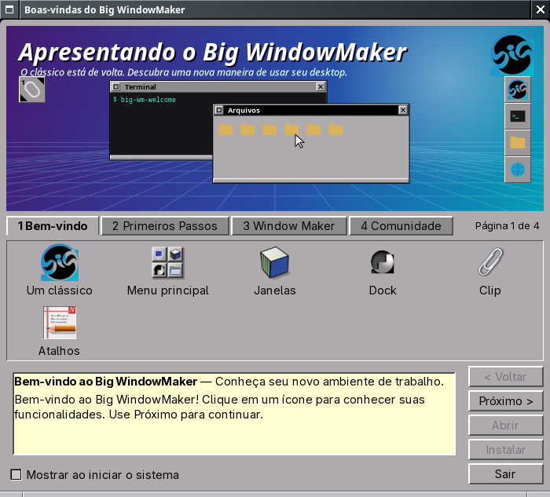<br>
      <sub><b>Boas-vindas</b>: o tutorial do primeiro login, com os atalhos reais da sessão</sub>
    </td>
    <td width="50%" align="center">
      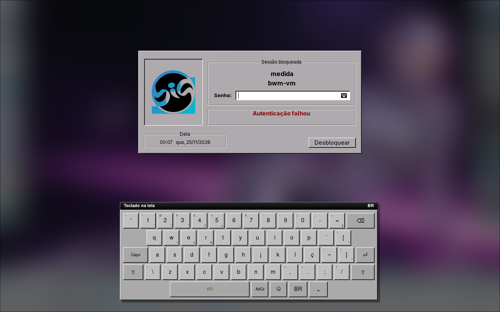<br>
      <sub><b>Bloqueio no Wayland</b>: gtklock com o módulo do teclado na tela</sub>
    </td>
  </tr>
</table>

<details>
<summary><b>Mais capturas</b>: Monitores, aplicativos com a mesma aparência e a ISO em VM (clique para abrir)</summary>

<p align="center">
  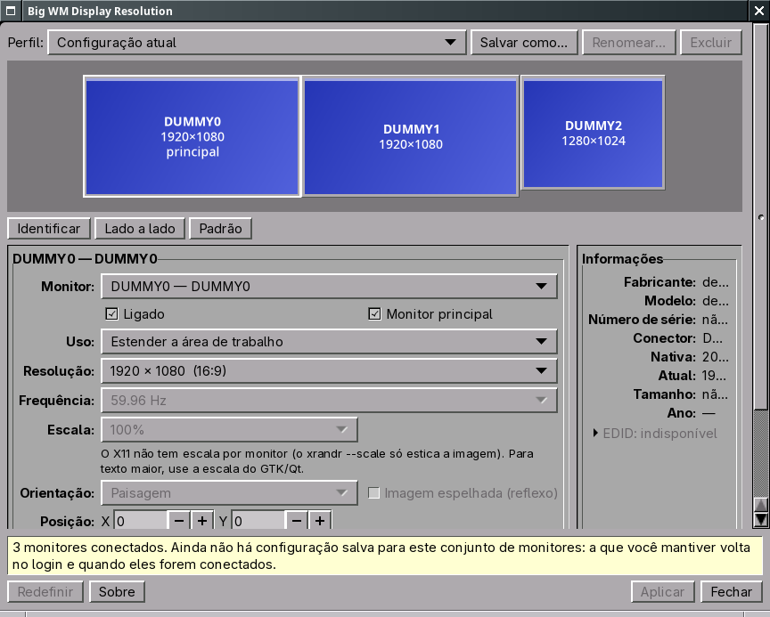 Monitores (Big WM Display Resolution) com três monitores desenhados em escala"><br>
  <sub><b>Configurações &gt; Monitores</b> (Big WM Display Resolution), 12/11/2026</sub>
</p>

<p align="center">
  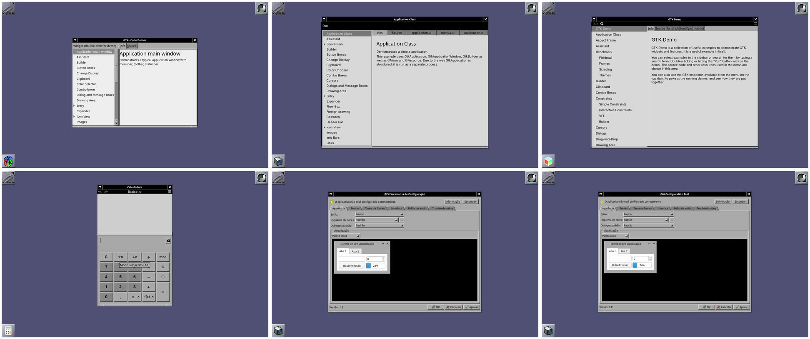<br>
  <sub><b>GTK 2, GTK 3, GTK 4, libadwaita, Qt 5 e Qt 6</b> com a barra de título do Window Maker (outubro de 2026)</sub>
</p>

Capturas da ISO em QEMU/KVM, feitas pelo pipeline do
[build-iso](https://github.com/big-windowmaker/build-iso) (outubro de 2026):

<p align="center">
  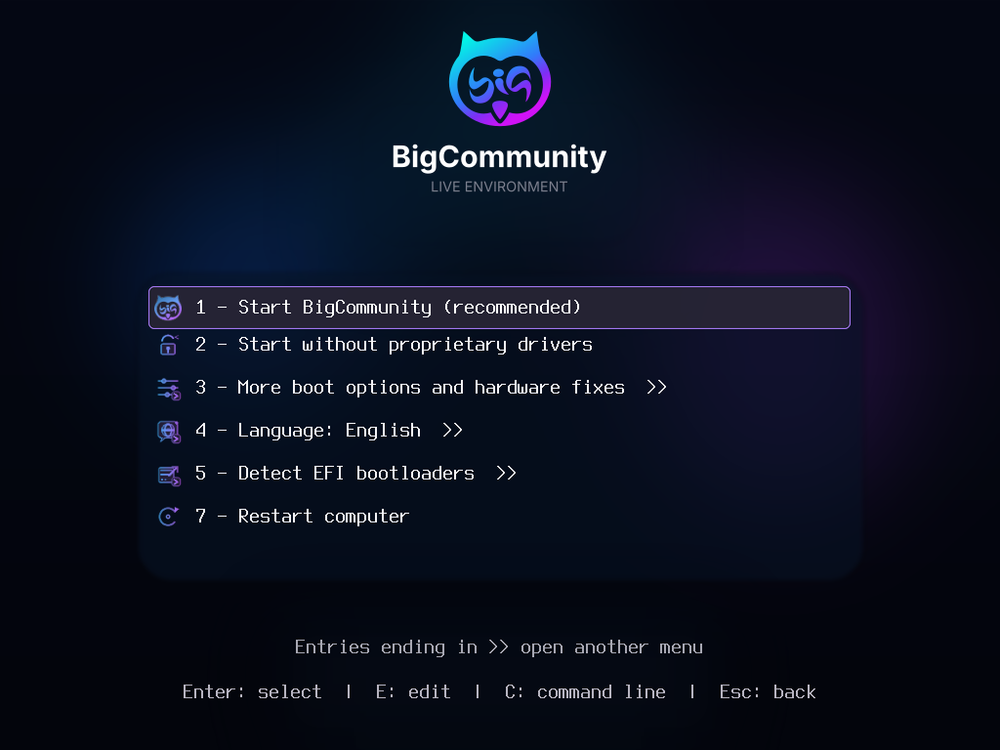
  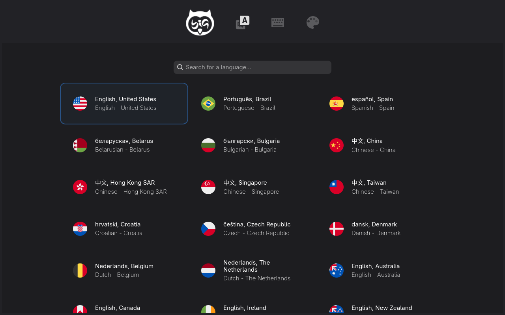
  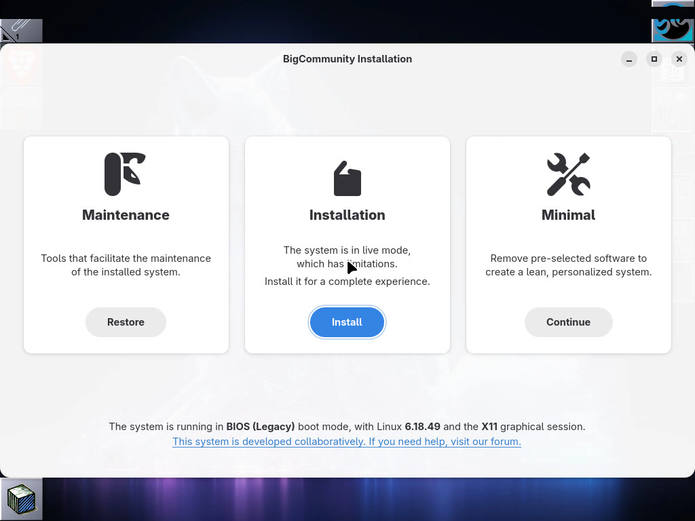
  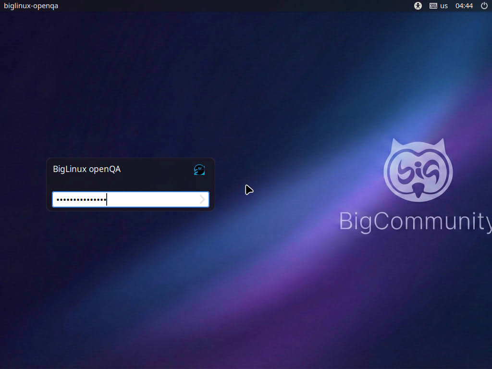
</p>

</details>

---

## Baixar e instalar

### ISO de teste (Alpha)

**Big WindowMaker Alpha** (x86_64, BIOS e UEFI):
**<https://github.com/big-windowmaker/build-iso/releases>**

A ISO vem em partes `.7z` (o GitHub limita cada arquivo a 2 GB). Para juntar
e conferir:

```sh
7z x big-windowmaker_TESTING_*.iso.7z.001
sha256sum -c SHA256SUMS --ignore-missing
```

| ISO | Usuário do modo live | Senha |
|---|---|---|
| 12/11/2026 (a última publicada) | `community` | `big` |
| As próximas, com a tela do wdm (F1 mostra a ajuda; [PR #20](https://github.com/big-windowmaker/big-wm/pull/20)) | `bigwindowmaker` | `big` |

A sessão "Big WindowMaker Live" abre o assistente (idioma, teclado, tema) e
depois a área de trabalho; o instalador é o Calamares. Detalhes:
[docs/live-wdm-integration.md](docs/live-wdm-integration.md).

As senhas dos programas que usam o Secret Service (Wi-Fi do nm-applet,
Chromium e derivados, Big Remote Play) ficam no chaveiro GNOME Keyring,
aberto pela senha do login nas duas sessões; o Firefox guarda as dele no
próprio perfil, fora do chaveiro:
[docs/chaveiro.md](docs/chaveiro.md).

> [!WARNING]
> É uma versão **Alpha**: teste primeiro numa máquina virtual.

### Pacotes num sistema BigLinux/BigCommunity

O jeito recomendado é o repositório assinado
[`[big-wm]`](https://github.com/big-windowmaker/repo), que traz todos os
pacotes e as atualizações pelo `pacman -Syu` (os passos para ativá-lo estão no
README dele). Para compilar a partir deste repositório, compile antes as
dependências dos outros repositórios da organização: Window Maker, wlmaker,
dockapps, temas retrô e gtk-nocsd ([packages](https://github.com/big-windowmaker/packages)),
o Dock com Abas ([tabbed-dock](https://github.com/big-windowmaker/tabbed-dock)),
a organização de janelas ([wmake-zones](https://github.com/big-windowmaker/wmake-zones))
e os Monitores ([big-wm-display-resolution](https://github.com/big-windowmaker/big-wm-display-resolution)).

```sh
git clone https://github.com/big-windowmaker/big-wm.git
cd big-wm/pkgbuild
makepkg -si                       # compila, testa e instala os 11 pacotes
```

Para compilar a sua cópia local (com mudanças ainda não publicadas):

```sh
cd pkgbuild && BIGWM_SOURCE="git+file://$PWD/..#branch=main" makepkg -si
```

Depois, escolha **Big WindowMaker** ou **Big WindowMaker (Wayland)** na tela
de login.

---

## Recursos

### Sessões X11 e Wayland

| | **Big WindowMaker** (X11, padrão) | **Big WindowMaker (Wayland)**, experimental |
|---|---|---|
| Gerenciador | Window Maker 0.96 (`wmaker`, chamado como está) | wlmaker, compositor Wayland nativo, com XWayland para aplicativos X11 |
| Início | `startbigwm` | `startbigwm-wayland` |
| Dock e Clip | os do Window Maker | os do wlmaker (`wlmdock`), com os mesmos lançadores; se o `wlmdock` cair, volta sozinho |
| Reiniciar | "Reiniciar o Window Maker" no menu | "Recarregar a configuração": o wlmaker relê tudo e o Dock, o Clip, os dockapps e os appicons que tinham caído voltam (o compositor não reinicia sem fechar a sessão) |
| Dockapps | nativos do Window Maker | os mesmos programas do X11 pelo XWayland (`big-wm-dockapps`) |
| Bandeja | `wmsystemtray` + `snixembed` | `big-wm-tray` (StatusNotifierItem), um dockapp como os outros |
| Ícones dos aplicativos abertos | appicons do Window Maker | `big-wm-appicons`, no canto de baixo à esquerda |
| Bloqueio | `xsecurelock` com os módulos do `big-wm-lockscreen` | `gtklock` com o layout e o teclado do Big WindowMaker |
| Captura de tela | Spectacle, se instalado; senão `scrot` | Spectacle (pelo `big-wm-kwin-screenshot`) ou `grim` + `slurp` |
| Preferências | WPrefs | WPrefs pelo XWayland; o `big-wm-wprefs-sync` leva ao wlmaker o que ele entende |

Na primeira entrada, o `big-wm-firstrun` aplica a configuração padrão na
conta (Dock, Clip, menus, tema, atalhos) sem sobrescrever o que o usuário já
mudou. As duas sessões rodam o autostart XDG pelo systemd `--user`.

### Dock, Clip e dockapps

O **Dock** fica à direita, como no NeXTSTEP; o **Clip**, no alto à esquerda,
guarda os lançadores da área de trabalho (navegador e gerenciador de arquivos
padrão). Dockapps padrão, de cima para baixo:

| Dockapp | Função | X11 | Wayland |
|---|---|---|---|
| `wmclock` (`big-wm-clock`) | relógio com mês e dia da semana no idioma da sessão | ✅ | ✅ |
| `big-wm-tabbed-dock-dockapp` | controlador do Dock com Abas: alinhamento, borda, monitor | ✅ | ✅ |
| bandeja | `wmsystemtray` no X11, `big-wm-tray` no Wayland, com paginação | ✅ | ✅ |
| `wmpulsemixer` | volume da saída e do microfone (PulseAudio/PipeWire) | ✅ | ✅ |
| `wmusic` | controle de música (MPRIS) | ✅ | ✅ |
| `wmcpuload`, `wmmemload`, `wmnet` | CPU, memória e rede | ✅ | ✅ |
| `wmake-zones` | modo da organização de janelas (Zonas, Mosaico, desligado) | ✅ | ✅ (`wmake-zones-wl`) |
| `wmcliphist` | histórico da área de transferência (os mesmos favoritos da janela do Super+V); vem com o `big-wm-session` e entra no Dock | ✅ | ✅ |
| `wmshutdown`, `wlmeyes` | desligar e os olhos que seguem o ponteiro | — | ✅ |

No Wayland, a ordem padrão de uma conta nova é: Clip com `wlmeyes`,
navegador, arquivos, terminal, aplicativos (`rofi`), `wmcliphist`,
`wmake-zones-wl` e o controlador do Dock com Abas; Dock com `wmclock`,
`wmcpuload`, `wmmemload`, `wmnet`, `wmusic`, `wmpulsemixer`, `wmshutdown` e
a bandeja. Soltar um ícone em cima de outro, no Dock ou no Clip, põe o ícone
ali e empurra os de baixo uma posição (wlmaker `-11`).

Outros 27 dockapps (calendário, bateria, clima, Wi-Fi, cubo 3D, discos...)
entram pelo menu **Configurações > Dockapps** quando instalados. Um dockapp
acoplado no Dock ou no Clip volta no próximo login, nas duas sessões. Detalhes:
[docs/appicons-dock-clip.md](docs/appicons-dock-clip.md),
[docs/wayland-dockapps.md](docs/wayland-dockapps.md),
[docs/wayland-appicons.md](docs/wayland-appicons.md),
[docs/dockapps-audio/](docs/dockapps-audio/RELATORIO-FINAL.md).

### Dock com Abas

Dock horizontal inspirado no OPENSTEP 4.0 beta, em C + GTK 3, com abas
(Geral, Desenvolvimento, Documentos, Temporário e as suas). É nativo nas duas
sessões: janela dock com EWMH no Window Maker, layer-shell no wlmaker. Convive
com o Dock clássico ou o substitui, sem apagar a configuração dele. O
controlador no Dock troca alinhamento e borda; clique duplo abre as
Preferências (também em **Configurações > Preferências do Dock com Abas**).
Super+Alt+1…9 escolhem a aba. Repositório e pacote próprios:
[big-windowmaker/tabbed-dock](https://github.com/big-windowmaker/tabbed-dock).

### Organização de janelas (zonas e mosaico)

O [wmake-zones](https://github.com/big-windowmaker/wmake-zones) junta zonas
de encaixe e mosaico automático ao Window Maker (serviço X11 de ~3 MiB que não
acorda em repouso) e ao wlmaker (dentro do próprio compositor), com os mesmos
atalhos. Arrastar uma janela mostra as regiões do layout, e soltar a encaixa
(Esc cancela); Super+Shift+Z liga o mosaico automático (master, colunas,
linhas, grade, BSP, espiral...). Fica em **Áreas de trabalho > Organização de
janelas**, em **Configurações > Organização de janelas** e no ladrilho do Dock
(as setas trocam o layout ou o algoritmo). O mosaico acompanha os monitores,
a área útil e o Dock.

### Modo claro e modo escuro

`big-wm-theme dark` (ou **Aparência > Tema escuro**) passa a aparência a um
NeXTSTEP em cinza-escuro: Window Maker, wlmaker, GTK (OneStepBack-Dark), Qt
(QTStepOpenStepDark), Dock com Abas, bandeja, notificações e as janelas do Big
WindowMaker. `big-wm-theme light` volta ao padrão. A escolha fica em
`~/.config/big-wm/theme` e vale nas duas sessões. Detalhes em
[docs/tema-claro-escuro.md](docs/tema-claro-escuro.md) e
[docs/aparencia.md](docs/aparencia.md).

### Tela de bloqueio e teclado na tela

`big-wm-lock` (Super+L, menu Sessão, canto ativo e, quando ligado, por
inatividade ou suspensão) mostra a janela de sessão bloqueada no estilo
OPENSTEP sobre a área de trabalho desfocada (ou fundo preto, cinza, papel de
parede ou imagem). A captura bruta nunca vai para o disco; a senha é conferida
pelo PAM do sistema (`authproto_pam` do xsecurelock no X11, gtklock no
Wayland).

- **Senha em qualquer monitor:** o campo aparece em todos (X11 e Wayland) e a
  senha é uma só, levada para o monitor onde se digita, clica ou toca.
- **Caracteres da senha** à escolha: bolinhas (padrão), quadradinhos,
  pontinhos, asteriscos, interrogações, losangos ou nada.
- **Teclado na tela** (botão ⌨ no campo de senha, ou aberto sozinho com tela de
  toque): o mesmo do [big-keyboard](https://github.com/big-windowmaker/big-keyboard),
  nas duas sessões: ABNT2, US e US internacional, símbolos e emojis, Shift e
  AltGr de um toque ou travados, Caps, teclas mortas e repetição. No X11 é
  desenhado pelo próprio módulo; no Wayland é um módulo do gtklock, no mesmo
  processo, sem injetar eventos.
- **Controle de videogame** (Xbox, DualShock/DualSense, Steam Deck,
  genéricos): o direcional move o cursor pelas teclas e os analógicos apontam
  (os gatilhos apertam), A aperta, X apaga, Y é espaço, LB é Shift, RB troca o
  layout, Start desbloqueia, B fecha o teclado.
- **Configurações > Tela de bloqueio** (`big-wm-lock-settings`): fundo,
  desfoque, escurecimento, o que a janela mostra e os caracteres da senha, com
  prévia.

Detalhes: [docs/aparencia.md](docs/aparencia.md) e
[docs/AUDITORIA-2026-11-BLOQUEIO-TECLADO-MOSAICO.md](docs/AUDITORIA-2026-11-BLOQUEIO-TECLADO-MOSAICO.md).

### Área de transferência (Super+V)

`big-wm-clipboard` guarda o que é copiado num banco SQLite em
`~/.local/share/big-wm/clipboard.db` (permissão 0600), com busca sem acento e
sem maiúscula, favoritos, limite de itens, retenção em dias, tamanho máximo,
pausa e a opção de não manter o histórico depois de reiniciar (o banco vai
para `$XDG_RUNTIME_DIR`). Não grava conteúdo marcado como senha pelo
gerenciador de senhas, binário ou grande demais. No X11 quem grava é o
dockapp `wmcliphist` (dependência do `big-wm-session`, no Dock por padrão);
se ele for fechado, a janela avisa. No Wayland, o `wl-paste --watch` pelo
data-control do wlmaker. Na janela, o botão direito do mouse num item abre
Copiar, Adicionar aos favoritos (ou Remover dos favoritos) e Excluir (sai do
histórico e dos favoritos); um clique na estrela também marca o favorito. O
`wmcliphist` mostra os mesmos favoritos (em vermelho, o cadeado dele) e a
janela aberta acompanha o que ele muda. O Ctrl+V sempre cola a última cópia, nunca um favorito. Detalhes:
[docs/clipboard-spectacle/](docs/clipboard-spectacle/README.md) e
[docs/clipboard-root-cause.md](docs/clipboard-root-cause.md).

### Mais ferramentas da sessão

| Ferramenta | O que faz |
|---|---|
| **Buscar aplicativos** (`big-wm-launcher`) | Janela GTK com categorias e busca (Alt+Espaço); o rofi é usado quando há `~/.config/rofi/config.rasi` |
| **Boas-vindas** (`big-wm-welcome`) | "Apresentando o Big WindowMaker": tutorial do primeiro login com menu, janelas, Dock, Clip, atalhos reais e configurações ([docs/welcome.md](docs/welcome.md)) |
| **Monitores** (`big-wm-display-resolution`) | Configurações > Monitores nas duas sessões; restaura o layout no login e quando um monitor entra ou sai ([docs/display-resolution.md](docs/display-resolution.md)) |
| **Ampliação** | Ctrl+Alt+roda amplia a tela; no X11 pelo plugin do picom (`big-wm-zoom`), no Wayland pelo wlmaker ([docs/zoom-acessibilidade.md](docs/zoom-acessibilidade.md)) |
| **Localizar o ponteiro** (`big-wm-locate-pointer`) | Sacudir o mouse aumenta o ponteiro por um instante; no Wayland quem desenha é o próprio wlmaker ([docs/localizar-ponteiro.md](docs/localizar-ponteiro.md)) |
| **Efeitos visuais** (`big-wm-compositor`) | Configurações > Efeitos visuais liga e desliga o compositor do X11 (picom): sem sombras, transparências e ampliação, menos CPU em computadores antigos ([docs/performance/](docs/performance/README.md)) |
| **Forçar o fechamento** (Ctrl+Alt+Esc) | O ponteiro vira a caveira vermelha; clique na janela travada ([docs/cursor-caveira.md](docs/cursor-caveira.md)) |
| **Captura de tela** (`big-wm-screenshot`) | Tela, janela ou área em *Imagens/Capturas de tela*, com notificação; Spectacle quando instalado ([docs/spectacle-multimonitor.md](docs/spectacle-multimonitor.md)) |
| **Microfone na bandeja** (`big-wm-mic-tray`) | Silenciar e o filtro de ruído do BigLinux ([docs/systray-microfone.md](docs/systray-microfone.md)) |
| **HP, scrcpy e AirPlay** | `big-wm-hp`, `big-wm-scrcpy` e `big-wm-airplay` ([docs/aplicativos-hp-scrcpy-uxplay.md](docs/aplicativos-hp-scrcpy-uxplay.md)) |
| **Diagnóstico** (`big-wm-doctor`) | Confere a instalação e a sessão (Dock, Clip, dockapps, serviços, erros do journal); `--repair` conserta o que sabe |
| **Relatar problema** (menu, `big-wm-doctor --report`) | O diagnóstico mais o sistema (versões, GPU, monitores, travamentos, serviços com falha, erros do journal), sem nome de usuário, máquina, pastas, IPs ou e-mails, numa janela para conferir; "Abrir no GitHub" abre o formulário da issue preenchido. Nada é enviado sem o usuário |
| **Tela de login de reserva** | Se uma atualização remove o gerenciador de login habilitado, um hook do pacman habilita o próximo instalado (wdm, lightdm, sddm, gdm, lxdm, ly) |

---

## Atalhos de teclado

Os atalhos vêm do menu raiz (`~/GNUstep/Defaults/WMRootMenu`), das teclas do
Window Maker e, no Wayland, do `~/.config/wlmaker/Config.plist`. Super é a
tecla do Windows (Mod4); Alt é Mod1.

| Ação | X11 (Window Maker) | Wayland (wlmaker) |
|---|---|---|
| Menu raiz | clique direito na área de trabalho, F12 | clique direito, F12, Ctrl+Esc |
| Buscar aplicativos | Alt+Espaço | Alt+Espaço, Super+Espaço |
| Executar... | Super+R | Super+R |
| Terminal | Ctrl+Alt+T | Ctrl+Alt+T, Super+Enter |
| Arquivos | Super+E | Super+E |
| Área de transferência | Super+V | Super+V |
| Bloquear a tela | Super+L | Super+L, Ctrl+Alt+L |
| Captura: tela / janela / área | Print / Alt+Print / Shift+Print | Print / Alt+Print / Shift+Print |
| Forçar o fechamento | Ctrl+Alt+Esc | Ctrl+Alt+Esc |
| Gerenciador de tarefas | Ctrl+Shift+Esc | Ctrl+Shift+Esc |
| Fechar a janela | Alt+F4 | Alt+F4 |
| Alternar janelas | Alt+Tab, Alt+Shift+Tab | Alt+Tab, Alt+Shift+Tab |
| Subir / descer a janela | Alt+↑ / Alt+↓ | Alt+↑ / Alt+↓ |
| Maximizar / tela cheia | — | Alt+F10 / Alt+F11 |
| Miniaturizar / ocultar | Alt+M / Alt+H | — |
| Lista de janelas / menu da janela | F11 / Ctrl+Esc | — |
| Área de trabalho anterior / seguinte | Ctrl+Alt+← / Ctrl+Alt+→ | Ctrl+Alt+← / Ctrl+Alt+→ |
| Ir para a área de trabalho N | Alt+1 … Alt+0 | — |
| Levar a janela para a área ao lado | — | Ctrl+Alt+Shift+← / → |
| Ampliar a tela / voltar ao normal | Ctrl+Alt+roda (com o picom) | Ctrl+Alt+roda / Ctrl+Alt+0 |
| Aba do Dock com Abas | Super+Alt+1…9, Super+Alt+PgUp/PgDn | Super+Alt+1…9, Super+Alt+PgUp/PgDn |
| Volume, mídia e brilho | teclas multimídia | teclas multimídia (wpctl, playerctl, brightnessctl) |

**Organização de janelas** (wmake-zones, iguais nas duas sessões):

| Ação | Atalho |
|---|---|
| Escolher a zona pelo teclado | Super+Z |
| Mosaico automático liga/desliga | Super+Shift+Z |
| Próximo layout | Super+Ctrl+Z |
| Editor de zonas | Super+Alt+Z |
| Mover a janela para a zona ao lado | Super+Ctrl+setas |
| Trocar com a janela ao lado / focar a janela ao lado | Super+Shift+setas / Super+Alt+setas |
| Restaurar tamanho e posição / flutuar | Super+Ctrl+0 / Super+Ctrl+F |
| Promover a principal / aumentar / diminuir | Super+Ctrl+Enter / Super+Ctrl+= / Super+Ctrl+- |
| Desfazer / refazer | Super+Ctrl+Backspace / Super+Ctrl+Shift+Backspace |

Os atalhos do X11 se mudam no WPrefs; no Wayland, o `big-wm-wprefs-sync`
leva ao wlmaker os que ele tem.

---

## X11 × Wayland: o que muda

A sessão X11 é a padrão e a mais completa. A Wayland é experimental: o
wlmaker ainda não tem tudo o que o Window Maker tem. Limites conhecidos:

| Recurso | X11 | Wayland |
|---|---|---|
| Miniaturizar para a área de ícones, lista de janelas, ocultar aplicativo | ✅ | ❌ o wlmaker não tem; os appicons do `big-wm-appicons` mostram e escondem |
| Preferências do WPrefs | ✅ todas | ⚠️ parte: aparência, atalhos, teclado, mouse, foco e cantos ativos chegam ao wlmaker; o resto não tem equivalente ([lista](docs/wayland-parity.md#preferências-do-window-maker-wprefs-no-wayland)) |
| Ícones XEmbed antigos na bandeja (GtkStatusIcon) | ✅ | ❌ não existe XEmbed no Wayland; aplicativos com StatusNotifierItem aparecem |
| Métodos de entrada (IBus, Fcitx5) | ✅ | ❌ sem `text-input`/`input-method` no wlmaker |
| Gravar a tela pelo Spectacle | ✅ | ❌ precisa do KWin; a captura funciona |
| Compartilhar a tela pelo portal | ✅ | ⚠️ só com GPU (o portal wlr exige linux-dmabuf) |
| Localizar o ponteiro sacudindo o mouse | ✅ | ✅ |
| Autologin na sessão Wayland | ✅ | ⚠️ exige o grupo `autologin` |
| Dockapps, bandeja, Dock com Abas, zonas, bloqueio, Super+V, modo escuro | ✅ | ✅ |

Comparação item a item, com evidências e pendências:
[docs/wayland-parity.md](docs/wayland-parity.md).

---

## Pacotes e dependências

O [`pkgbuild/PKGBUILD`](pkgbuild/PKGBUILD) gera onze pacotes. A versão vem da
última tag `vX.Y.Z` (`git describe`), com `epoch=1`: `1:1.0.0` na tag e
`1:1.0.0.r3.g1deee08` três commits depois. O mesmo commit gera sempre a mesma
versão. Até a 1.0.0 (26/11/2026), a versão era a data do build
(`AA.MM.DD-HHMM`).

| Pacote | Arquitetura | Conteúdo |
|---|---|---|
| `big-wm-session` | x86_64 | Sessão **Big WindowMaker (X11)**, a padrão: `startbigwm`, configuração padrão do Window Maker, integração com o systemd, notificações, polkit, bandeja, bloqueio, captura de tela, área de transferência, menu de aplicativos e modo escuro |
| `big-wm-wayland` | x86_64 | Sessão **Big WindowMaker (Wayland)**, experimental, com o wlmaker, bandeja SNI, os dockapps do X11 pelo XWayland, appicons, painel Sobre, Spectacle e sincronização com o WPrefs |
| `big-wm-themes` | any | Logo, temas e estilos do Window Maker, tema de ícones `BigWindowMaker`, papéis de parede e emblemas das sessões |
| `big-wm-welcome` | any | Boas-vindas do primeiro login (Apresentando o Big WindowMaker), X11 e Wayland |
| `big-wm-notifications` | x86_64 | Notificações: balões que não tiram o foco, central com histórico, Não perturbe e sininho na bandeja (X11 e Wayland) |
| `big-wm-lockscreen` | x86_64 | **Tela de bloqueio OPENSTEP**: fundo desfocado, módulos `auth_big_wm` e `saver_big_wm` do xsecurelock, teclado na tela do gtklock e o controle de videogame |
| `big-wm-locate-pointer` | x86_64 | Sacudir o mouse aumenta o ponteiro (no Wayland, o daemon só grava a configuração e o wlmaker desenha); `big-wm-xkill` e o cursor da caveira |
| `big-wm-zoom` | x86_64 | Ampliação da tela com Ctrl+Alt+roda na sessão X11 (plugin do picom 13) |
| `big-wm-name` | any | Nome do sistema: "Big WindowMaker, based on BigLinux" no os-release, no lsb-release e no console; substitui o `bigcommunity-name` |
| `grub-theme-big-wm` | any | Tema do GRUB no estilo da tela de boot do Window Maker ([themes/boot](themes/boot/README.md)) |
| `plymouth-theme-big-wm` | any | Tema do Plymouth no estilo do Window Maker |

Pacotes de outros repositórios da organização usados aqui: `windowmaker`,
`wlmaker`, os dockapps e os temas retrô
([packages](https://github.com/big-windowmaker/packages)), `big-wm-tabbed-dock`
([tabbed-dock](https://github.com/big-windowmaker/tabbed-dock)), `wmake-zones`
([wmake-zones](https://github.com/big-windowmaker/wmake-zones)) e
`big-wm-display-resolution`
([big-wm-display-resolution](https://github.com/big-windowmaker/big-wm-display-resolution)).

<details>
<summary><b>Dependências de cada pacote</b> (clique para abrir)</summary>

### Build e testes

| Uso | Pacotes |
|---|---|
| Geral | `git` `python` `desktop-file-utils` `gettext` |
| Ícones e logo (PNG a partir dos SVG) | `librsvg` |
| Binários em C (locate-pointer, xkill, zoom, lockscreen, teclado do gtklock) | `libx11` `libxi` `libxfixes` `libxext` `libxcursor` `libxrandr` `libxres` `cairo` `gdk-pixbuf2` `fontconfig` `systemd-libs` `gtk3` `libxcb` `xcb-util-keysyms` `libev` `pixman` |
| Fontes `.pf2` do tema do GRUB | `grub` `freetype2` `gsfonts` |
| Testes (`check()`) | `shellcheck` `xdg-utils` `python-gobject` `python-cairo` `gtk-layer-shell` |

### `big-wm-session`

| Função | Pacotes |
|---|---|
| Window Maker, temas e organização | `windowmaker>=0.96.0.r130.g558e67f-13` `big-wm-themes` `wmake-zones>=0.3.1-3` `big-wm-tabbed-dock>=1:0.2.0` `big-wm-display-resolution` `big-wm-locate-pointer` |
| Sessão e systemd `--user` | `bash` `dbus` `systemd` `xdg-utils` `xdg-user-dirs` `xorg-setxkbmap` `xorg-xrdb` `gettext` |
| Portais, terminal e tema ao vivo | `xdg-desktop-portal-gtk` `xdg-terminal-exec` `xterm` (reserva) `xsettingsd` |
| Notificações, polkit e bandeja | `dunst` `libnotify` `polkit-gnome` `snixembed` `libdbusmenu-glib` `json-glib` (o `big-wm-mic-tray`, em C) |
| Bloqueio | `big-wm-lockscreen` `xsecurelock` `xss-lock` `i3lock` (reserva) |
| Captura de tela, Ctrl+Alt+Esc e área de transferência | `scrot` `xorg-xkill` `xsel` `sqlite` |
| Scripts Python | `python` `python-gobject` `python-cairo` `gtk3` `gdk-pixbuf2` `pango` `libx11` |
| Modo claro/escuro e aparência NeXTSTEP | `glib2` `gtk-nocsd` `kvantum` `qtstep-kvantum` `onestepback-gtk-theme` `retrothemes-firefox` |
| Dockapps padrão | `wmclock` `wmsystemtray>=20260412-8` `wmix` `wmcpuload` `wmmemload` `wmnet` `wmpulsemixer>=0.2.2-1` `wmusic>=20260412-10` `playerctl` |
| Som e fontes dos dockapps | `alsa-lib` `alsa-utils` `xorg-fonts-misc` `xorg-mkfontscale` |

Opcionais: `rofi`, `spectacle`, `xfce4-taskmanager`, `picom`, `thunar`,
`firefox`, `ashyterm`, `kvantum-qt5`, `indicator-sound-switcher`,
`network-manager-applet`, `blueman`, `wireplumber`,
`biglinux-noise-reduction-pipewire`, `fastfetch`, `wdm`,
`lightdm-slick-greeter`, `xorg-xwininfo`, `big-video-player`, `bigcam`,
`python-pyqt5` (HPLIP), `scrcpy`, `uxplay`, `avahi`, os programas do menu
**Configurações** (`pavucontrol`, `nm-connection-editor`,
`system-config-printer`, `cups`, `biglinux-driver-manager`, `pamac-gtk`,
`big-system-config`; ver [docs/menu-configuracoes.md](docs/menu-configuracoes.md))
e os 27 dockapps do menu **Configurações > Dockapps** (`wmcalclock`,
`wmbattery`, `wmweather`, `wmcube`, `wmwifi`, `wmcliphist`, `pclock`...).

### `big-wm-wayland`

| Função | Pacotes |
|---|---|
| Compositor e sessão | `big-wm-session` `wlmaker>=1:0.8.r96.g5576886-9` `xorg-xwayland` `bash` |
| Papel de parede, bloqueio e inatividade | `swaybg` `gtklock` (5 ou mais novo: o módulo do teclado é da versão 5) `swaylock` (reserva) `swayidle` |
| Portal, captura de tela e área de transferência | `xdg-desktop-portal-wlr` `grim` `slurp` `wl-clipboard` |
| Bandeja e Sobre (Python); Spectacle (`big-wm-kwin-screenshot`, em C, GIO) | `python` `python-gobject` `python-cairo` `gtk3` `gtk-layer-shell` `libdbusmenu-gtk3` `glib2` `gdk-pixbuf2` `pango` |
| Sincronização com o WPrefs | `libxkbcommon` |

Opcionais: `wireplumber` (teclas de volume), `playerctl` (teclas de mídia),
`brightnessctl` (brilho), `xdotool` e `xorg-xprop` (Ctrl+Alt+Esc em janelas
do XWayland).

### Demais pacotes

| Pacote | Dependências |
|---|---|
| `big-wm-themes` | `hicolor-icon-theme` |
| `big-wm-welcome` | `python` `python-gobject` `python-cairo` `gtk3` `glib2` `gdk-pixbuf2` `librsvg` `xdg-utils` |
| `big-wm-lockscreen` | `glibc` `libx11` `libxi` `libxrandr` `cairo` `gdk-pixbuf2` `glib2` `fontconfig` `hicolor-icon-theme` `gtk3` `systemd-libs` |
| `big-wm-locate-pointer` | `glibc` `libx11` `libxi` `libxfixes` `libxext` `libxcursor` `libxrandr` `libxres` |
| `big-wm-zoom` | `bash` `glibc` `libxcb` `xcb-util-keysyms` `libev` `pixman` `picom>=13` |
| `big-wm-name` | `bash` `sed` `grep` |
| `grub-theme-big-wm` | `grub` `bash` `coreutils` `util-linux` `findutils` |
| `plymouth-theme-big-wm` | `plymouth` `gsfonts` `bash` |

</details>

---

## Comandos

Todos ficam em `/usr/bin` e servem às duas sessões, salvo quando indicado.

| Comando | O que faz |
|---|---|
| `big-wm-theme light\|dark\|get\|apply` | Modo claro ou escuro de toda a aparência. A escolha fica em `~/.config/big-wm/theme` |
| `big-wm-firstrun x11\|wayland` | Aplica a configuração padrão na conta, sem sobrescrever nada do usuário |
| `big-wm-firstrun --reset x11\|wayland` | Guarda a configuração atual em `*.bak-<data>` e aplica os padrões de novo |
| `big-wm-wallpaper ARQUIVO` | Troca o papel de parede (`wmsetbg` no X11, `swaybg` no Wayland) e guarda a escolha |
| `big-wm-screenshot full\|window\|area` | Captura de tela em *Imagens/Capturas de tela*, com notificação |
| `big-wm-lock` | Bloqueia a tela (xsecurelock no X11, gtklock no Wayland; i3lock e swaylock de reserva) |
| `big-wm-lock-settings` | Configurações > Tela de bloqueio, com prévia |
| `big-wm-clipboard` | Histórico da área de transferência (Super+V); `--clear`, `--dump`, `--watch` (Wayland) |
| `big-wm-launcher apps\|run` | Buscar aplicativos e Executar |
| `big-wm-open browser\|files\|terminal\|apps\|run\|music\|clipboard\|taskmanager` | Abre o aplicativo padrão do usuário para cada função |
| `big-wm-kill` | Força o fechamento de um aplicativo travado (Ctrl+Alt+Esc) |
| `big-wm-appmenu` | Gera o menu Aplicativos por categoria (`--dockapps`, `--icons`, `--wallpapers`) |
| `big-wm-session-ctl start\|stop` | Liga e desliga a integração da sessão com o systemd `--user` |
| `big-wm-doctor [--json] [--repair]` | Diagnóstico da instalação e da sessão |
| `big-wm-doctor --report [--print]` | Relatório para uma issue, sem dados pessoais, salvo em `~/.cache/big-wm/relatorios/` (`--print`: no terminal, sem janela) |
| `big-wm-dock-reset` | X11: traz o Dock de volta para um lugar visível |
| `big-wm-zoom in\|out\|reset` | Ampliação da tela por comando (menu Aparência) |
| `big-wm-wprefs-sync [--watch]` | Wayland: leva ao wlmaker o que foi configurado no WPrefs |
| `big-wm-dockapps` | Wayland: inicia os dockapps (`~/.config/big-wm/dockapps` troca a lista) |
| `big-wm-about` | Wayland: painel Sobre o Big WindowMaker (duplo clique no ladrilho principal do Dock) |
| `big-wm-appicons` | Wayland: ícones dos aplicativos abertos no canto de baixo à esquerda |
| `big-wm-kwin-screenshot` | Wayland: interface de captura do KWin para o Spectacle, com grim e slurp |

### Iniciar programas junto com a sessão

Crie um arquivo `.desktop` em `~/.config/autostart/`: vale nas duas sessões e
é o que os aplicativos usam. O script clássico
`~/GNUstep/Library/WindowMaker/autostart` também funciona na sessão X11, mas o
Big WindowMaker não instala um por padrão.

---

## Como funciona

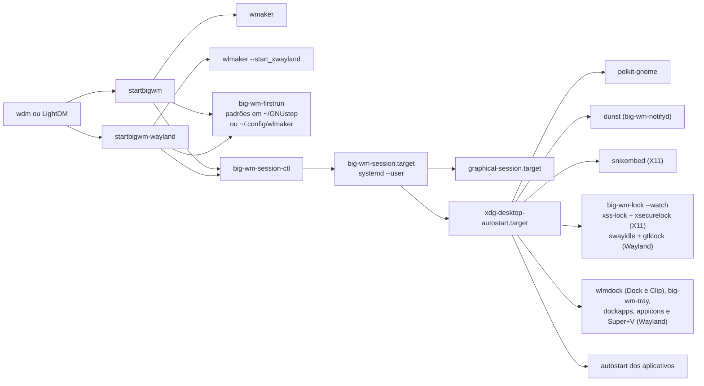

1. A tela de login inicia `startbigwm` (X11) ou `startbigwm-wayland`.
2. `big-wm-firstrun` aplica os padrões que ainda faltam na conta e reaplica o
   modo claro/escuro guardado.
3. `big-wm-session-ctl` exporta o ambiente gráfico para o systemd `--user` e
   ativa `big-wm-session.target`, que puxa `graphical-session.target` e o
   autostart XDG.
4. Os serviços da sessão sobem como unidades do systemd: notificações,
   polkit, bandeja, bloqueio e, no Wayland, Dock, Clip, dockapps e o
   histórico da área de transferência.
5. Drop-ins em `/usr/lib/systemd/user/*.d/big-wm.conf` cortam, só nas sessões
   Big WindowMaker, applets que lá não servem (Bluetooth sem adaptador,
   impressora sem fila, seletor de som duplicado).

### Princípios

- **Nenhum binário de outro pacote é alterado.** O `/usr/bin/wmaker` é chamado como está.
- **Nada em `/etc/skel`.** A configuração padrão é aplicada no primeiro login,
  inclusive em contas que já existiam.
- **Convive com Plasma, XFCE e GNOME.** Todo autostart instalado aqui tem
  `OnlyShowIn=WindowMaker;` e/ou `wlmaker;`; os testes garantem isso e também
  que nada é instalado fora dos caminhos do projeto.
- **Instalar não muda o sistema.** Os pacotes da sessão não têm scripts de
  instalação. Dois hooks do pacman agem em casos precisos: o do `big-wm-name`
  mantém o nome do sistema, e o `big-wm-display-manager` habilita outra tela
  de login só quando a habilitada foi removida e o boot cairia no console. Os
  `.install` dos temas de boot só explicam como ativá-los e, ao remover o tema
  do Plymouth que estava ativo, voltam ao tema padrão.
- **Leve.** Em VM o GTK 4 desenha por software e serviços sem hardware não
  sobem. Números e decisões em [docs/memoria.md](docs/memoria.md) e
  [docs/performance-decisions.md](docs/performance-decisions.md).
- **No idioma do usuário.** Window Maker, WPrefs, wlmaker, wmake-zones e as
  ferramentas em português do Brasil e inglês ([docs/i18n/](docs/i18n/RELATORIO-FINAL.md)).

### Onde cada coisa fica

| Caminho | Conteúdo |
|---|---|
| `/usr/bin/startbigwm`, `/usr/bin/big-wm-*` | Início das sessões e utilitários |
| `/usr/lib/big-wm/` | Bibliotecas e auxiliares dos scripts |
| `/usr/share/big-wm/` | Padrões do Window Maker (`GNUstep/Defaults`), do wlmaker, dunst, rofi, picom, bloqueio e fastfetch |
| `/usr/share/xsessions/big-wm.desktop` | Sessão X11 |
| `/usr/share/wayland-sessions/big-wm-wayland.desktop` | Sessão Wayland |
| `/usr/lib/systemd/user/big-wm-session.target` | Alvo da sessão no systemd `--user` |
| `/etc/xdg/autostart/big-wm-*.desktop` | Serviços da sessão (só nas sessões Big WindowMaker) |
| `/etc/xdg/{windowmaker,wlmaker}-mimeapps.list` | Aplicativos padrão de cada sessão |
| `/usr/share/WindowMaker/{Themes,Styles,Icons}` | Temas, estilos e ícones do Window Maker |
| `/usr/share/icons/BigWindowMaker/` | Tema de ícones XDG |
| `/usr/share/backgrounds/big-wm/` | Papéis de parede |
| `~/.config/big-wm/` | Escolhas do usuário: tema, papel de parede, bloqueio, área de transferência, dockapps |

### Medições de memória

Sistema instalado em VM (4 GiB), mediana de 5 boots, 600 s depois do login
e de 40 janelas abertas e fechadas, rodada de 23/11/2026 ([metodologia e números](docs/performance/2026-11-23-memoria/11-resultados-finais.md)):

| Métrica | X11 | Wayland |
|---|---|---|
| PSS da sessão (processos do usuário) | 289 MiB | 334 MiB |
| PSS de todos os processos | 502 MiB | 442 MiB |
| "Usada" (MemTotal − MemAvailable; inclui ~465 MiB de reserva do kernel) | 998 MiB | 1004 MiB |

Os compositores usam o malloc da glibc: cinco alocadores alternativos
(mimalloc, jemalloc, tcmalloc, snmalloc e Scudo) foram medidos e todos ocupam mais
([comparativo](docs/performance/2026-11-23-memoria/01-comparativo-alocadores.md)).

---

## Desenvolvimento

```sh
make check                       # testes estáticos (tests/run.sh)
make install DESTDIR=/tmp/teste  # instalação de teste
cd pkgbuild && BIGWM_SOURCE="git+file://$PWD/..#branch=main" makepkg   # pacotes locais
```

Cada alvo do `Makefile` corresponde a um pacote: `install-session`,
`install-wayland`, `install-themes`, `install-welcome`, `install-lockscreen`,
`install-locate-pointer`, `install-zoom`, `install-name`,
`install-grub-theme` e `install-plymouth-theme`. Traduções: `make pot`,
`make update-po` e `make mo`.

### Estrutura do repositório

```text
big-wm/
├── session/       scripts de sessão, utilitários, autostart, unidades do systemd
│                  e os binários em C (bloqueio, locate-pointer, xkill, zoom)
├── data/          padrões do Window Maker e do wlmaker, dunst, rofi, picom,
│                  bloqueio, fastfetch, hooks do pacman e aplicativos padrão
├── themes/        logo, temas, estilos, ícones SVG, papéis de parede e temas de boot
├── welcome/       boas-vindas (Python + GTK 3)
├── po/            traduções (catálogo big-wm)
├── tests/         testes estáticos, de integração e de desempenho
├── docs/          documentação técnica e capturas de tela
└── pkgbuild/      PKGBUILD e scripts .install
```

### Testes

| Nível | Onde | O que cobre |
|---|---|---|
| Estáticos | [`tests/run.sh`](tests/run.sh) | shellcheck, plists do Window Maker e do wlmaker, `.desktop`, `big-wm-firstrun` e as migrações, `big-wm-theme`, `big-wm-appmenu`, área de transferência, bloqueio e controle, zoom, locate-pointer, condições de autostart, `big-wm-wprefs-sync`, traduções e boas-vindas |
| Integração | [`tests/integration/`](tests/integration/) | Os pacotes reais num contêiner Manjaro com as duas sessões: Dock, dockapps, bandeja, menus no ponteiro, bloqueio com o teclado |
| Desempenho | [`tests/perf/`](tests/perf/) | Memória e tempo de login no sistema instalado, em VM libvirt |
| ISO | [build-iso](https://github.com/big-windowmaker/build-iso) | Boot, instalação pelo Calamares e login, BIOS e UEFI |
| Dock com Abas, zonas, Monitores | repositórios próprios | `meson test` em cada um |

O CI ([`.github/workflows/ci.yml`](.github/workflows/ci.yml)) roda os testes
estáticos, monta os pacotes, passa o `namcap` e roda a integração com as duas
sessões. Os testes de integração precisam dos pacotes de
[big-windowmaker/packages](https://github.com/big-windowmaker/packages) e rodam
num contêiner Manjaro descartável:

```sh
podman run --rm -v "$PWD/tests/integration:/t:ro" -v "$PWD/pacotes:/pkgs:ro" \
  -v "$PWD/resultado:/out" docker.io/manjarolinux/base bash /t/session-test.sh /pkgs /out
```

Para testar a sessão Wayland à mão sem sair da sua: [docs/wayland-test-lab.md](docs/wayland-test-lab.md).

## Contribuir

- **Problemas:** use **menu raiz → Sessão → Relatar problema**: ele monta o relatório sem
  dados pessoais e abre a [issue](https://github.com/big-windowmaker/big-wm/issues)
  já preenchida; descreva o que fez, o que esperava e o que aconteceu e, se
  puder, anexe uma captura. Sem a sessão gráfica: `big-wm-doctor --report
  --print`. Problemas da ISO vão no
  [build-iso](https://github.com/big-windowmaker/build-iso/issues).
- **Código:** um *pull request* por assunto, com `make check` passando e um
  teste de regressão do que foi corrigido; o CI roda os testes estáticos, o
  pacote, o `namcap` e a integração com as duas sessões.
- **Tradução:** `po/` (catálogo `big-wm`) e `welcome/po/`; os termos seguem o
  glossário de [docs/i18n/](docs/i18n/11-glossario-pt-br.md).
- **Segurança:** não abra issue pública; veja a
  [política de segurança](https://github.com/big-windowmaker/.github/blob/main/SECURITY.md).

Guia completo: [CONTRIBUTING](https://github.com/big-windowmaker/.github/blob/main/CONTRIBUTING.md).

## Documentação

| Documento | Assunto |
|---|---|
| [docs/guia-do-usuario.md](docs/guia-do-usuario.md) | **Guia do usuário**: primeiros passos, atalhos essenciais, Dock e Clip, janelas, aparência, bloqueio, atualizações, relatar problema, perguntas frequentes |
| [docs/aparencia.md](docs/aparencia.md) | Aparência retrô dos aplicativos, modo escuro, bloqueio, Flatpak, Firefox, ícones |
| [docs/tema-claro-escuro.md](docs/tema-claro-escuro.md) | Como o modo claro/escuro troca cada componente |
| [docs/wayland-parity.md](docs/wayland-parity.md) | Paridade entre as sessões X11 e Wayland, item a item |
| [docs/appicons-dock-clip.md](docs/appicons-dock-clip.md) | Dock, Clip e appicons nas duas sessões |
| [docs/wayland-dockapps.md](docs/wayland-dockapps.md) | Os dockapps do X11 no Wayland |
| [docs/clipboard-spectacle/](docs/clipboard-spectacle/README.md) | Área de transferência e Spectacle |
| [docs/welcome.md](docs/welcome.md) | Boas-vindas (`big-wm-welcome`) |
| [docs/menu-configuracoes.md](docs/menu-configuracoes.md) | Menu Configurações, Lupa e ampliação, migração dos menus |
| [docs/aplicativos-padrao.md](docs/aplicativos-padrao.md) | Aplicativos padrão e limpeza do menu Aplicativos |
| [docs/display-resolution.md](docs/display-resolution.md) | Monitores e hotplug |
| [docs/live-wdm-integration.md](docs/live-wdm-integration.md) | Sessão live pelo wdm |
| [docs/i18n/](docs/i18n/RELATORIO-FINAL.md) | Tradução pt_BR e glossário |
| [docs/wayland-test-lab.md](docs/wayland-test-lab.md) | Laboratório de testes da sessão Wayland |
| [docs/memoria.md](docs/memoria.md), [docs/performance-benchmarks.md](docs/performance-benchmarks.md) | Memória e desempenho |
| [docs/AUDITORIA_GERAL.md](docs/AUDITORIA_GERAL.md), [docs/RELEASE_CHECKLIST.md](docs/RELEASE_CHECKLIST.md) | Estado da publicação e checklist com reversão |
| [themes/boot/](themes/boot/README.md), [themes/icons/](themes/icons/README.md) | Temas de boot e tema de ícones |

## Projetos relacionados

| Repositório | Conteúdo |
|---|---|
| [big-windowmaker/tabbed-dock](https://github.com/big-windowmaker/tabbed-dock) | Dock horizontal com abas e o controlador no Dock (X11 e Wayland) |
| [big-windowmaker/wmake-zones](https://github.com/big-windowmaker/wmake-zones) | Zonas de encaixe e mosaico automático (X11 e Wayland) |
| [big-windowmaker/big-wm-display-resolution](https://github.com/big-windowmaker/big-wm-display-resolution) | Configurações > Monitores (X11 e Wayland) |
| [big-windowmaker/packages](https://github.com/big-windowmaker/packages) | PKGBUILDs do Window Maker, wlmaker, dockapps, temas retrô e gtk-nocsd, com os patches |
| [big-windowmaker/build-iso](https://github.com/big-windowmaker/build-iso) | Pipeline da ISO e testes de instalação em VM |
| [big-windowmaker/iso-profiles](https://github.com/big-windowmaker/iso-profiles) | Perfil da edição (fork do big-comm/iso-profiles) |
| [big-windowmaker/biglinux-livecd](https://github.com/big-windowmaker/biglinux-livecd) | Sessão live e instalador (fork do biglinux/biglinux-livecd) |
| [big-windowmaker/wmaker](https://github.com/big-windowmaker/wmaker) · [window-maker/wmaker](https://github.com/window-maker/wmaker) | Window Maker: fork e upstream (os patches do Big WindowMaker ficam no `packages`) |
| [big-windowmaker/wlmaker](https://github.com/big-windowmaker/wlmaker) · [phkaeser/wlmaker](https://github.com/phkaeser/wlmaker) | wlmaker: fork e upstream (idem) |

## Créditos

### Mantenedores do Big WindowMaker

- **Rafael Ruscher** — <rruscher@gmail.com>
- **Barnabé Di Kartola** — <barnabedikartola@gmail.com>

O Big WindowMaker integra, empacota e corrige; os autores e mantenedores do
Window Maker, do wlmaker e dos demais projetos continuam sendo os deles (ver
[`CREDITS.md`](CREDITS.md) e os PKGBUILDs do
[packages](https://github.com/big-windowmaker/packages)).

### Agradecimentos especiais

- **Alfredo Kojima** — pelo desenvolvimento original do
  [Window Maker](https://www.windowmaker.org/) e pelo legado que inspirou
  este projeto.
- **Philipp Kaeser** — pelo [wlmaker](https://github.com/phkaeser/wlmaker) e
  pelo trabalho de levar a inspiração do Window Maker ao Wayland.
- **Bruno Gonçalves** — pelo [BigLinux](https://www.biglinux.com.br/) e por
  suas contribuições ao ecossistema Linux.
- **Tales A. Mendonça** — pelas contribuições ao desenvolvimento e
  fortalecimento da [BigCommunity](https://communitybig.org).

### Uma homenagem

O NeXTSTEP, da NeXT (1989), e a especificação OPENSTEP que veio dele (1994)
trouxeram o Dock, os menus destacáveis, as miniaturas e o visual cinza com
relevo que ainda reconhecemos. O Window Maker, começado por Alfredo Kojima
em 1997 e mantido desde então por muitas mãos, levou essa experiência ao
X11 como software livre, junto do GNUstep; o wlmaker a traz ao Wayland. O
Big WindowMaker existe para que esse jeito simples e elegante de usar o
computador continue à mão no dia a dia.

## Licença

GPL-2.0-or-later. O módulo do teclado na tela do gtklock
(`session/lockscreen/gtklock-keyboard.c`) é GPL-3.0-or-later, como o gtklock.
Veja [`LICENSE`](LICENSE) e, para os créditos de temas, ícones, fontes e
papéis de parede, [`CREDITS.md`](CREDITS.md).

## In English

**Big WindowMaker** is the Window Maker desktop of BigLinux/BigCommunity: the
NeXTSTEP-style window manager with what a current desktop needs around it
(generated application menu, tray, notifications, OPENSTEP screen lock with an
on-screen keyboard, screenshots, clipboard history on Super+V, window zones and
tiling, dark mode, GTK and Qt apps with one look), in two sessions: **X11**
with Window Maker (stable) and **Wayland** with the
[wlmaker](https://github.com/phkaeser/wlmaker) compositor (experimental; see
[X11 × Wayland](#x11--wayland-o-que-muda) for what it still lacks). It runs
`/usr/bin/wmaker` unchanged and does not break Plasma, XFCE or GNOME on the
same machine.

- Try it: the test ISO (Alpha) from
  [build-iso releases](https://github.com/big-windowmaker/build-iso/releases),
  or build the packages on a BigLinux/BigCommunity system
  ([Baixar e instalar](#baixar-e-instalar)).
- Build and test: `make check` and `tests/run.sh` (see
  [Desenvolvimento](#desenvolvimento)); report problems in the
  [issues](https://github.com/big-windowmaker/big-wm/issues).
- Maintainers: Rafael Ruscher <rruscher@gmail.com> and Barnabé Di Kartola
  <barnabedikartola@gmail.com>. Special thanks to Alfredo Kojima (Window
  Maker), Philipp Kaeser (wlmaker), Bruno Gonçalves (BigLinux) and Tales A.
  Mendonça (BigCommunity).
- License: GPL-2.0-or-later.
