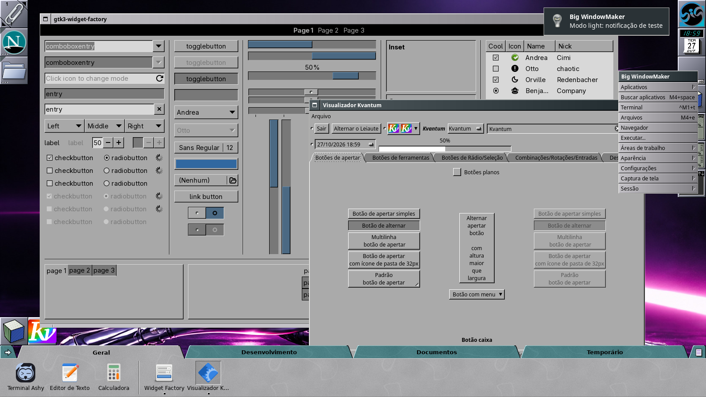
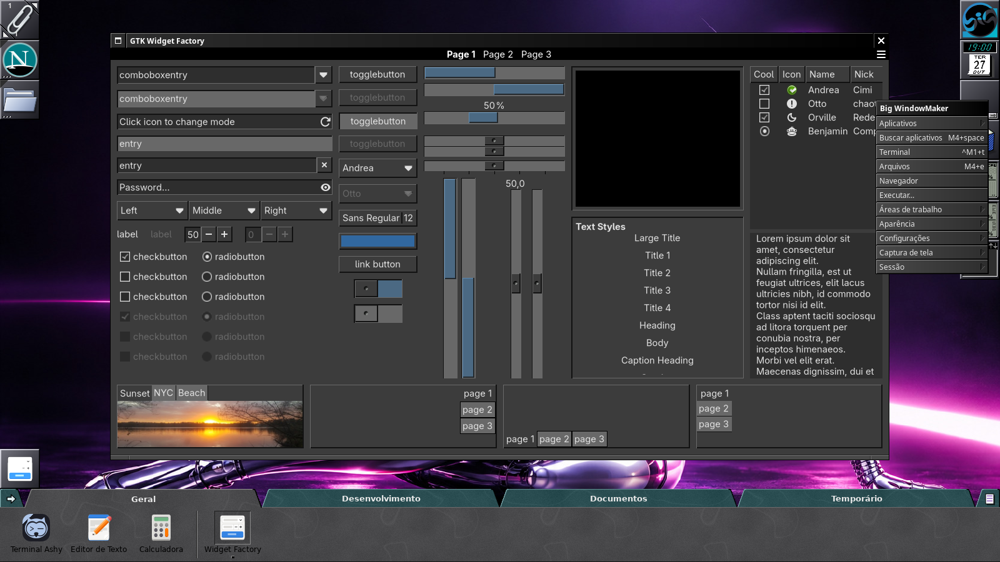
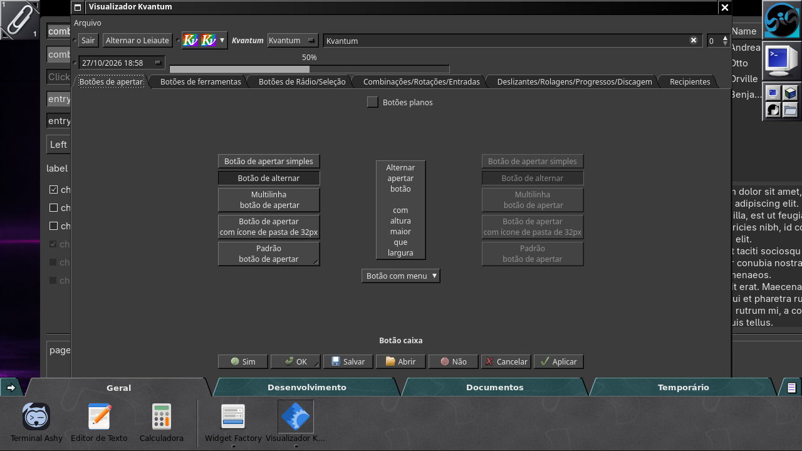
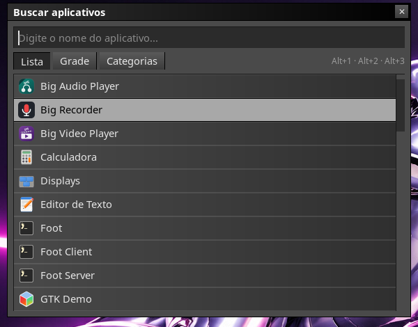
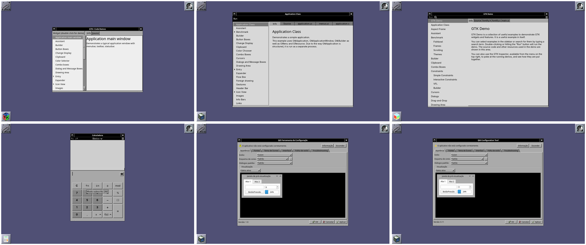
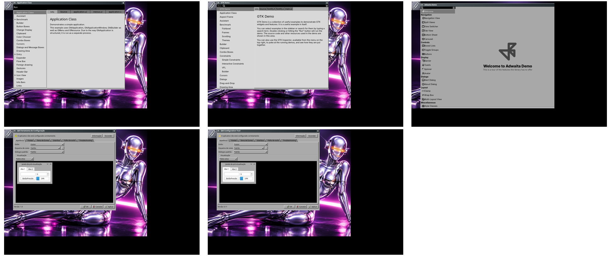
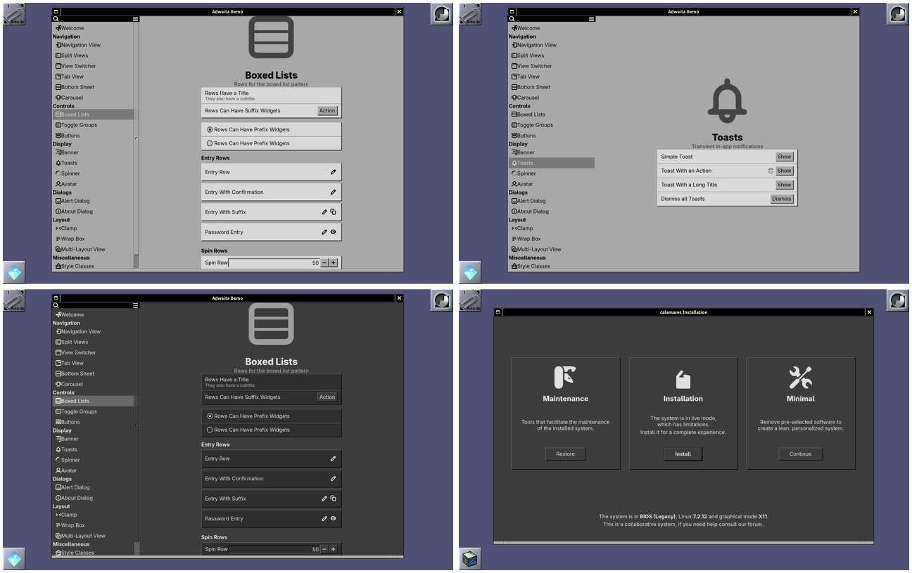
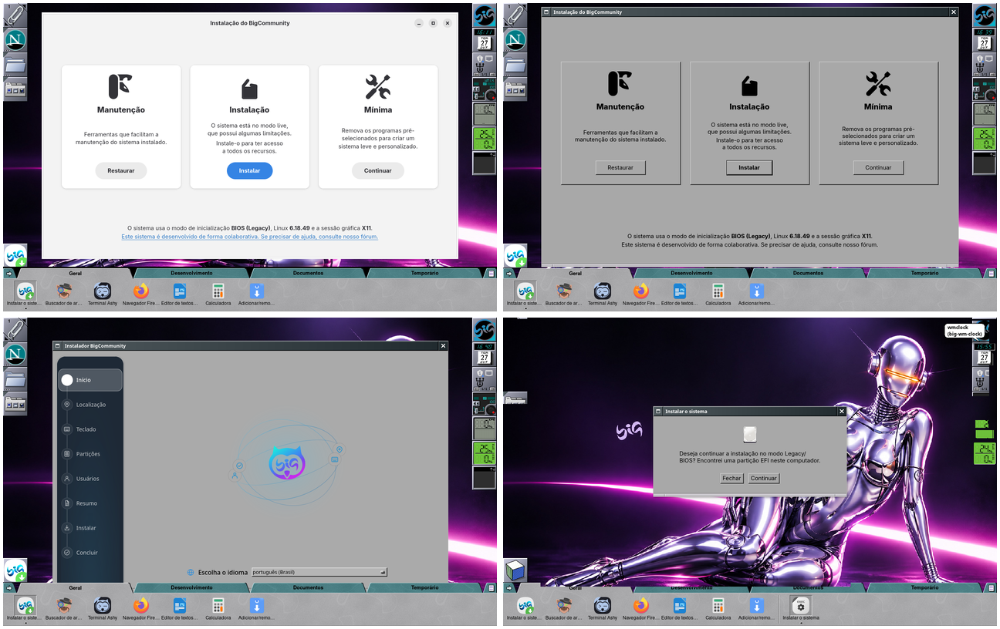
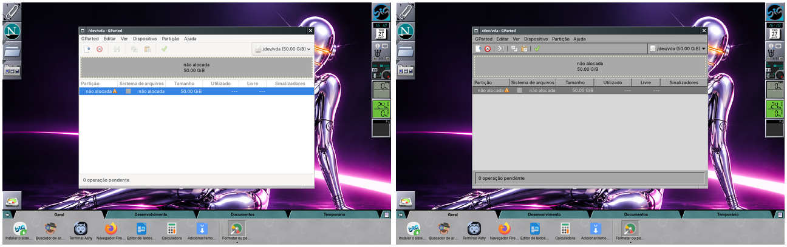

# Aparência retrô dos aplicativos

As sessões Big WindowMaker (X11 e Wayland) dão aos aplicativos a mesma cara
do Window Maker: cinza, relevo e a barra de título do gerenciador de janelas.
Nada disso vale fora delas; Plasma, GNOME e XFCE continuam com os temas deles.

| Aplicativos | Tema | Pacote | Onde é ligado |
|---|---|---|---|
| Qt 5 e Qt 6 | QTStep OpenStep (Kvantum); QTStepOpenStepDark no modo escuro | `qtstep-kvantum` | `QT_STYLE_OVERRIDE=kvantum` em `big-wm-env.sh`; o tema vai para `~/.config/Kvantum/kvantum.kvconfig` (`big-wm-firstrun`, `big-wm-theme`) |
| GTK 2, 3 e 4 (Thunar, Firefox...) | OneStepBack; OneStepBack-Dark no modo escuro | `onestepback-gtk-theme` | `GTK_THEME` em `big-wm-env.sh` (pelo modo de `~/.config/big-wm/theme`), exportado ao D-Bus por `big-wm-session-ctl` |
| Firefox | Netscape 4 (RetroThemesFirefox) | `retrothemes-firefox` | `chrome/` copiado para o perfil por `big-wm-firstrun` |
| AshyTerm (terminal padrão) | fundo translúcido (transparência 22) | `ashyterm` | `~/.config/ashyterm/settings.json` criado por `big-wm-firstrun` |
| Dock, Clip e ícones | ícones do Window Maker em SVG (BigWindowMaker) | `big-wm-themes` | PNG gerados no build, nos atributos do Window Maker e no `State.plist` do wlmaker; o tema XDG é opcional |

## Modo claro e modo escuro

A aparência acima é o **modo claro**, o padrão. O **modo escuro** troca tudo
de uma vez para os cinzas escuros de um NeXTSTEP/OPENSTEP noturno, com o mesmo
relevo (luz em cima e à esquerda, sombra preta embaixo e à direita): barra de
título preta com texto branco na janela em foco, cinza médio nas outras,
menus, ladrilhos e janelas em `#2e2e2e`–`#4a4a4a`, texto claro e o realce em
cinza-claro com texto preto.

    big-wm-theme dark     # modo escuro
    big-wm-theme light    # modo claro (padrão)
    big-wm-theme get      # imprime light ou dark

Também em Aparência > Tema claro / Tema escuro, no menu raiz das duas sessões.
A escolha fica em `~/.config/big-wm/theme` (sem o arquivo, claro) e vale para
X11 e Wayland. O assistente da live pode chamar `big-wm-theme dark` antes do
primeiro login: o `big-wm-firstrun` instala os padrões e chama
`big-wm-theme apply`, que os passa ao modo escuro.

| Parte | Modo claro | Modo escuro | Quando muda |
|---|---|---|---|
| Window Maker (barras, menus, ícones, Clip, Dock) | estilo `BigWindowMaker` | estilo `BigWindowMaker-Dark` | na hora: o `wmaker` relê `~/GNUstep/Defaults/WindowMaker` |
| wlmaker e wlmdock | `Theme.plist` | `Theme-Dark.plist` | próximo login (o `ThemeFile` do `~/.config/wlmaker/Config.plist`; o wlmaker não relê o tema) |
| GTK 3 e 4 (e GTK 2: o tema escuro traz o `gtk-2.0` também) | `OneStepBack` | `OneStepBack-Dark` (`onestepback-gtk-theme` 0.997-4) | aplicativos abertos depois da troca (ver abaixo) |
| libadwaita, portal (Firefox, Chromium) | `color-scheme` `default` | `prefer-dark` | na hora, nos aplicativos que seguem o portal |
| Qt 5 e 6 (Kvantum) | `QTStepOpenStep` | `QTStepOpenStepDark` (`qtstep-kvantum` 0.r23.36dc0d3-2) | aplicativos abertos depois da troca |
| Dock com abas | mármore cinza, abas verde-azuladas | mármore escuro, abas petróleo | na hora (o dock acompanha `~/.config/big-wm/theme`) |
| Buscar aplicativos e Executar (rofi) | `big-wm.rasi` | `big-wm-dark.rasi` | na próxima vez que abrir |
| Notificações (dunst) | `dunstrc` | `dunstrc-dark` (cinzas neutros) | na hora (`dunstctl reload`) |

O `big-wm-theme` só alterna entre os dois do par: um estilo do Window Maker
escolhido pelo usuário (WPrefs, Aparência > Estilos), outro `ThemeFile` no
wlmaker, outro tema no Kvantum, outro `GTK_THEME` ou um `~/.config/dunst/dunstrc`
próprio ficam como estão. No Kvantum, o `BigAdwaitaRoundGtk*` gravado pelo
assistente do BigLinux e pela sincronização do tema do GNOME com o Qt
(`sync-gnome-theme-to-qt`) não conta como escolha do usuário. Os dois estilos
também aparecem em Aparência > Estilos e no WPrefs, e não mexem no papel de
parede.

Com a sessão aberta:

- GTK: o `GTK_THEME` é do ambiente da sessão, fixado no login. O
  `big-wm-theme` atualiza o do systemd `--user` e do D-Bus (aplicativos
  ativados pelo D-Bus, portais), e o Buscar aplicativos e o `big-wm-open`
  (Navegador, Arquivos e Terminal do menu e dos atalhos de teclado, o
  Navegador do Clip, os lançadores do Dock no Wayland) passam o tema novo
  aos aplicativos que abrem. O resto (menu Aplicativos, o Thunar do Clip,
  outros atalhos) herda o ambiente do Window Maker ou do wlmaker e só muda
  no próximo login. Aplicativo já aberto só muda depois de fechado (o
  Thunar fica aberto em segundo plano: `thunar -q`).
- Qt: cada aplicativo lê o tema do Kvantum ao abrir.
- wlmaker: a decoração das janelas, os menus e o Dock do Wayland mudam no
  próximo login.
- Firefox: o tema Netscape 4 continua claro (não tem variação escura); as
  páginas seguem o `color-scheme`.

Quando o `big-wm-wprefs-sync` está instalado, o `big-wm-theme` o chama depois
de trocar o estilo do Window Maker, para o wlmaker acompanhar a aparência do
X11.

  
  

  
  

  

As capturas vêm de um contêiner (Xvfb + wmaker; wlmaker no backend
headless) com os pacotes desta versão; o teste de integração X11
(`tests/integration/x11.sh`) troca para o escuro e de volta com a sessão
aberta.

## Qt: QTStep

[QTStep](https://github.com/andbgr/QTStep) traz o modelo e as cores de cada
variação; o pacote gera os 25 temas do Kvantum. O padrão é o
`QTStepOpenStep`, o da captura `screenshots/kvantum.png` do projeto: fundo e
campos `#aaaaaa`, seleção branca, texto preto. As outras variações aparecem no
Kvantum Manager (`kvantummanager`).

O Kvantum só lê o tema da configuração do usuário. O `big-wm-firstrun` cria o
arquivo apenas quando ele ainda não existe: quem escolheu outro tema fica com
ele.

## GTK: OneStepBack

[OneStepBack](http://www.vide.memoire.free.fr/pages/onestepback/onestepback.php)
imita o NeXTSTEP com três cinzas e uma cor. Para usar outro tema GTK nas
sessões Big WindowMaker, defina `GTK_THEME` em `~/.config/environment.d/` ou
`BIGWM_GTK_THEME=0`. Os aplicativos libadwaita ignoram temas GTK em boa parte.

Um aplicativo GTK que já estava aberto antes do login (por exemplo o Thunar
ativado pelo D-Bus) só muda depois de fechado: `thunar -q`.

## Todos os aplicativos, em todas as versões

O tema não depende de cada aplicativo: vem do ambiente da sessão
(`big-wm-env.sh`) e, para o que roda fora dela (root), de padrões do
sistema na edição wmaker da ISO.

| Caso | Resultado | Como | Conferido |
|---|---|---|---|
| GTK 2 | OneStepBack (`gtk-2.0`, motor pixmap do próprio gtk2) | `GTK2_RC_FILES` = gtkrc do tema do `GTK_THEME` + `~/.gtkrc-2.0` (`big-wm-env.sh`) | contêiner, `gtk-demo` |
| GTK 3 | OneStepBack, barra de título do Window Maker | `GTK_THEME` + gtk-nocsd (`LD_PRELOAD`) | contêiner (`gtk3-demo`), live |
| GTK 4 | idem | idem | contêiner, `gtk4-demo` |
| libadwaita | cinzas do OneStepBack, barra do Window Maker; cartões, listas em caixa, botões de ação, página de status, avisos e títulos com o relevo do tema | `GTK_THEME` faz o libadwaita trocar a folha de estilo dele pela do tema; as cores nomeadas e as classes próprias do libadwaita vêm do `libadwaita.css` e do `libadwaita-widgets.css` do pacote (0.997-5) | contêiner (`gnome-calculator`, `adwaita-1-demo`, claro e escuro), instalador no live |
| Qt 5 | QTStep | `QT_STYLE_OVERRIDE=kvantum` + `kvantum-qt5` (na lista da ISO) | contêiner, `qt5ct` |
| Qt 6 | QTStep | `QT_STYLE_OVERRIDE=kvantum` + `kvantum` | contêiner (`qt6ct`), Calamares no live |
| Aplicativos do D-Bus e do `systemd --user` | iguais aos de cima | `big-wm-session-ctl` exporta `GTK_THEME`, `GTK2_RC_FILES`, `LD_PRELOAD` e `QT_*` | — |
| Abertos pelo Dock com Abas | iguais | o processo é filho do dock (só depois vai para o escopo do systemd): herda o ambiente | live |
| root pelo `pkexec`/`sudo` (GParted, Timeshift) | GTK 3/4: OneStepBack; barra do Window Maker quando o programa não desenha a própria (GParted). Qt: Fusion | ver abaixo | live (GParted antes/depois) e contêiner |
| Instalador do live | barra do Window Maker, OneStepBack e QTStep | ver [Instalador do sistema live](#instalador-do-sistema-live) | live |
| Flatpak | tema do runtime (Adwaita/Breeze) | não ligado, ver abaixo | — |

O `QT_STYLE_OVERRIDE` vale mais que o estilo sugerido pelo plugin de
plataforma (`QT_QPA_PLATFORMTHEME=xdg-desktop-portal`), que fica só com as
cores de destaque, o esquema claro/escuro e os diálogos de arquivo do portal.
Sem o `kvantum-qt5` o Qt 5 avisa "invalid style override" e cai no Fusion.

Na sessão Wayland vale o mesmo ambiente; a barra é a do wlmaker (GTK pelo
protocolo de decoração do KDE com o gtk-nocsd, Qt pelo xdg-decoration).
Conferido com o wlmaker aninhado no Xvfb (`WLR_BACKENDS=x11`):

As classes próprias do libadwaita (cartões, listas em caixa, botões pílula,
de ação e destrutivos, barra lateral de navegação, página de status, grupos
de preferências, avisos, `.osd`, títulos) não existem no OneStepBack: o
`onestepback-gtk-theme` (0.997-5) as desenha com o relevo do tema e só com
nomes de cor, então valem também no OneStepBack-Dark. O botão padrão
(`.suggested-action`) fica em negrito com um filete preto (cinza-claro no
OneStepBack-Dark), como no NeXTSTEP. O tema não desenhava foco de teclado:
desde a 0.997-6 botões, linhas, caixas de seleção, interruptores, réguas e
abas ganham um tracejado por dentro quando recebem o foco pelo teclado (Tab,
Orca).

### Programas como root

O `pkexec` e o `sudo` começam o programa com um ambiente limpo: nada de
`GTK_THEME`, `QT_STYLE_OVERRIDE` ou `LD_PRELOAD`. Passar essas variáveis
adiante (regra no polkit, `env_keep` no sudo, `/etc/ld.so.preload`) mexeria
na fronteira de privilégio, por isso a edição wmaker da ISO traz só padrões
estáticos no `desktop-overlay` (repositório `iso-profiles`):

- `/etc/gtk-3.0/settings.ini` e `/etc/gtk-4.0/settings.ini` com
  `gtk-theme-name=OneStepBack`: valem para quem não tem `settings.ini`
  próprio, como o root. Os usuários não mudam nada, porque o `GTK_THEME` da
  sessão vale mais. O GParted (GTK 3, sem barra própria) abre com o
  OneStepBack e a barra do Window Maker; um programa GTK com barra própria
  (headerbar) continua com ela, porque o gtk-nocsd não atravessa o `pkexec`.
- `/etc/xdg/Kvantum/kvantum.kvconfig` com `theme=QTStepOpenStep`: o Kvantum lê
  esse arquivo quando o usuário (o root) não tem o dele. Só vale quando o
  estilo Kvantum é escolhido (`QT_STYLE_OVERRIDE=kvantum`, como faz o
  instalador); um programa Qt aberto pelo `pkexec` fica no Fusion.
- O libadwaita como root ignora o tema (não há `GTK_THEME`).

Nada é gravado em `/root`: o `/root` é 0750 e um diretório no overlay
levaria o modo do checkout. O modo escuro do usuário não chega ao root:
programas como root abrem claros.

### Flatpak

Os aplicativos Flatpak usam o GTK e o Qt do runtime deles e não enxergam
`/usr/share/themes` nem `/usr/share/Kvantum`. Não há extensão Flatpak
conhecida do OneStepBack nem do QTStep (a busca do Flathub não acha nada),
então nada é ligado automaticamente. Para quem
quiser, por usuário (fica a cargo dele):

    mkdir -p ~/.themes ~/.config/Kvantum
    cp -r /usr/share/themes/OneStepBack ~/.themes/
    flatpak override --user --filesystem=~/.themes:ro --env=GTK_THEME=OneStepBack
    # Qt: extensão org.kde.KStyle.Kvantum do runtime do aplicativo, e
    cp -r /usr/share/Kvantum/QTStepOpenStep ~/.config/Kvantum/
    flatpak override --user --filesystem=xdg-config/Kvantum:ro --env=QT_STYLE_OVERRIDE=kvantum

A barra de título do Window Maker num Flatpak GTK exigiria o gtk-nocsd dentro
do sandbox (`/opt/gtk-nocsd`, que o pacote não instala); fica de fora.

### Sincronização de tema do BigLinux

O `sync-gnome-theme-to-qt` (BigLinux, na lista da ISO) grava
`theme=BigAdwaitaRoundGtk` no `~/.config/Kvantum/kvantum.kvconfig` e copia o
`kdeglobals` do BigLinux a cada mudança no dconf, fora do Plasma: uma
`gsettings set` qualquer trocava o QTStep. Um drop-in
(`sync-gnome-theme-to-qt.service.d/big-wm.conf`) pula o serviço nas sessões
Big WindowMaker (`big-wm-autostart-condition qt-theme-sync`), também no
login, antes de a sessão exportar o `XDG_CURRENT_DESKTOP`: aí vale a sessão
do logind (`Desktop=big-wm` ou `big-wm-wayland`, gravado pelo lightdm).
Plasma, GNOME, XFCE e Cinnamon continuam sincronizando.

### Processo extra do gtk-nocsd

Cada programa GTK aberto com o gtk-nocsd tem um processo filho
`ld-linux-x86-64.so.2 /usr/lib/libgtk-nocsd.so.0 <programa>`: é o vigia de
falhas do gtk-nocsd 4.x, que reabre o programa sem a biblioteca se ele
travar. Não é o programa aberto duas vezes; usa cerca de 2 MB e não há
opção para desligá-lo sem desligar o gtk-nocsd.

Quando o programa trava, esse vigia o reabre **sem** o gtk-nocsd
(`LD_PRELOAD=` vazio) e fora do controle do systemd (o processo principal
da unidade já morreu). Visto no Dock com Abas na VM live, depois de o
binário ser trocado com o dock aberto: o dock reaberto pelo vigia tinha
`LD_PRELOAD=` vazio, e os programas abertos por ele vinham com a headerbar.
O dock se protege disso: ao abrir numa sessão Big WindowMaker sem o
gtk-nocsd no próprio `LD_PRELOAD`, ele lê o `LD_PRELOAD` da sessão (o
ambiente do `systemd --user`, exportado pelo `big-wm-session-ctl`) e o
passa aos programas que abre, avisando no diário ("gtk-nocsd is not loaded
in the dock"). Só quando a sessão tem o gtk-nocsd e a biblioteca está
instalada: quem o desligou (`BIGWM_NOCSD=0`, `GTK_CSD=1`) continua sem ele.
Conferido na VM live com o dock aberto com `LD_PRELOAD=` vazio: a
calculadora aberta por ele veio com o gtk-nocsd.

## Instalador do sistema live

No live, o Dock com Abas mostra "Instalar o sistema no HD" como primeiro ícone
da aba Geral (ver [tabbed-dock/uso-e-configuracao.md](tabbed-dock/uso-e-configuracao.md#sistema-live-instalar-o-sistema-no-hd)).
O instalador roda como root por `sudo env -i`, que limpa o ambiente; numa
sessão Big WindowMaker o `calamares-biglinux_polkit` (biglinux-livecd) passa
só os **nomes** do tema, conferidos por expressão regular: `BIGLINUX_BIG_WM=1`,
`BIGLINUX_GTK_THEME` (o `GTK_THEME` da sessão), `BIGLINUX_GTK_NOCSD=1` (quando
o gtk-nocsd está no `LD_PRELOAD` da sessão) e `BIGLINUX_KVANTUM_THEME` (lido
do `kvantum.kvconfig` do usuário). Já como root,
`/usr/lib/biglinux-livecd/window-maker-look` confere cada um de novo:

- tema GTK: só se `/usr/share/themes/<nome>/gtk-4.0` existe;
- gtk-nocsd: só `/usr/lib/libgtk-nocsd.so.0`, arquivo comum (não link), do
  root e que só o root pode alterar; o `LD_PRELOAD` do usuário nunca passa;
- Kvantum: só se `/usr/share/Kvantum/<nome>/<nome>.kvconfig` existe; o
  `BigAdwaitaRound*` (o que os outros desktops gravam) e nomes desconhecidos
  viram `QTStepOpenStep`.

Com isso os diálogos (`gtk_dialog.py`) e a tela inicial do instalador
(`main.py`, GTK 4/libadwaita) abrem com `GTK_THEME` e o gtk-nocsd (barra do
Window Maker em vez da headerbar), e o Calamares com o Kvantum do usuário em
`/root/.config/Kvantum/kvantum.kvconfig`. As janelas GTK recebem também
`BIGLINUX_WINDOW_MAKER=1`, que tira o fundo 3% translúcido (efeito "vidro"
pensado para o Plasma e o GNOME): no Window Maker as janelas são painéis
opacos, e o papel de parede aparecia através da tela inicial. O `.desktop`
do instalador tem `StartupWMClass=calamares`, a classe da janela do
Calamares: no Dock com Abas ele fica junto do ícone "Instalar o sistema no
HD", com o ícone do instalador (no Wayland o dock também reconhece o
app_id `io.calamares.calamares` pelo último nome). Os diálogos do instalador
(`gtk_dialog.py`: verificação da mídia, modo EFI, versão antiga) usam o id do
instalador, `com.biglinux.calamares-config`, e o ícone dele, e ficam no mesmo
ícone do dock. Fora do Big WindowMaker nada muda:
o instalador continua claro, com o tema do BigLinux. No Big WindowMaker ele
segue o tema Kvantum do usuário, também o escuro.

## Terminal translúcido

O AshyTerm, terminal padrão, abre com o papel de parede aparecendo por trás
do texto, no X11 (composto pelo picom) e no Wayland (pelo wlmaker). O
`big-wm-firstrun` grava `{"transparency": 22}` em
`~/.config/ashyterm/settings.json` só quando o arquivo ainda não existe: cerca
de 87% de opacidade nos esquemas escuros (o padrão do AshyTerm, 16, dá 92%).
Quem já usava o AshyTerm fica com a transparência que escolheu; ela muda em
Preferências › Aparência › Transparência do Terminal, no AshyTerm.

Com o OneStepBack o fundo ficava opaco: o VTE pinta o widget com a cor
`@text_view_bg` antes do fundo translúcido, e o tema a define. O pacote
`onestepback-gtk-theme` 0.997-2 tira essa cor do `gtk-4.0`, e o AshyTerm
corrige o mesmo do lado dele para qualquer tema. Sem compositor (picom
desligado no X11) o fundo aparece escuro e opaco.

## Firefox: Netscape 4 e a barra de título do Window Maker

O navegador padrão é o Firefox. O `big-wm-firstrun` copia o tema Netscape 4
de [RetroThemesFirefox](https://github.com/matthewmx86/RetroThemesFirefox)
para cada perfil que ainda não tem `chrome/`. Sem perfil nenhum, abre o Firefox
uma vez sem janela (`--headless`) para criar o perfil padrão, como na primeira
execução. Ficam de fora os scripts do fx-autoconfig do tema (`JS/`, `utils/`),
que rodariam JavaScript com privilégios a cada início.

No `prefs.js` do perfil, só com o Firefox fechado, entram três preferências
que o usuário pode mudar depois em `about:config`:

- `toolkit.legacyUserProfileCustomizations.stylesheets = true`: lê o
  `userChrome.css`;
- `browser.tabs.inTitlebar = 0`: barra de título e bordas do Window Maker
  (X11) ou do wlmaker (Wayland, decoração do servidor) em vez das abas no
  lugar dela;
- `browser.shell.checkDefaultBrowser = false`: o `.desktop` do Firefox chama
  `firefox`, que no BigLinux é o wrapper `/usr/local/bin/firefox`
  (auto-tweaks-browser); o Firefox não se reconhece nele e diria que não é o
  padrão mesmo sendo.

Para voltar ao visual normal do Firefox: apague a pasta `chrome/` do perfil
(`about:support` mostra onde ele fica).

## Ícones: o tema Window Maker em SVG

Clip, Dock e os atalhos deles usam os ícones clássicos do Window Maker
redesenhados em SVG (`themes/icons`, detalhes e origem no
`themes/icons/README.md`): o clipe no Clip, o "N" do Netscape no Firefox, a
pasta no Thunar, o monitor no terminal e os ladrilhos no botão Aplicativos.
O build gera os PNG de cada sessão a partir dos SVG: 64 px em
`/usr/share/WindowMaker/Icons/big-wm-*.png` (X11, `WMWindowAttributes`) e
56 px em `/usr/share/wlmaker/icons/big-wm-*-56x56.png` (Wayland,
`Clip.Icon` e `Icon` dos lançadores no `State.plist`).

Contas criadas antes recebem os ícones novos pelo `big-wm-firstrun`, que só
troca o que ainda é o padrão antigo do Big WindowMaker: o PNG do Firefox e
do Thunar gravado nos atributos, o cubo `defaultAppIcon.tiff`, o globo
(`big-wm-browser-56x56.png`), a pasta amarela (`big-wm-files-56x56.png`) e o
`terminal-56x56.png` do lançador `big-wm-open terminal`. Um ícone escolhido
pelo usuário fica como está.

O mesmo desenho também vira o tema de ícones XDG **BigWindowMaker**
(`/usr/share/icons/BigWindowMaker`), que **não** é ligado sozinho. Para os
aplicativos GTK usarem os ícones do Window Maker:

    gsettings set org.gnome.desktop.interface icon-theme BigWindowMaker

Para voltar: `gsettings set org.gnome.desktop.interface icon-theme
bigicons-papient` (ou o tema que estava antes, mostrado por `gsettings get`).
O tema herda do bigicons-papient, do breeze, do Adwaita e do hicolor os
ícones que não tem.

## Navegadores Chromium (Chrome, Brave, Vivaldi)

O Brave saiu da edição. Num navegador Chromium instalado pelo usuário, a barra
de título do Window Maker se liga em Configurações > Aparência > "Usar barra
de título e bordas do sistema" (ou `custom_chrome_frame: false` no
`Preferences` do perfil, com o navegador fechado).

## fastfetch

O `fastfetch` mostra o logo do Big WindowMaker em ASCII, com as cores do
logo também nos textos: azul `#2d85c6` (Sistema), ciano `#04bacc` (Área de
trabalho e o título) e branco (Hardware e as letras "big" do logo). O
`big-wm-firstrun` copia `/usr/share/big-wm/fastfetch/{ascii-art,config.jsonc}`
para `~/.config/fastfetch/` quando o usuário ainda não tem nenhum dos dois; o
wrapper `/usr/local/bin/fastfetch` da BigCommunity usa esses arquivos e
continua traduzindo os rótulos (mesmos módulos do `/etc/fastfetch/config.jsonc`).

O ASCII é gerado do `themes/logo/big-wm.svg`:

    rsvg-convert -w 512 -h 512 themes/logo/big-wm.svg -o /tmp/logo.png
    python3 -I data/fastfetch/gerar-ascii.py /tmp/logo.png 38

(a saída usa `$1`/`$2`/`$3`, que viram as cores azul, ciano e branco no
`ascii-art`). Para voltar ao fastfetch padrão: apague `~/.config/fastfetch`.
