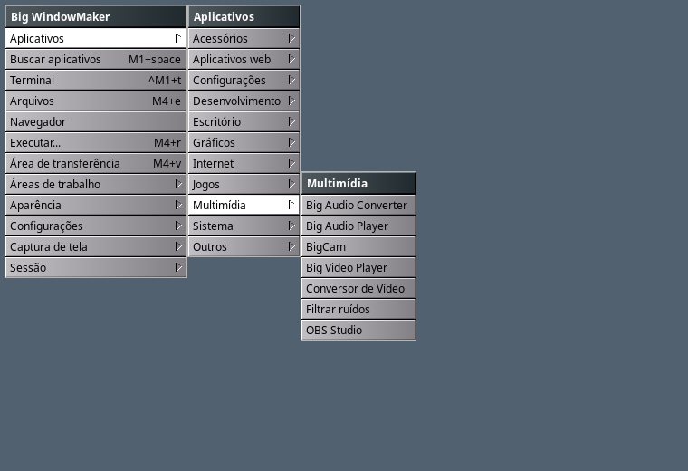
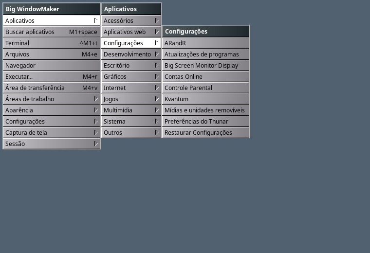

# Aplicativos padrão e o menu Aplicativos

Missão de novembro de 2026 (rodada 2, agente "menus"). Como as sessões Big
WindowMaker escolhem os aplicativos padrão e limpam o menu **Aplicativos**
(e o **Buscar aplicativos**) sem mexer nos menus do KDE, GNOME e XFCE.




## Problema

- Vídeos: o `mimeapps.list` da BigLinux aponta vídeos para o SMPlayer e o
  VLC, que o Big WindowMaker não traz; o padrão saía do primeiro registrado.
- O menu Aplicativos repetia programas: o **mpv Media Player** ao lado do
  Big Video Player (que usa o mpv), a **Webcam Guvc**/guvcview ao lado do
  BigCam, **scrcpy (console)**, **Rofi** e **Rofi Theme Selection** (o
  lançador da sessão é o `big-wm-launcher`), o **ARandR** no Wayland e o
  **wdisplays** no X11 (não funcionam lá), **Ajustes gerais** (o mesmo
  "Configurações do BigLinux" do menu raiz), os itens do menu raiz
  Configurações outra vez em Aplicativos > Configurações, e os dockapps do
  X11 (wmcalc, wmmon, wmusic...) que já estão em Configurações > Dockapps.
- Pedido do agente "apps": as entradas novas do Big WindowMaker para o
  scrcpy (`org.bigwindowmaker.Scrcpy`), o HPLIP
  (`org.bigwindowmaker.HPDeviceManager`, `org.bigwindowmaker.HPScan`) e o
  UxPlay (`org.bigwindowmaker.AirPlay`, "Receptor AirPlay") substituem as
  originais nas sessões, e os lançadores já presos no Dock/Clip passam a
  elas.

## Causa

O `big-wm-appmenu` seguia só o que os pacotes declaram (NoDisplay, Hidden,
OnlyShowIn/NotShowIn, TryExec), e os pacotes não sabem das sessões Big
WindowMaker. Copiar os .desktop para um diretório na frente do
`XDG_DATA_DIRS` esconderia também do "Abrir com" e ficaria velho a cada
atualização do pacote; listas de nomes no código não dariam ao usuário como
desfazer.

## Arquivos

- `data/desktop-overrides/*.desktop` → `/usr/share/big-wm/desktop-overrides/`
  (pacote `big-wm-session`): os ajustes por ID.
- `session/bin/big-wm-appmenu` — `desktop_overrides()`, `apply_overrides()`,
  `display_name(..., entry)`; dockapps fora de Aplicativos nas duas sessões;
  cache refeito quando um ajuste muda.
- `session/bin/big-wm-launcher` — usa os mesmos ajustes (Buscar
  aplicativos).
- `data/xdg/windowmaker-mimeapps.list`, `wlmaker-mimeapps.list` →
  `/etc/xdg/` — aplicativos padrão só das sessões.
- `session/lib/big-wm-menu-migrate` (`launchers-2026-11`) e
  `session/bin/big-wm-firstrun` (`migrate_app_launchers`) — lançadores do
  Dock e do Clip.
- `tests/run.sh` — testes de tudo isso.

## Solução

### Ajustes por ID, só nas sessões Big WindowMaker

Arquivos **parciais**, um por ID de .desktop, só com `[Desktop Entry]` e as
chaves que mudam; entram por cima do .desktop original no `big-wm-appmenu`
(menu Aplicativos) e no `big-wm-launcher` (Buscar aplicativos):

| ID | Ajuste | Por quê |
|---|---|---|
| `mpv` | `NoDisplay=true` | Big Video Player é o reprodutor (usa o mpv; o mpv continua instalado e no "Abrir com") |
| `guvcview`, `guvcview-qt` | `NoDisplay=true` | BigCam é a webcam |
| `scrcpy`, `scrcpy-console` | `NoDisplay=true` | `org.bigwindowmaker.Scrcpy` (`big-wm-scrcpy`) |
| `hplip`, `hp-uiscan` | `NoDisplay=true` | `org.bigwindowmaker.HPDeviceManager`/`HPScan` (`big-wm-hp`) |
| `uxplay` | `NoDisplay=true` | `org.bigwindowmaker.AirPlay` (`big-wm-airplay`) |
| `rofi`, `rofi-theme-selector` | `NoDisplay=true` | o lançador é o `big-wm-launcher` (`big-wm-open apps`); o rofi continua como mecanismo (`~/.config/rofi/config.rasi`) |
| `arandr` | `NotShowIn=wlmaker;` | o xrandr do XWayland não configura saídas |
| `network.cycles.wdisplays` | `NotShowIn=WindowMaker;` | só wlroots |
| `br.com.biglinux-settings` | `Name`/`Name[pt_BR]` "Configurações do BigLinux", `X-BigWM-RootMenu=true` | o nome do menu raiz, sem repetir |
| `WPrefs`, `wmake-zones-prefs`, `org.bigwindowmaker.DisplayResolution`, `nm-connection-editor`, `system-config-printer`, `cups`, `org.pulseaudio.pavucontrol`, `blueman-manager`, `br.com.biglinux.drivermanager`, `org.manjaro.pamac.manager` | `X-BigWM-RootMenu=true` | já estão no menu raiz Configurações |

- `X-BigWM-RootMenu=true` (a convenção que as Preferências do Dock com Abas
  já usavam) tira de **Aplicativos**, mas o **Buscar aplicativos** continua
  achando ("bluetooth", "impressora"...).
- Um nome vindo de um ajuste fica inteiro (`X-BigWM-KeepName`): a regra que
  tira "BigLinux" dos nomes não transforma "Configurações do BigLinux" em
  "Configurações".
- Os ajustes **não** ficam no `XDG_DATA_DIRS`: KDE, GNOME, XFCE, o "Abrir
  com" e o `gtk-launch` veem os .desktop originais, que continuam valendo
  (Exec, ícone, tipos MIME) e sendo atualizados pelos pacotes deles.
- O usuário desfaz ou acrescenta com o mesmo formato em
  `~/.config/big-wm/desktop-overrides/<ID>.desktop` (vence o do pacote),
  ex.: trazer o rofi de volta:

  ```
  [Desktop Entry]
  NoDisplay=false
  ```
- Dockapps (X11 e wlmaker) ficam fora de Aplicativos nas duas sessões: estão
  em Configurações > Dockapps, que os abre com o comando certo de cada
  sessão. O Buscar aplicativos do X11 continua achando-os.

### Aplicativos padrão das sessões

`/etc/xdg/windowmaker-mimeapps.list` e `/etc/xdg/wlmaker-mimeapps.list`
(iguais; o XDG lê `<sessão>-mimeapps.list` antes do `mimeapps.list` do
sistema e depois do `~/.config/mimeapps.list` do usuário):

- pastas: Thunar (já era);
- vídeos: **Big Video Player** (`br.com.biglinux.VideoPlayer.desktop`) em
  todos os tipos que ele declara (`video/*`, `application/x-matroska`,
  `application/mxf`, `application/vnd.ms-asf`...);
- programas e pacotes baixados (`.exe`, `.msi`, `.msix`, `.bat`, `.deb`,
  `.rpm`, AppImage, executáveis ELF, scripts, `.jar`, `.flatpakref`):
  **Big Trust Alt** primeiro (novembro de 2026). Ele identifica o arquivo
  sem executá-lo e então oferece o pacote nativo, o Flatpak, o
  big-pkg-installer ou o Wine. Atrás dele na lista ficam os de antes
  (big-pkg-installer, rpmtoarch-gui, big-executable, java-open): sem o Big
  Trust Alt instalado, o XDG abre o próximo.

A escolha do usuário (Abrir com > Definir como padrão, `xdg-mime default`)
vale mais. Webcam não tem tipo MIME: o BigCam é "o padrão" por ser o único
aplicativo de webcam no menu (o guvcview fica escondido) e o da ISO.

### Lançadores do Dock e do Clip

`big-wm-menu-migrate launchers-2026-11` troca, no `WMState` (X11) e no
`State.plist` (wlmaker), só os comandos exatamente iguais aos que o Window
Maker ou o wlmaker gravam para os originais — `gtk-launch scrcpy[.desktop]`,
`gtk-launch scrcpy-console`, `scrcpy`, `gtk-launch hplip`, `hp-toolbox`,
`gtk-launch hp-uiscan`, `hp-uiscan`, `gtk-launch uxplay`, `uxplay` (com e sem
`/usr/bin/`) — pelo `gtk-launch` da entrada do Big WindowMaker. Só com o
.desktop novo instalado; uma vez por conta (marca
`app-launchers-2026-11-{x11,wayland}`, posta só quando os .desktop novos
existem): um lançador que o usuário acoplar de novo depois fica.

## Testes feitos

`tests/run.sh`:

- `big-wm-appmenu` com .desktop falsos e os ajustes do repositório
  (`BIGWM_DATADIR`): mpv, guvcview, rofi-theme-selector, scrcpy (e console),
  HPLIP, HP Scan e UxPlay fora dos dois menus; o ajuste do usuário traz o
  rofi de volta; Big Video Player e BigCam ficam; ARandR só no X11 e
  wdisplays só no Wayland; "Ajustes gerais" fora de Aplicativos e
  "Configurações do BigLinux" no Buscar aplicativos; dockapp do X11 fora de
  Aplicativos e no Buscar aplicativos; os arquivos de ajuste não têm `Exec`,
  `TryExec` nem `Type`.
- `xdg-mime query default` com um `mimeapps.list` do sistema apontando para
  SMPlayer/VLC e o mpv instalado: `video/mp4` e `video/x-matroska` →
  Big Video Player nas duas sessões; a escolha do usuário (mpv) vence.
- Lançadores: sem os .desktop novos nada muda e não há marca; com eles,
  `gtk-launch scrcpy` (X11) e `/usr/bin/uxplay` (Wayland) passam aos novos;
  acoplado de novo pelo usuário, fica.

Laboratório (`mklab.sh menus`): menus gerados nas duas sessões com os
aplicativos reais da máquina — 66 itens no X11 e 66 no Wayland; a única diferença é ARandR
(X11) × Displays/wdisplays (Wayland); nenhum mpv, guvcview, rofi, scrcpy,
Ajustes gerais; Big Video Player e BigCam em Multimídia (capturas acima).

## Limitações

- O Big Tabbed Dock tem a própria lista de aplicativos (abas): os ajustes
  daqui não chegam a ela.
- Ajustes valem por ID: um flatpak ou pacote com outro ID para o mesmo
  programa aparece até ganhar o seu ajuste.

## Próximos passos

- Levar os mesmos ajustes ao catálogo do Big Tabbed Dock.
