# Ícones de aplicativos (appicons), Dock e Clip — X11 e Wayland

Missão Big WindowMaker, novembro de 2026. Ramos `feat/appicons-dock-2026-11`
em wlmaker, wmaker e big-wm.

## Problema

1. **Wayland**: o `big-wm-appicons` mostrava um ícone por aplicativo aberto,
   mas sem o menu do Window Maker, sem arrastar o ícone para o Dock ou o
   Clip e sem a organização/persistência do X11. Os aplicativos do XWayland
   nem apareciam (o wlmaker não os publicava no foreign toplevel).
2. **X11 e Wayland**: "pego o ícone aberto, coloco no Clip/Dock e o duplo
   clique não abre". No X11 o Window Maker guardava como comando a linha de
   comando do processo (`WM_COMMAND`, tirada de `/proc/<pid>/cmdline`): no
   `WMState` havia `Command = "biglinux-tts main.py"`, que não roda (um
   script que mudou o próprio nome, com o arquivo relativo à pasta do
   processo). E com o programa aberto mas sem janela (Telegram ou Steam na
   bandeja), o duplo clique só "desescondia" — nada aparecia
   (`wmaker/src/dock.c`, `iconDblClick`). No wlmaker não havia como
   transformar o ícone de um programa aberto em lançador.

## Inventário dos menus do Window Maker (o que o Wayland segue)

Código: `wmaker/src/appicon.c` (`createApplicationMenu`, `appIconMouseDown`,
`iconDblClick`), `wmaker/src/dock.c` (`dockMenuCreate`), traduções
`po/pt_BR.po`.

| Onde | Window Maker (X11) | Wayland (wlmaker) |
|---|---|---|
| Appicon, botão direito | Mostrar Aqui, Esconder/Mostrar, Executar, Colocar ícone..., Terminar (com "Terminar Aplicação ... Confirme, por favor.") | os mesmos, na mesma ordem; desabilitados como no X11 (sem janela) |
| Appicon, duplo clique | mostra o aplicativo na área da janela; Shift: aqui; Ctrl: executa de novo; Alt (MOD): esconde os outros | o mesmo (Alt = `MoveWindowModifier`) |
| Appicon, botão do meio | Executar | o mesmo |
| Appicon, arrastar | solto no Dock/Clip/gaveta vira ícone acoplado (comando, ícone); fora, o appicon fica onde foi solto | solto no Dock/Clip/gaveta vira lançador (`State.plist`); fora, o appicon fica na fileira |
| Ícone acoplado | Executar, Mostrar Aqui, Esconder, Configurações... (comando, ícone, Iniciar com o Window Maker, Travado), Terminar; Clip: Remover Ícone, Opções do Clip | já existiam no wlmaker (D10, D16 de `wayland-parity.md`) |

Não foram criadas opções que o Window Maker não tem. "Manter ícone" do
Window Maker só existe para ícones atraídos pelo Clip (Autoattract), que o
wlmaker não tem; "Esconder outros" do Window Maker é o Alt+duplo clique,
não um item de menu. "Colocar ícone..." do X11 é o seletor de ícones do
Window Maker; no Wayland é o seletor de arquivos do `big-wm-dock-settings`
com prévia, gravando o mesmo `WMWindowAttributes` (`Icon`,
`AlwaysUserIcon = YES`).

## Decisão: onde implementar (Wayland)

Os appicons continuam desenhados pelo `big-wm-appicons` (cliente GTK,
layer shell): só ele resolve o que o compositor não sabe — ícone do tema
(SVG), `.desktop` do aplicativo (app_id/StartupWMClass/WM_CLASS → desktop
id), `WMWindowAttributes`. A **interação** passou para o **wlmaker**, que já
tem tudo do Dock do Window Maker: menus no estilo do Window Maker, diálogo
de Terminar, "Trazer aqui" entre áreas de trabalho (o protocolo foreign
toplevel não move janelas de área), o arraste de ladrilhos com fantasma,
deslize e encaixe (`tile_drag.c`), a gravação do `State.plist` e o aviso ao
`wlmdock`. Mesma solução usada para o Dock (`wlmdock` desenha, o compositor
trata o ponteiro).

O cliente publica a fileira em `$XDG_RUNTIME_DIR/big-wm-appicons.plist`
(nome, app IDs das janelas, `CommandLine = "gtk-launch <id>.desktop"`, ícone
desenhado como PNG 56×56 em `~/.local/share/wlmaker/icons`, onde o Dock
procura os ícones dos lançadores). O wlmaker reconhece a superfície
`big-wm-appicons` (como reconhece `wlmdock`) e:

- botão direito → menu do appicon; botão do meio → Executar;
- duplo clique com Shift/Ctrl/Alt como o `iconDblClick`;
- arrastar (limiar de 8 px) → o ladrilho segue o ponteiro, o fantasma mostra
  onde vai ficar (Dock, Clip ou gaveta aberta, com as regras do
  `wDockSnapIcon`), soltar desliza para o lugar e insere o lançador; **Esc
  cancela** (vale para qualquer arraste de ladrilho); solto fora não muda
  nada;
- balão com o nome, como nos ícones do Dock.

Alternativas descartadas: arrastar e soltar do `wl_data_device` (o Esc não
chega ao cliente durante o arraste, e o fantasma/encaixe teriam de ser
refeitos); protocolo próprio (mais código nos dois lados para o mesmo
resultado); mover os appicons inteiros para o compositor (ele não tem tema
de ícones nem índice de `.desktop`).

## Lançador confiável

- Wayland: o comando é o `gtk-launch` do `.desktop` (o arquivo inteiro, com
  `.desktop`: `gtk-launch org.telegram.desktop.desktop` funciona; sem o
  sufixo, não). Sem `.desktop`, o wlmaker monta o comando a partir do
  processo da janela (`/proc/<pid>/cmdline`, `cwd`, `exe`): programa fora do
  PATH vira o executável do processo, programa ou arquivo relativo vira
  absoluto, argumentos com espaço/aspas vão entre aspas
  (`appicons.c: wlmaker_appicons_command_from_process`, com teste).
- X11: o Window Maker do Big WindowMaker faz o mesmo ao acoplar o ícone de
  um aplicativo aberto (`wmaker/src/appcommand.c`): `.desktop` por
  StartupWMClass, desktop id, última parte do id reverso ou programa do
  `Exec` (também pelo `_NET_WM_PID` de uma janela do aplicativo, já que o
  líder do GTK não tem); senão a linha de comando tratada, com as aspas que
  o `ExpandOptions` e o `wtokensplit` esperam. Dockapps ficam como estavam.
- X11, duplo clique num ícone acoplado de aplicativo aberto **sem nenhuma
  janela** (mapeada, minimizada, enrolada ou escondida): roda o comando, o
  que traz a janela nos programas de instância única. O estado do ícone não
  muda.
- X11, entradas antigas: `big-wm-dock-commands` (do `startbigwm`, antes do
  wmaker, uma vez por conta, marca em
  `~/.config/big-wm/migrations/dock-commands`) troca no `WMState` o comando
  que não roda (programa inexistente ou script relativo) pelo `gtk-launch`
  do `.desktop` correspondente; o `PasteCommand`/`DropCommand` derivados
  também, salvo se o usuário os mudou. Sem `.desktop` correspondente, fica
  como está. Cópia em `WMState.bak-dock-commands`.

## Arquivos

| Repositório | Arquivos |
|---|---|
| wlmaker | `src/appicons.[ch]` (novo: fileira publicada, menu, duplo clique, lançador, comando do processo), `src/layer_panel.c` (superfície `big-wm-appicons`), `src/tile_drag.[ch]` (lançador novo, Esc), `src/input/manager.[ch]` (`wlmim_has_key_grab`), `src/toplevel_tracker.[ch]` (todas as janelas; estado minimizado espelhado), `src/xwl_surface.c` (janelas XWayland no foreign toplevel, mudança pequena), `src/context_menu.c` (menu dentro da tela depois de ter os itens), `src/i18n.c` |
| big-wm | `tabbed-dock/src/ui/btd-appicons.c`, `session/bin/big-wm-dock-settings` (`appicon <AppID>`), `session/lib/big-wm-dock-commands`, `session/bin/startbigwm`, `Makefile`, `tests/run.sh` |
| wmaker | `src/appcommand.[ch]` (novo), `src/dock.c`, `src/Makefile.am`, `test/appcommand_test.c`, `test/Makefile.am` |

## Testes feitos

Unitários:

- wlmaker: `ctest` (29/29), com os novos `appicons.command`,
  `appicons.load` e `toplevel_tracker.app_windows` (todas as janelas).
- wmaker: `make -C test check` → `appcommand_test` (StartupWMClass, id com
  `.desktop`, id = classe, última parte do id, programa do Exec com e sem
  executável, subpasta `kde4-`, `Hidden`, `Type=Link`, script renomeado,
  aspas para ExpandOptions/wtokensplit).
- big-wm: `tests/run.sh` inteiro passou; novo bloco 6a1a
  (`big-wm-dock-commands`: TTS e Telegram trocados, `DropCommand` do usuário
  mantido, sem `.desktop`/comando que roda/dockapp intocados, uma vez só).

Laboratório (Xvfb, wlmaker aninhado deste ramo, `wlmdock` e
`big-wm-appicons` deste ramo; X11 com o wmaker deste ramo; safebin):

- Wayland: GTK 3 (gedit, duas janelas → um appicon), GTK 4 (Calculadora),
  Qt 6 (KWrite, Qt Designer), Chrome e VSCodium (Electron) pelo XWayland,
  xterm pelo XWayland, Firefox (Wayland; tem lançador no Clip, então fica lá
  e não na fileira, como no X11), aplicativo sem `.desktop` (script Python).
  Todos com `CommandLine` do `.desktop` (`gtk-launch google-chrome.desktop`,
  `gtk-launch vscodium-insiders-bin.desktop`...), menos o sem `.desktop`,
  acoplado como `python3 /…/apps/nodesk/./sem-desktop.py arg1` (relançado
  pelo duplo clique depois de Terminar).

  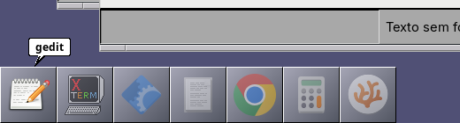
  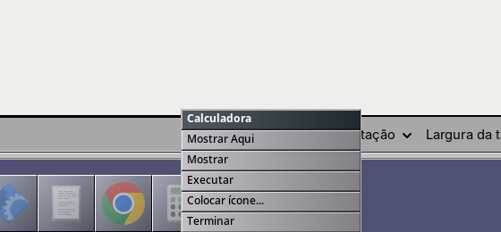
  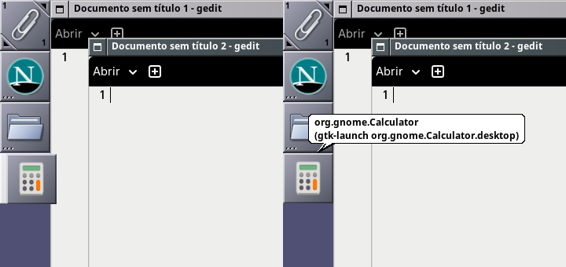
  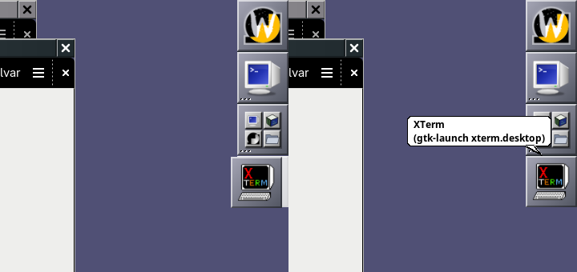
  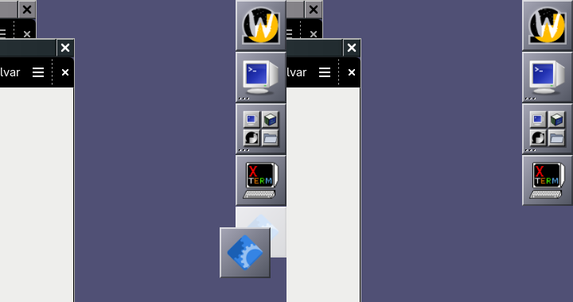
  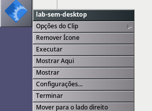
  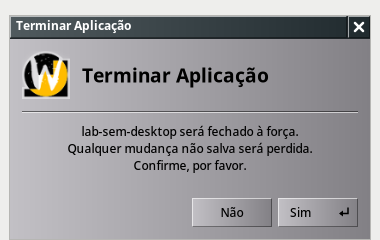
  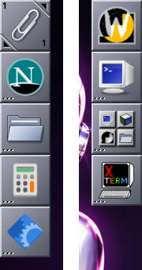
  

- X11 (wmaker deste ramo): aplicativo de instância única que fecha para a
  bandeja (`org.lab.Bandeja`, `.desktop` com StartupWMClass) e a
  Calculadora (GTK 4) acoplados no Clip → `WMState` com
  `Command = "gtk-launch org.lab.Bandeja.desktop"` e
  `"gtk-launch org.gnome.Calculator.desktop"` (antes da correção do líder
  GTK, a Calculadora ficava `"gnome-calculator"`). Janela fechada para a
  bandeja (`IsUnMapped`), duplo clique no ícone do Clip → `IsViewable`.
  **Controle**: o mesmo com o `/usr/bin/wmaker` instalado → continua
  `IsUnMapped`. Com o wmaker instalado, um script renomeado
  (`exec -a renamed-tts python3 sem-desktop.py`) era acoplado como
  `Command = "sem-desktop.py"` (o caso relatado).

  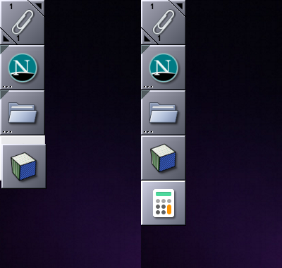
  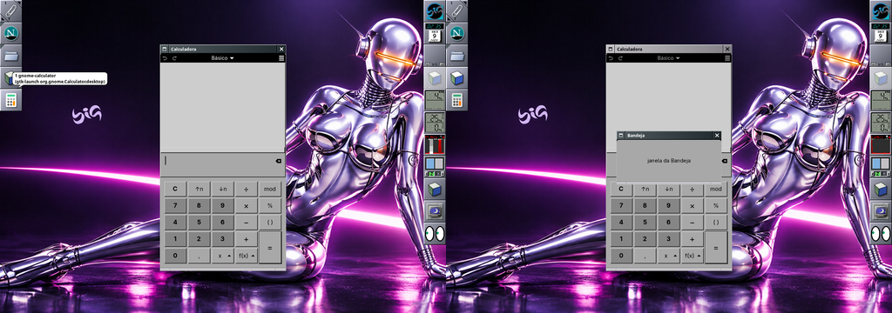

## Limitações e pendências

- Flatpak: há um instalado (AnyDesk), não aberto no laboratório (serviço de
  rede); o `.desktop` exportado em `/var/lib/flatpak/exports/share` entra na
  busca nos dois lados, mas não foi conferido com uma janela de verdade.
- Os appicons do Wayland ficam numa fileira (não se soltam em qualquer
  lugar da tela como no X11) e não há miniaturas de janelas minimizadas.
- O balão do lançador acoplado mostra o AppID (como os outros lançadores do
  wlmaker), não o nome do `.desktop`.
- No laboratório X11 um `xdotool mousedown` que cai na raiz começa a seleção
  por retângulo do Window Maker com o servidor agarrado e o próprio xdotool
  fica preso (artefato do teste sintético, não do código).
- Ícone PNG desenhado do tema na hora de publicar: trocar de tema não
  redesenha os lançadores já acoplados (como o cache de ícones do Window
  Maker).

## Rodada 2: posição livre no Dock e no Clip (lançadores e dockapps numa ordem só)

Ramo `feat/dock-free-placement-2026-11` em wlmaker e big-wm.

### Problema

No Wayland, ao arrastar um ícone (appicon de aplicativo aberto, lançador já
acoplado) para o Clip, só dava para encaixá-lo antes dos dockapps: não ia
para o fim, depois do `wmake-zones-wl`, nem entre dois dockapps. No Dock, a
inserção ficava limitada às posições acima do `big-wm-tray`. Os dockapps,
arrastados, também só iam para o meio dos outros dockapps.

### Causa

O wlmaker tratava cada coluna (Dock, Clip, gaveta) como **duas listas
separadas**: primeiro os lançadores (desenhados pelo `wlmdock`, numa
superfície contínua), depois os dockapps (ladrilhos do compositor, num
`wlmtk_dock` posto logo depois da superfície do `wlmdock`).
`wlmaker_tile_drag_snap()` (`src/tile_drag.c`) calculava o encaixe só dentro
da lista do tipo arrastado ("Launchers come right after the first tile;
dock-apps after them") e limitava o índice ao tamanho dela: para um lançador,
a última posição alcançável era logo depois do último lançador, isto é,
antes do primeiro dockapp — os dockapps eram uma barreira. A ordem gravada
também não tinha como dizer "este dockapp fica entre o 2º e o 3º lançador".

No X11 o Window Maker não tem esse limite: o Dock e o Clip são grades de
posições (`wDockSnapIcon` acha a posição livre mais próxima), qualquer ícone
vai para qualquer posição livre e pode haver buracos. Nenhum patch nosso
(`wmaker/src/dock.c`, `appcommand.c`) mexe no `wDockSnapIcon`: conferido no
laboratório X11 (xterm acoplado depois do `wmeyes`, Firefox levado do Clip
para depois do xterm, 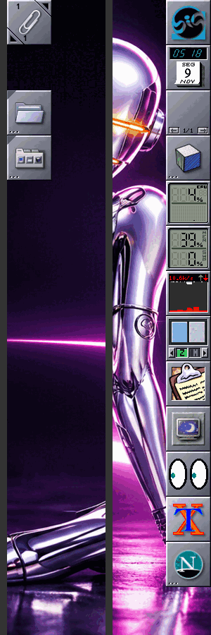).

### Política adotada

- **Uma ordem só por coluna** no Dock e no Clip, misturando lançadores e
  dockapps, como no Window Maker. Qualquer ícone vai para qualquer posição:
  no início (logo depois do quadrado principal / do Clip), entre dois ícones
  quaisquer, ou logo depois do último. Diferente do Window Maker, não há
  buracos: os ícones seguintes descem uma posição (ajuste automático), como
  já acontecia entre lançadores.
- **Persistência**: os lançadores continuam no `State.plist` (`Launchers`);
  cada dockapp guarda quantos lançadores ficam antes dele, em
  `Dockapps.plist`, chave nova `AfterLaunchers = { Order = {...}; Dock =
  {...}; }` (`Order` é o Clip, como a lista de ordem). Sem a chave (estados
  antigos), o dockapp fica depois de todos os lançadores: o layout antigo,
  sem migração. Lançadores inseridos, removidos ou movidos pelo wlmaker
  (arrastar, menus) mantêm cada dockapp depois dos mesmos lançadores.
  Edições externas do `State.plist` (outro programa) só limitam o número ao
  total de lançadores.
- **Tamanho físico**: uma coluna está cheia quando mais um ícone sairia da
  tela. Aí o ícone vindo de fora (outra coluna, appicon) é **recusado com
  indicação**: um balão "O Dock está cheio" / "O Clip está cheio" junto do
  último ícone, sem fantasma; soltar ali devolve o ícone para onde estava
  (antes, soltar fora de posição válida apagava um lançador). Mover dentro da
  mesma coluna sempre funciona. Window Maker também recusa com o Dock cheio
  (`icon_count >= max_icons`).
- **Gavetas**: continuam com os lançadores primeiro e os dockapps depois
  (como antes); a gaveta sai do Dock na posição do seu ladrilho.
- O fantasma (indicador de encaixe), o deslizar para o lugar, o Esc que
  cancela e o "kaboom" fora das docas continuam os mesmos.

### Como funciona (wlmaker)

| Arquivo | O que mudou |
|---|---|
| `src/dockapps.[ch]` | `AfterLaunchers` por dockapp (carregar, gravar, `launcher_inserted/removed`, `freeze_after`, `positions` = máscara das posições dos dockapps na coluna), aviso de mudança (`set_changed_callback`) |
| `src/clip.[ch]` | o `wlmtk_dock` dos dockapps do Dock passa a começar logo depois do quadrado principal, com espaçadores transparentes (que deixam o ponteiro passar) no lugar de cada lançador, como o Clip já fazia; `_wlmaker_clip_arrange` põe espaçadores e dockapps na ordem da coluna; `wlmaker_dock_column_t` ganhou `dockapp_positions`/`mixed` e funções de posição; publica o layout em `$XDG_RUNTIME_DIR/wlmaker-docks-<display>.plist` (`Gaps` para o `wlmdock`, `Positions` para outros clientes) e avisa o `wlmdock` (SIGUSR1); "Mover para cima/baixo" do dockapp passa também por lançadores |
| `src/wlmdock.c` | deixa ladrilhos transparentes (vãos) antes de cada lançador, quantos dockapps houver ali, lidos do arquivo de layout |
| `src/layer_panel.c` | índice do ladrilho do `wlmdock` → lançador, pulando os vãos; sobre um vão o ponteiro vai para o dockapp |
| `src/tile_drag.[ch]` | encaixe em qualquer posição (`position`, `launchers_before`, `dockapps_before`), coluna cheia (`full`, balão, soltar = cancelar), ao soltar um lançador os dockapps que estavam antes/depois do alvo ficam antes/depois dele |
| `src/drawer.c`, `src/dnd.c` | posição de um lançador pela ordem da coluna |
| `src/dock_launchers.c` | edições usam a lista gravada: lançadores que o `wlmdock` não mostra (ícone faltando no momento) não somem mais do `State.plist` ao arrastar outro (defeito D1 de `onboard-dock.md`) |
| `src/dock/launcher.c`, `src/dock/toplevel.c`, `src/toplevel_tracker.c` | ícone que não carrega vira ladrilho vazio (as contagens do compositor e do `wlmdock` não se desencontram); AppID comparado sem diferenciar maiúsculas (D2) |
| big-wm `session/bin/big-wm-tray` | a bandeja adotada acha a própria posição (para menus e balões) no arquivo de layout do wlmaker |

### Testes

Unitários (wlmaker, `ctest` 28/28 sem o teste de metainfo, que depende da
rede): novos `tile_drag.snap_mixed` (cada posição da coluna, inserir no
início/meio/entre dois/depois do último, mover dentro, coluna cheia,
gaveta), `dockapps.after_launchers` (posições, ajuste ao inserir/remover
lançador, mover, congelar, gravar e reler) e `dock_launchers.stored_index`.

Laboratório Wayland (`mklab.sh dock`, wlmaker/wlmdock deste ramo,
`big-wm-tray` e `big-wm-dockapps` deste ramo, `big-wm-appicons` instalado;
1280×900; ponteiro pelo xdotool):

1. Firefox (lançador do Clip) para o fim do Dock, depois do `wlmeyes`
   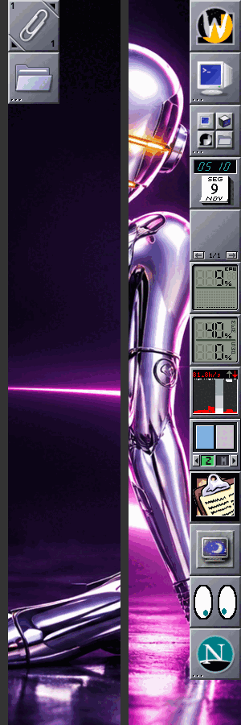
2. `wlmeyes` (dockapp, Alt+arrastar) do fim do Dock para o início do Clip,
   antes do Thunar 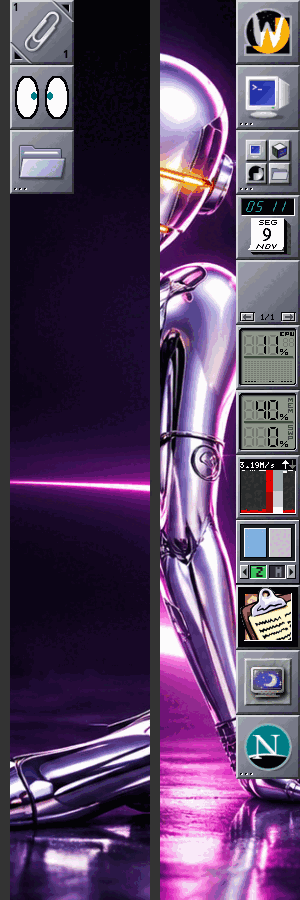
3. Thunar do Clip para o Dock, entre `wmake-zones-wl` e `wmcliphist`
   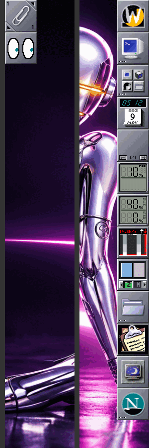
4. Appicon da Calculadora (GTK 4, Wayland) para o fim do Clip, depois do
   `wlmeyes` (o caso relatado); fantasma no lugar
   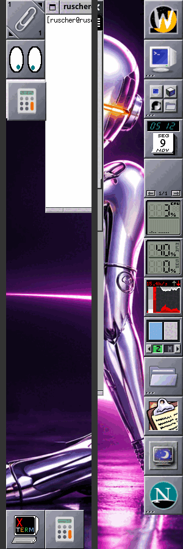
5. Appicon do XTerm (XWayland) para o Dock entre `big-wm-tray` e
   `wmcpuload` 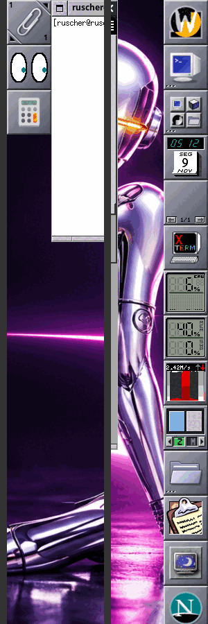
6. Menu do lançador com vãos (Firefox) e menu do dockapp sobre um vão do
   `wlmdock` (`wmclock`): cada clique chega a quem está ali.
7. Reinício do wlmaker com o mesmo HOME: `State.plist` e `Dockapps.plist`
   iguais, layout igual 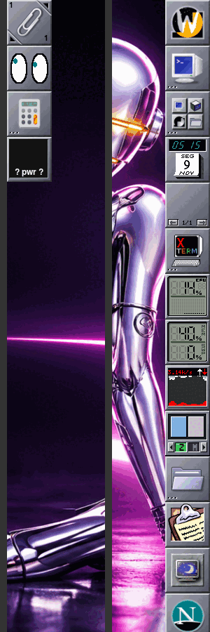
   (o `wlmbattery` que aparece no Clip veio do `big-wm-dockapps`, que inicia
   os dockapps da lista `Order`; ver Limitações).
8. Dock cheio: lançador do Clip arrastado para o Dock → balão "O Dock está
   cheio", solto → volta ao Clip, `State.plist` inalterado
   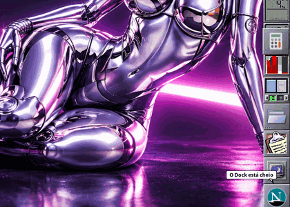
9. Esc durante o arraste (Firefox para o topo do Dock): fantasma some, nada
   muda 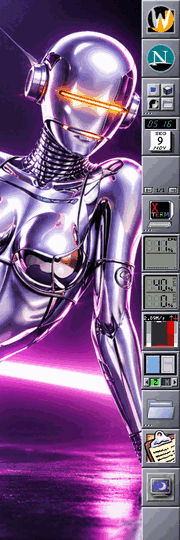; depois o
   mesmo arraste solto: Firefox no topo, os outros descem.
10. "Mover para baixo" no `wlmeyes`: passa para depois da Calculadora
    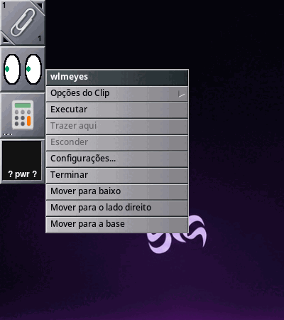
    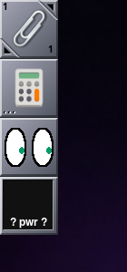

X11 (Window Maker instalado): conferido que já permite qualquer posição livre
(imagem acima).

### Limitações e próximos passos

- Gavetas mantêm as duas seções (lançadores, depois dockapps).
- Dockapps sem nome (processo sem nome) não guardam posição: vão para depois
  dos lançadores.
- Um dockapp que inicia sozinho (sessão) ou um lançador incluído pelo menu
  ainda podem passar do fim da tela; a recusa vale para o arrastar.
- Mudanças nos lançadores feitas por outro programa direto no `State.plist`
  não reposicionam os dockapps (só o limite ao total).
- O `big-wm-dockapps` inicia os dockapps listados em `Order` que estão no
  catálogo; o wlmaker grava em `Order` também os nomes do `Clip.Dockapps`
  padrão (comportamento anterior): no laboratório isso iniciou o
  `wlmbattery`. Fora do escopo desta rodada.
- O `wlmdock` só lê o arquivo de layout pelo `WAYLAND_DISPLAY`; iniciado com
  outro valor que o do wlmaker, desenha os lançadores juntos (como antes).
