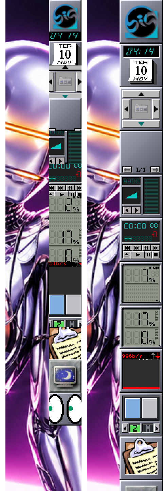

# 04 — Dockapps no X11

## Sintoma

Todos os dockapps do Dock real cortados: relógio, CPU, memória, rede,
mixer, música, bandeja e o controlador do Dock com Abas (as setas pela
metade), sem o ladrilho do tema atrás, ladrilhos de 48 px.

## Causa (comprovada)

`IconSize = 48` em `~/GNUstep/Defaults/WindowMaker` (gravado pelo WPrefs em
07/11; nenhum programa do Big WindowMaker grava essa chave). Os dockapps
desenham uma janela fixa de 64×64 e o Window Maker não redimensiona janelas
de terceiros: com ladrilho de 48 sobra recortar 8 px de cada lado.

Prova controlada: a mesma sessão (`startbigwm` num Xvfb, HOME descartável),
mudando só o `IconSize`:

## Correção

Escolha do usuário: voltar a 64 (backup feito, `wdwrite WindowMaker IconSize
64`; o Window Maker só lê essa chave ao iniciar). Na sessão real, depois do
reinício: todos os dockapps inteiros e nítidos, com o ladrilho do tema.
O `big-wm-doctor` avisa um `IconSize` abaixo de 64.

## Outros

- Dockapps no Dock com `AutoLaunch = No` (wmfsm, wmgtemp, wmglobe, wmcube
  na lista `Applications` usada na tela de 1080) aparecem como o cubo
  padrão do Window Maker: é o ícone de um aplicativo do Dock que não está
  rodando. Configuração do usuário (por altura de tela); não mudada.
- O wmnet fica vazio por alguns segundos depois de reiniciar o Window Maker
  (redesenha no próprio relógio). Cosmético.
