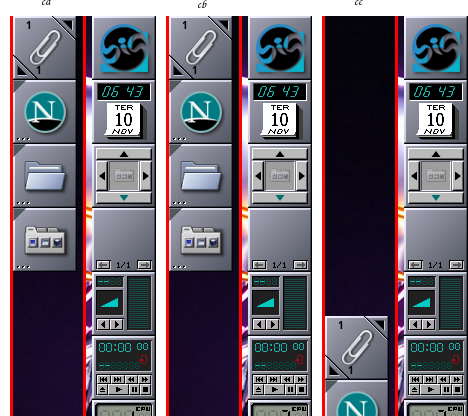
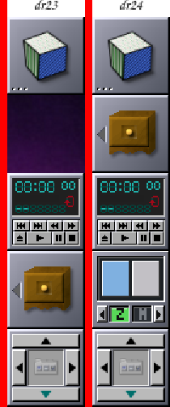

# 06 — Dock, Clip e gavetas

Depois do reinício das 06:35 a tela passou a 1920×1080 (um monitor só).
Dois defeitos do Window Maker apareceram na sessão real:

## O Clip sobre o primeiro ícone do Dock

- O Clip estava salvo em `6880,0` (o canto do terceiro monitor). Fora da
  tela, o `wScreenKeepInside()` o empurrava para a borda mais próxima — onde
  fica o Dock: o Clip cobria o logo do Dock (o menu do Dock, arrastar a
  coluna) e o reinício seguinte o gravava ali, já dentro da tela.
- Correção (patch 0028 do Window Maker, `src/dock.c`): um Clip restaurado
  sobre o primeiro ícone do Dock vai para o alto do outro lado do monitor
  do Dock, onde fica por padrão.

## A gaveta sobre um dockapp

- O Dock tem uma lista por altura de tela (`Applications`,
  `Applications1440`), mas as gavetas têm uma posição só: na tela de 1080 a
  gaveta voltou para a vaga 12, a do wmake-zones, e o cobriu. O próprio
  código do upstream pedia "algo mais inteligente" ali.
- Correção (patch 0029): uma gaveta restaurada numa vaga ocupada vai para a
  vaga livre mais próxima (abaixo primeiro).

Verificado no laboratório (com uma cópia do WMState real) e na sessão real
depois de instalar o Window Maker 24.
