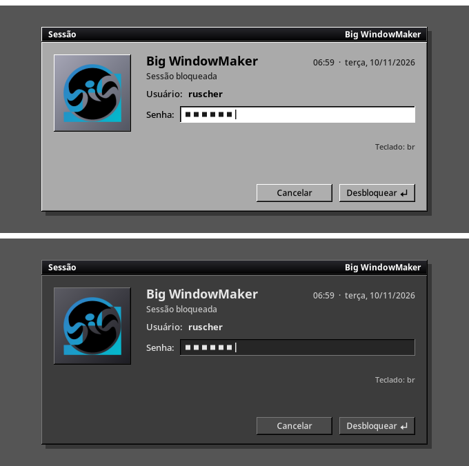
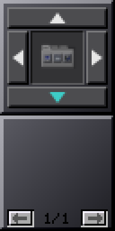

# 07 — Modo escuro no X11

## O que estava salvo e o que estava carregado

| Camada | Salvo | Efetivo |
|---|---|---|
| modo (`~/.config/big-wm/theme`) | dark | — |
| XSETTINGS (GTK) | OneStepBack-Dark | OneStepBack-Dark |
| gsettings color-scheme / gtk-theme | prefer-dark / OneStepBack-Dark | idem |
| Kvantum | QTStepOpenStepDark | idem |
| ícones | bigicons-papient-dark | idem |
| **Window Maker** | — | **o estilo claro** (menus, molduras sem foco, ladrilhos claros) |
| tela de bloqueio | — | **sempre o painel cinza** |

## Window Maker preso no estilo claro

- **Causa:** o WPrefs, ao salvar, tira do arquivo do usuário toda chave
  igual à do `/etc/WindowMaker/WindowMaker` (`WPrefs.c`, "remove redundant
  data"). O `IconBack` do estilo claro é igual ao global e sumiu (ao mudar o
  `IconSize`, 07/11). O `big-wm-wmstyle` comparava só o arquivo do usuário:
  faltando o `IconBack`, achava "custom" e o `big-wm-theme` nunca mais
  trocava o estilo do Window Maker.
- **Correção:** `session/lib/big-wm-wmstyle` compara o valor efetivo — o
  global (`BIGWM_WM_GLOBAL`, `/etc/WindowMaker`) com o do usuário por cima,
  como o Window Maker lê.
- **Verificação:** o arquivo real passou de "custom" a "light"; o
  `big-wm-theme apply` aplicou o `BigWindowMaker-Dark` (título 2e/00, menus
  4a/2e) e manteve o `IconSize`. Teste novo no `tests/run.sh` com um arquivo
  "salvo pelo WPrefs".

## Tela de bloqueio

Sempre o painel cinza do OPENSTEP, também no modo escuro. Agora o
`big-wm-lockscreen` tem uma paleta clara (a de sempre: a prévia do binário
novo e do antigo têm 0 pixels diferentes) e uma escura, com as cores do
`BigWindowMaker-Dark`. O teclado na tela segue o modo quando
`KeyboardTheme` não é escolhido.

## Dockapps próprios

O controlador do Dock com Abas e a bandeja seguem o modo:

Os dockapps clássicos de terceiros (wmcpuload, wmmemload...) não têm modo
escuro: são desenhos fixos, como no Window Maker original.

## Não resolvido

- **Apps KDE (Kate) no laboratório:** barras e moldura escuras, áreas de
  conteúdo brancas. A paleta do Kvantum escuro é escura (`base.color
  #2e2e2e`); a hipótese de que vinham do `kdeglobals` foi testada (um
  `kdeglobals` escuro por `XDG_CONFIG_DIRS`) e não se confirmou. Na conta
  real, o `~/.config/kdeglobals` fixa `BigAdwaitaRoundDark` (escuro sempre,
  também no modo claro). Mexer no `kdeglobals` do usuário mudaria também uma
  sessão Plasma; não foi feito.
- **gedit:** barras escuras, área de texto clara (o esquema de cores do
  editor; o gedit 50 tem `style-scheme-for-dark-theme-variant = oblivion`,
  mas não o usa aqui). A hipótese de faltar
  `gtk-application-prefer-dark-theme` foi testada e não se confirmou.
