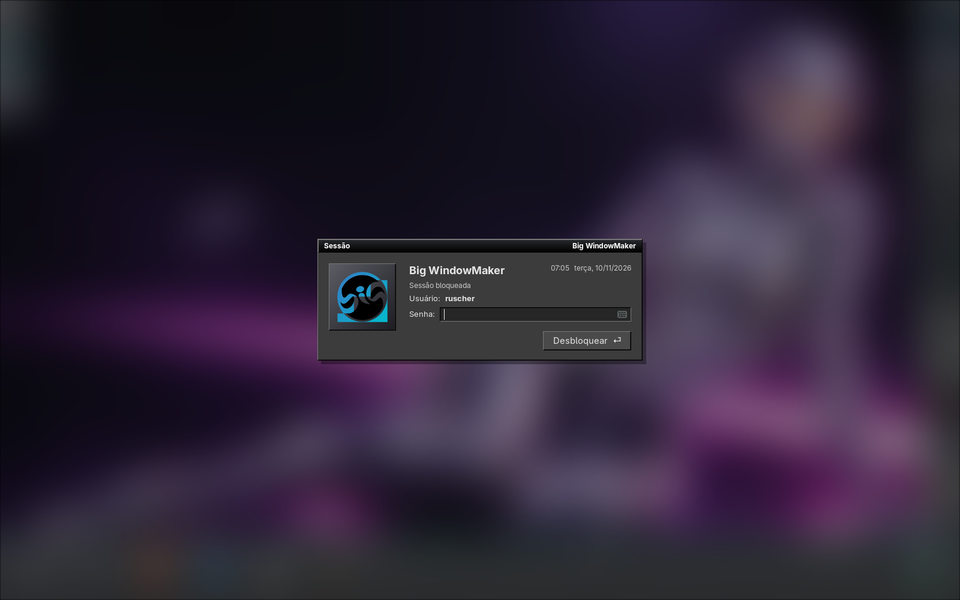

# 08 — Modo escuro no Wayland

Laboratório aninhado (wlmaker 31), `big-wm-theme dark` antes de iniciar.

- wlmaker: Dock, Clip e ladrilhos escuros; controlador e bandeja escuros;
  Dock com Abas escuro.
- GTK 3: com o ambiente da sessão (`big-wm-env.sh`, `GTK_THEME=BigWindowMaker`
  → OneStepBack-Dark), barras escuras; o gedit com a área de texto clara, como
  no X11 (ver [07](07-tema-escuro-x11.md)). Sem o `big-wm-env.sh` (um
  programa iniciado fora da sessão) o GTK fica no Adwaita claro — é o
  esperado: na sessão real o ambiente vem do `startbigwm-wayland`.
- Tela de bloqueio (gtklock): agora escura no modo escuro
  (`gtklock-dark.css` por cima do `gtklock.css`, juntados pelo `big-wm-lock`).

Observação do laboratório: matar o gtklock sem desbloquear mantém o
compositor bloqueado (`ext-session-lock`) — o comportamento seguro.

**Não testado numa sessão Wayland real.**
