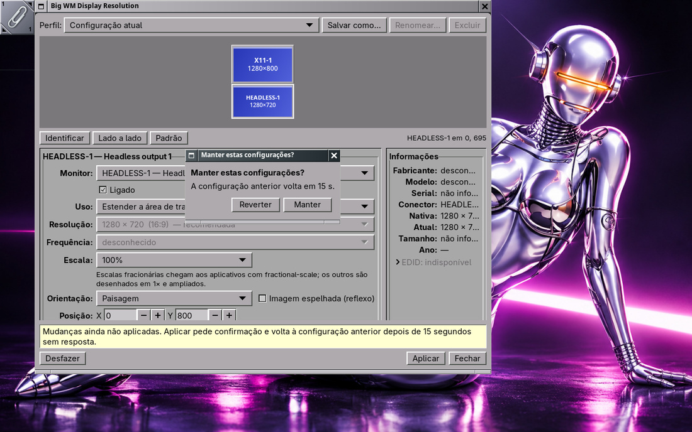
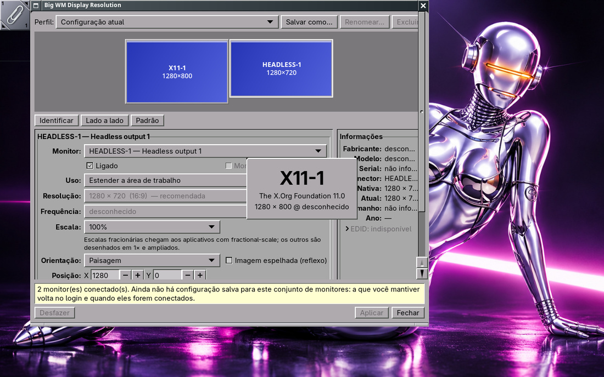
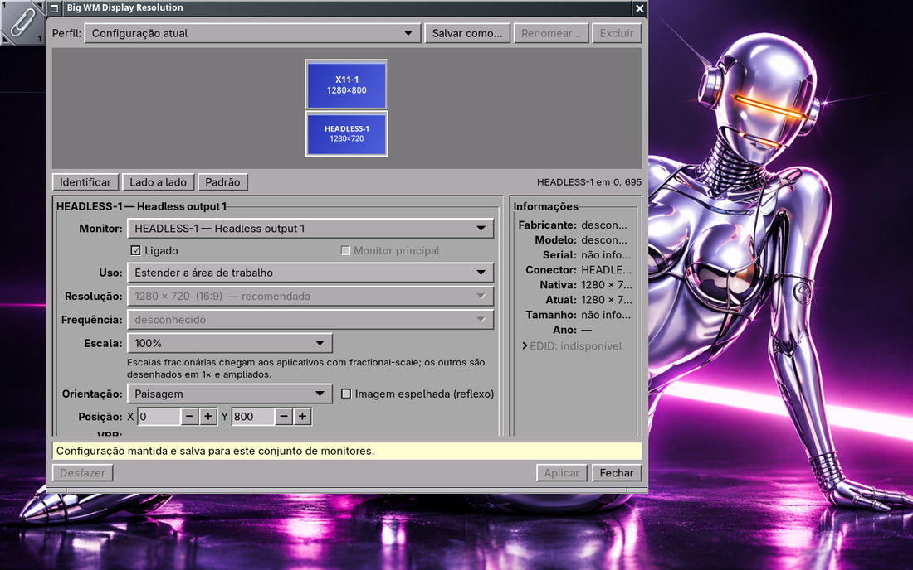
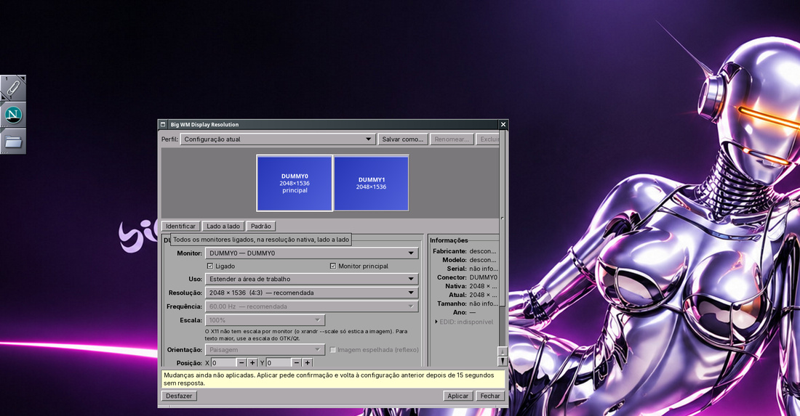
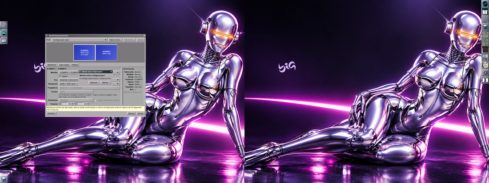
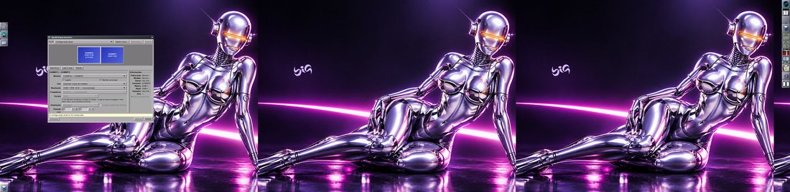

# Big WM Display Resolution — monitores nas duas sessões

Configurações > Monitores abre o **Big WM Display Resolution**
(`big-wm-display-resolution`) no X11 (Window Maker) e no Wayland (wlmaker),
no lugar do ARandR e do wdisplays (que continuam instalados como
alternativa). Visual OPENSTEP (cinzas, relevos de 1 pixel, controles
compactos, como o `big-wm-about` e o `big-wm-welcome`); organização como nas
configurações de tela do KDE Plasma.


## Problema

- No X11 o ARandR só gravava um script em `~/.screenlayout`;
  `big-wm-monitors` o executava no login, casando pelas **saídas**
  (conectores), sem confirmação e sem reversão.
- No Wayland o wdisplays aplica sem confirmar nada; nada guardava o layout
  por conjunto de monitores; o wlmaker só lembra o estado por saída
  (`OutputState.plist`), e só se o usuário usar "Salvar estado dos
  monitores".
- No wlmaker, um monitor **desligado** pelo `wlr-output-management` sumia
  para os clientes (não dava para religar), um monitor marcado como
  desligado no `OutputState.plist` era destruído ao conectar, e um monitor
  conectado depois do login ficava apagado.

## Arquitetura

Repositório e pacote próprios: `big-wm-display-resolution`
(`/home/ruscher/Documentos/Git/big-windowmaker/big-wm-display-resolution`,
branch `main`, sem remoto ainda). Python 3 + GTK 3 (PyGObject), como os
outros aplicativos do big-wm, mais um auxiliar em C pequeno:

| Parte | Arquivo | Papel |
|---|---|---|
| Modelo | `bigwmdisplay/model.py` | modos, saídas, identidade, validação, encaixe, layout padrão |
| EDID | `bigwmdisplay/edid.py` | fabricante/modelo/serial com as regras da libdisplay-info (as do wlroots), tamanho, nativa, HDR (bloco CTA), faixa de VRR, FreeSync |
| Perfis | `bigwmdisplay/store.py` | `profiles.json` versionado, gravação atômica, backup, casamento pelo conjunto de monitores |
| X11 | `bigwmdisplay/backend_x11.py` | `xrandr --verbose` (modos com id, EDID, rotações aceitas, `vrr_capable`) e uma única chamada `xrandr` para aplicar; `--dryrun` para testar |
| Wayland | `bigwmdisplay/backend_wl.py` + `helper/big-wm-display-helper.c` | `wlr-output-management-unstable-v1` (v4): estado, `test`, `apply`; EDID do sysfs do DRM pelo nome do conector |
| Vigia da reversão | `bigwmdisplay/guard.py` | processo separado que reverte sem confirmação |
| Migração | `bigwmdisplay/migrate.py` | scripts do ARandR e `OutputState.plist`, lidos como texto |
| Linha de comando | `bigwmdisplay/cli.py` | `--restore`, `--hotplug`, `--watch`, `--show`, `--profiles`, `--apply-profile` |
| Janela | `bigwmdisplay/ui.py` | GTK 3, área dos monitores desenhada com cairo |

Por que um auxiliar em C: o `python-pywayland` não está instalado nas
máquinas (existe no extra, mas seria uma dependência a mais só para isto) e
o vigia de hotplug precisa ficar residente com o mínimo de memória. O
`big-wm-display-helper` (≈3 MB de RSS) faz `wl-dump`, `wl-apply [--test]`,
`wl-watch` e `x11-watch`; tudo o mais (regras, perfis, interface) é Python.

### Identidade do monitor

Fabricante + modelo + serial do EDID, **não o conector**. No Wayland vem
do wlroots (`make`/`model`/`serial`); no X11 o mesmo texto é calculado do
EDID com as regras da libdisplay-info (nome PNP do `hwdata`, descritor de
nome ou `0x%04X`, descritor de serial ou `0x%08X`). Conferido nos três
monitores reais desta máquina, lendo só o EDID do sysfs: o resultado é
idêntico ao `OutputState.plist` do wlmaker (`LG Electronics`,
`LG ULTRAWIDE`, `306AZBZ48517`...). Assim um perfil acompanha o monitor
quando o cabo troca de porta. Dois monitores iguais sem serial distinguem-se
pelo conector; saídas virtuais (aninhado, headless, dummy) usam o conector.

## Controles (e o que é honesto em cada sessão)

| Controle | X11 | Wayland |
|---|---|---|
| Posição: arrastar com encaixe nas bordas e alinhamentos (guias), X/Y exatos, setas (1 px, Shift 10) | ✅ | ✅ |
| Resolução e frequência: só os modos anunciados, a nativa marcada "recomendada" | ✅ (id do modo do RandR) | ✅ (modos do `wlr-output-management`) |
| Escala | ❌ explicado: o `xrandr --scale` só estica a imagem; use a escala do GTK/Qt | ✅ 100–300 % (fracionária para clientes com `fractional-scale`); o wlmaker não aceita menos de 1 |
| Orientação (paisagem, retrato, invertidos) e reflexo | ✅ o que o driver anuncia | ✅ as 8 do `wl_output_transform` |
| Ligar/desligar | ✅ | ✅ (com a correção do wlmaker abaixo) |
| Espelhar/estender | ✅ `--same-as`, exige a mesma resolução | ✅ mesma posição e mesmo tamanho lógico (o wlmaker mostra a mesma área nas duas saídas) |
| Monitor principal | ✅ `--primary` | ❌ explicado: o wlmaker não tem principal configurável (o primeiro da disposição fica com o Dock) |
| VRR | só informação: `vrr_capable` do driver e a faixa do EDID; no X11 o VRR é `Option "VariableRefresh"` do driver | controle só quando o compositor **aceita** a troca num `test` do protocolo (v4, `set_adaptive_sync`); senão o estado aparece fixo, com o motivo |
| HDR | o EDID diz se o monitor declara HDR (PQ/HLG); o X11 não tem saída HDR | idem; o wlmaker não liga HDR e o protocolo de saídas não tem ajuste de HDR: sem controle |
| Informações | fabricante, modelo, serial, conector, nativa, atual, tamanho (mm e polegadas), ano, EDID em hexadecimal | idem |
| Identificar | janela no centro de cada monitor | `gtk-layer-shell` na saída certa |

Validação antes de aplicar: um monitor ligado no mínimo, modos
anunciados, sem sobreposição, sem vão (os monitores precisam se encostar),
espelho com o mesmo tamanho, sem posições negativas, tamanho máximo da tela
do X, um só principal. Depois, o teste do próprio backend (`xrandr
--dryrun`, `test` do protocolo).

## Aplicação segura (15 s, mesmo com a janela travada)

1. A janela valida e testa.
2. Inicia o **vigia** `big-wm-display-resolution --guard ARQUIVO`, em outra
   sessão de processo (`start_new_session`), com a configuração **anterior**
   no arquivo (em `$XDG_RUNTIME_DIR`). O vigia grava `apply.lock` e responde
   "ready".
3. Só então a janela aplica a nova configuração e pergunta "Manter estas
   configurações?" com contagem de 15 s.
4. Pela entrada padrão do vigia: `keep` (Manter) → ele sai sem mexer;
   `revert` (Reverter ou fim da contagem) → ele reverte. **Sem resposta em
   18 s** (janela travada) ou com a entrada fechada (janela morreu), o vigia
   reverte sozinho. Ele não usa GTK nem a janela, só o backend.
5. Mantido: o estado lido de volta vira o perfil automático do conjunto
   (ou o perfil escolhido passa a ser o do conjunto).

Enquanto o vigia vive, o hotplug não aplica perfis (não briga com uma
confirmação em andamento).



## Persistência

`~/.config/big-wm/display-resolution/profiles.json` (modo 600):

```json
{
  "format": "big-wm-display-resolution",
  "version": 1,
  "profiles": [
    {
      "id": "…", "name": "", "kind": "auto", "session": "wayland",
      "setkey": "lg electronics|lg ultrawide|306azbz48517\n…",
      "outputs": [
        {"identity": {"make": "LG Electronics", "model": "LG ULTRAWIDE", "serial": "306AZBZ48517"},
         "key": "lg electronics|lg ultrawide|306azbz48517", "connector": "HDMI-A-1",
         "enabled": true, "mode": {"width": 3440, "height": 1440, "refresh_mhz": 49953},
         "position": [0, 0], "scale": 1.0, "transform": "normal",
         "primary": false, "mirror_of": null, "vrr": null}
      ],
      "created": 0, "updated": 0
    }
  ],
  "last_applied": {"wayland\n<setkey>": "<id>"},
  "migrated": {}
}
```

- Gravação atômica: arquivo temporário, `fsync`, `rename`, `fsync` do
  diretório. Antes de gravar, a versão atual — se for válida — vira
  `profiles.json.bak` (a última configuração boa). Se `profiles.json`
  quebrar, vale o `.bak`. Versão maior que a conhecida não é lida.
- Perfis: **automático** (um por sessão e conjunto, gravado ao Manter),
  **Padrão** (calculado: todos ligados, nativos, lado a lado, eDP primeiro)
  e **personalizados** (Salvar como, Renomear, Excluir; escolher um na
  lista mostra-o na área e Aplicar o aplica com a confirmação).
- Casamento: só o perfil cujo **conjunto inteiro** de identidades é igual ao
  conectado. Um perfil de 3 monitores nunca vale com 1 conectado; um modo
  que o monitor não anuncia mais invalida o perfil. Ordem: o último
  aplicado para o conjunto, o automático, o personalizado mais novo.
- Sessões separadas: X11 e Wayland têm perfis automáticos próprios
  (escala e frequências diferem); um personalizado da outra sessão aparece
  com "(X11)"/"(Wayland)" e passa pela validação.

## Login e hotplug (sem serviço residente desnecessário)

- **X11**: `startbigwm` já chamava `big-wm-monitors --restore` antes do
  Window Maker; agora `big-wm-monitors` passa para
  `big-wm-display-resolution --restore` quando ele está instalado (o caminho
  antigo do ARandR continua para quando não está).
- **As duas sessões**: `/etc/xdg/autostart/big-wm-display-resolution-watch.desktop`
  (`OnlyShowIn=WindowMaker;wlmaker;`, iniciado pelo `big-wm-session.target`)
  roda `big-wm-display-resolution --watch`, que **troca o processo Python
  pelo auxiliar em C** (`exec`): ele aplica o perfil do conjunto ao iniciar
  (no Wayland é a restauração do login) e depois fica bloqueado no `poll()`
  esperando eventos — `RROutputChangeNotify` do XRandR ou `head`/`done`/
  `finished` do `wlr-output-management` — sem polling. Quando o conjunto
  (nome+fabricante+modelo+serial / conector+EDID) muda, espera 0,8 s e roda
  `big-wm-display-resolution --hotplug` (processo curto).
- Hotplug sem perfil: no X11 os monitores ligados ficam e os novos (ou um
  que o X deixou sobreposto) entram à direita no modo nativo; no Wayland
  nada é feito (o wlmaker liga o monitor novo e o põe ao lado).

## Migração (sem executar nada)

- **ARandR**: `~/.screenlayout/*.sh` (o escolhido em `~/.config/big-wm/monitors`
  primeiro) são lidos como texto. Só linhas `xrandr` com opções conhecidas;
  `;`, `|`, `` ` ``, `$(...)`, outros comandos → o script é recusado e
  registrado no journal. Os conectores viram identidades pelos monitores
  conectados **agora**, e só se todos que o script liga estão conectados
  (senão espera o conjunto aparecer). Cada script vira o perfil "ARandR:
  nome"; o escolhido (ou o mais novo válido) vira também o automático do
  conjunto. Feito no `--restore` e ao abrir a janela.
- **wlmaker**: `~/.config/wlmaker/OutputState.plist` (leitor do formato de
  texto do GNUstep) vira o automático do conjunto no Wayland, se todos os
  monitores conectados têm entrada nele e ainda não há automático.

## Correções no wlmaker

Branch `feat/output-management-disabled` (worktree
`~/.cache/bwm-wt/display/wlmaker`, base `big-wm/missao-2026-11`), commit
`64ad73b` "Output management: disabled outputs stay listed and can be
enabled again":

- O gerenciador de saídas lista **todas** as saídas do backend (antes, só
  as do layout): desligar deixava o monitor sem volta pelos clientes.
- Saída religada: a saída da cena volta a acompanhar a nova saída do layout
  (remover do layout tinha desfeito a ligação) ou é criada.
- `Enabled = False` no `OutputState.plist`: a saída é criada desligada (e
  listada), em vez de destruída.
- Saídas desconectadas saem da lista do backend (ficavam penduradas).
- Saída descoberta depois do início: ligada, no modo aceso ou no preferido
  (antes a configuração era copiada do estado "sem CRTC" = desligada).
- Saída sem modos (aninhada/headless) ao ser religada: o head é recriado,
  contornando um `assert` do wlroots 0.20 (`head_send_state: found`) que
  derrubava o compositor quando um cliente conectado com a saída desligada
  recebia o estado. Reproduzido no laboratório e confirmado com gdb.
- Teste: `backend_test` → `disabled_output` (backend headless: desligar,
  continuar listada, religar na posição pedida com a saída da cena junto,
  criar desligada pelo estado, desconectar).

## Testes feitos

- **Unitários** (`make check` no repositório do app): 62 testes —
  EDID (identidade, HDR, inválidos), identidade/conjunto, validação
  (sobreposição, vão, modos, escala, espelho, rotação, tamanho do X),
  encaixe, perfis (formato, permissões, backup e uso do `.bak`, versão
  futura, conector trocado, conjunto diferente nunca casa, modo não
  anunciado, sessões, renomear/excluir), parser do `xrandr --verbose`
  (EDID, rotações/reflexos, modos entrelaçados, Xvfb), argumentos do
  xrandr, ARandR (scripts maliciosos recusados e **não executados**),
  `OutputState.plist`, vigia (manter, reverter, **janela travada** → reverte
  no prazo, **janela morta com SIGKILL** → reverte na hora), restauração,
  hotplug (conjunto diferente, trava da confirmação, extensão no X11, falha).
- **big-wm** `tests/run.sh`: menus, hashes dos menus antigos, migração da
  linha Monitores em menu editado (só com o programa instalado), delegação
  do `big-wm-monitors`, shellcheck, desktop-file-validate — tudo passando.
- **wlmaker**: `ctest` 29/29 (o `wlmaker_test` às vezes trava esperando um
  `cat` filho — subprocesso do libbase, anterior a esta mudança; repetido
  passa).
- **Laboratório Wayland** (wlmaker deste worktree aninhado, backends
  `x11,headless`: uma saída X11 com entrada e uma headless):
  arrastar com encaixe → Aplicar → pergunta → Manter → perfil gravado;
  sem resposta → reverteu em 18 s; janela parada com `SIGSTOP` → o vigia
  reverteu 16 s depois; wlmaker reiniciado → o vigia do autostart aplicou o
  perfil; desligar/religar com outro cliente conectado sem derrubar o
  compositor; Identificar com layer-shell.
  
  
- **Laboratório X11**: Xorg **sem root** com o driver dummy
  (`tests/lab/xdummy.sh`; 16 saídas `DUMMYn` com modos reais, sem tocar no
  hardware), Window Maker por cima. Script do ARandR migrado e aplicado no
  `--restore` (também pelo `big-wm-monitors` do worktree); Padrão →
  Aplicar → Manter (2048×1536 nos dois); janela com `SIGSTOP` → revertido
  17 s depois; hotplug: com o vigia rodando, "conectar" `DUMMY2`/`DUMMY3`
  → evento do XRandR → monitores novos à direita.
  
  
  
- **Medidas** (laboratório): abertura da janela 0,52 s no X11 e ≈0,3 s no
  Wayland; RSS da janela 73–76 MB (GTK 3 + Python, como o welcome); vigia
  de hotplug residente ≈3 MB (C); vigia da reversão só existe durante os
  15 s.

## Limitações e o que precisa de hardware real

- **HDR**: só detecção pelo EDID; nenhuma sessão liga HDR. Validar a
  leitura com monitores HDR diferentes.
- **VRR**: o controle no Wayland depende do `test` do compositor; validar
  num monitor FreeSync/G-Sync com DRM (no laboratório as saídas virtuais
  recusam a troca). No X11 é opção do driver.
- **Hotplug físico**: os eventos foram testados com o dummy (X11) e com o
  protocolo (Wayland), não com cabos. No dummy o estado "conectado" só muda
  quando alguém sonda (`xrandr`); num driver real o kernel avisa o Xorg.
  No wlmaker com DRM, conferir que o monitor conectado depois do login
  acende (correção acima) e que o perfil é aplicado.
- **Modos de DRM** (resoluções/frequências de verdade no Wayland): o
  laboratório só tem saídas virtuais com um modo; o caminho `set_mode` foi
  exercitado com elas.
- Laboratório Wayland com duas saídas X11: o wlmaker mapeia o ponteiro
  absoluto do backend x11 para o layout inteiro (cliques deslocados);
  por isso o laboratório usa uma saída X11 + uma headless.
- Monitor principal no Wayland não existe no wlmaker (precisaria de um
  protocolo ou configuração própria).
- Escala menor que 100 % não é aceita pelo wlmaker.

## Próximos passos

- Publicar o repositório `big-wm-display-resolution` e o pacote antes do
  `big-wm-session` que depende dele.
- Validar com os monitores reais (fora do laboratório) e com hotplug físico.
- No wlmaker, levar a correção do `assert` do wlroots (o envio do modo
  virtual por cliente) ao upstream do wlroots.
