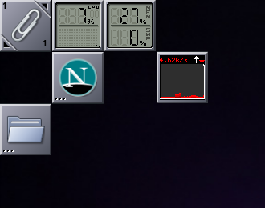
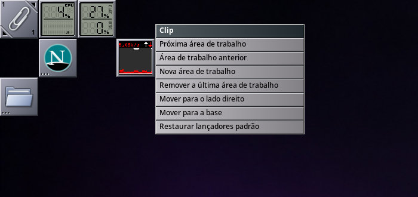

# Clip em grade — validação em VM (libvirt / virt-manager)

Data: 2026-11-23. Host: Manjaro, libvirt `qemu:///system`.

## VM

| Item | Valor |
|---|---|
| Domínio | `bwm-clip-grade` (novo; nenhuma VM existente tocada) |
| Mídia | ISO r57 `big-windowmaker_TESTING_2026-11-21_k618.iso` (sha256 `20061e70…`, conferido) |
| Hardware | 4 GB, 4 vCPU host-passthrough, virtio-gpu, disco virtio 40 GB, tablet USB, canal do qemu-guest-agent |
| Pacote testado | `wlmaker 1:0.8.r96.g5576886-8` (0174–0178), `check()` 30/30 |
| Entrada | `uptr` (dispositivo **uinput**: kernel → libinput → wlmaker, como um mouse real) e `virsh send-key` (teclado) |
| Captura | `virsh screenshot` (framebuffer da VM) |

## Resultados

| Etapa | Resultado |
|---|---|
| Live X11 (Window Maker da ISO), referência | **verificado**: `wmcpuload` em (1,0), `wmmemload` (2,0), `wmnet` na diagonal (3,1) |
| Live Wayland com `-8` | **verificado**: os mesmos gestos → (1,0), (2,0), (3,1), mesmo resultado do X11 (log "Dock-app … to the Clip's cell") |
| Reinício da sessão Wayland no live (wdm) | **verificado**: `Dockapps.plist` idêntico; dockapps reiniciados pelo `big-wm-dockapps` voltam às células |
| Instalação pelo Calamares (apagar disco, usuário `ruscher`) | **verificado**: "completion: succeeded"; `-8` instalado no alvo; `sshd` habilitado |
| 1º boot do instalado | **verificado**: sem unidades falhas; login Wayland pelo wdm |
| Grade no instalado: dockapps (1,0) (2,0), lançador (1,1), buraco em (0,1) | **verificado** |
| D24: reiniciar a VM e entrar de novo | **verificado**: mesmas células gravadas, mesma tela |

## Máquina real (OptiPlex 760: Core 2 Duo E8400, 3,7 GB, Intel G41/Gen4)

Reinstalada do zero pela ISO r57: `sda2` virou a partição live (btrfs
`BIG_WINDOWMAKER_LIVE`, conteúdo da ISO, entrada única no GRUB), Calamares
em "Substituir uma partição" sobre `sda1`, usuário `ruscher`/`123`;
"completion: succeeded"; Calamares habilitou `big-wm-intel-gen4` e
`big-wm-grub-resolucao` (ambos `Result=success`); Xorg com SNA (Eaglelake),
0 GPU hang. `-8` e `sshd` instalados no alvo antes do 1º boot. Entrada por
**uinput** (`uptr`: ponteiro absoluto, botões e teclas, via kernel e
libinput); capturas com `grim`.

| Caso | Resultado |
|---|---|
| D01/D03/D04: `wmcpuload` (1,0), `wmmemload` (2,0), `wmnet` diagonal (3,1) | **verificado** |
| D02/D07: lançador Netscape (1,1), buraco em (0,1) | **verificado** |
| D15/D14: pasta sobre `wmcpuload` | recusado, nada removido (**verificado**) |
| D13: Esc no meio do arraste | cancelado (**verificado**) |
| D21: menu do Clip (pt-BR) | inteiro, fora dos ícones (**verificado**) |
| D24: reiniciar a máquina e entrar | `State.plist` e `Dockapps.plist` idênticos (`cmp`), mesma tela (**verificado**) |
| D30: 60 idas e voltas faixa↔coluna | mesmo PID, RSS 44,2 → 44,7 → 44,8 → 44,8 MB (estável) (**verificado**) |
| Sessão X11 no instalado | Window Maker, Dock, Clip, sem unidades falhas (**verificado**) |

Observação: a 1ª tentativa de boot do live (09:08) subiu sem rede até ser
reiniciada à mão; a 2ª (10:33) subiu normal. Causa não identificada.
