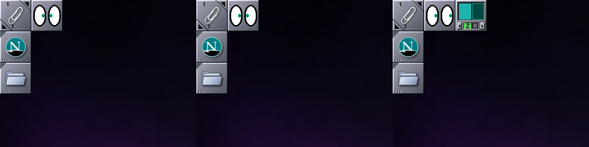
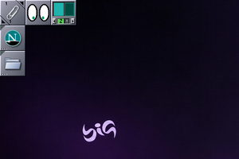

# Dock, Clip e gavetas no Window Maker X11 — inventário de comportamento

Referência: `wmaker/src/dock.c` (branch do Big WindowMaker, sem patches no
encaixe), `wmaker/src/wconfig.h`. Conferido no código e, onde indicado, no
laboratório X11 (Xvfb + `wmaker` instalado, 2026-11-23).

## Encaixe: `wDockSnapIcon` (`dock.c:2732`)

Entrada: posição do canto do ícone arrastado (`req_x`, `req_y`). A célula é
calculada com arredondamento para a mais próxima:
`ex = (req ± ICON_SIZE/2 − dock_pos) / ICON_SIZE` (divisão inteira do C,
truncada para zero). Recusa tudo se `wPreferences.flags.noupdates`, se a
célula sai da tela (`onScreen`: o ícone inteiro num monitor) ou, vindo de
fora, se o contêiner está cheio (`icon_count >= max_icons`).

| Contêiner | Regra |
|---|---|
| **Dock** (`WM_DOCK`) | Só a coluna (`ex_x == 0`). Vindo de fora: só um slot **livre** (buracos permitidos, nada desloca). Reencaixe dentro do Dock: o slot livre mais próximo, procurando para cima e para baixo até `DOCK_DETTACH_THRESHOLD` (3); longe disso, desacopla. Slot de gaveta: recusa (a gaveta recebe). |
| **Clip** (`WM_CLIP`) | **Grade 2D**: qualquer célula `(x, y)` livre e na tela com um vizinho a até `CLIP_ATTACH_VICINITY` (1) células, **inclusive na diagonal**; o próprio Clip (0,0) conta como vizinho. Sem limiar: sem vizinho, desacopla. Ícones onipresentes consultam os Clips de todas as áreas. |
| **Gaveta** (`WM_DRAWER`) | Linha horizontal a partir do ladrilho da gaveta, para o lado de dentro da tela; compacta: os ícones entre a origem e o destino deslizam (`wSlideAppicons`). |

Verificado no laboratório X11: `wmeyes` ao lado do Clip (1,0), outro
dockapp ao lado dele (2,0) e um terceiro na diagonal (3,1)
(,
).

## Posição automática: `wDockFindFreeSlot` (`dock.c:2973`)

- Gaveta: no fim da linha.
- Clip num canto: alterna o primeiro livre da coluna `(0,i)` e da linha
  `(i,0)` (i = 1, 2, …); fora de canto, espiral a partir do Clip.
- Dock: primeiro slot livre.

## Persistência

`WMState`: cada ícone com `Position = "x,y"` (índices relativos ao Dock ou ao
Clip, com sinal conforme o canto), `Command`, `Name` (instância.classe),
`AutoLaunch`, `Lock`, `Omnipresent`, `DropCommand`, `PasteCommand`. O Clip
guarda ícones por área de trabalho (`Workspaces[n].Clip`).

## Menus (`dockMenuCreate`, strings de `dock.c`)

Dock: *Dock position* (Normal / Auto raise & lower / Keep on Top), *Add a
drawer*, *Launch*, *Bring Here*, *Hide/Unhide*, *Settings…*, *Kill*.
Clip: além dos anteriores, *Clip Options* (Keep on Top, Collapsed, Autoraise,
Autoattract Icons), *Rename Workspace*, *Selected / Select All Icons /
Unselect*, *Keep Icon(s)*, *Move Icon(s) To* (área de trabalho),
*Remove Icon(s)*, *Attract Icons*, *Toggle Omnipresent*. Gaveta: *Drawer
options* (Keep on Top e Autoraise seguem o Dock; Collapsed, Autocollapse),
*Remove drawer*.

## Modificadores e cliques (`appicon.c`, `dock.c`)

- Arrastar com o modificador de mover (Alt) desacopla um lançador; dockapps
  são arrastados pela borda do ladrilho ou com Alt.
- Duplo clique: lança (ou mostra o aplicativo); Shift: aqui; Ctrl: lança de
  novo; Alt: esconde os outros. Botão do meio: `PasteCommand`.
- Ícone travado (`Lock`) ou de aplicativo em execução não sai ao ser solto
  fora (o de aplicativo sai com o modificador).
- Soltar fora: "kaboom"; um dockapp desacoplado é encerrado.
