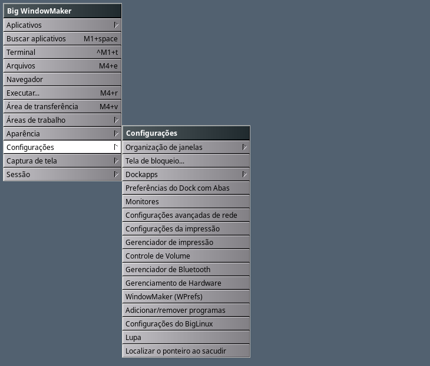
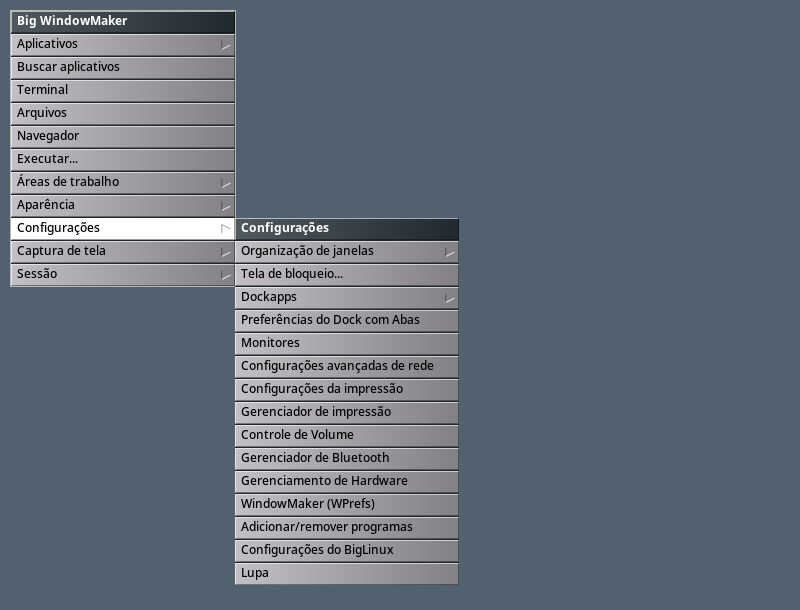
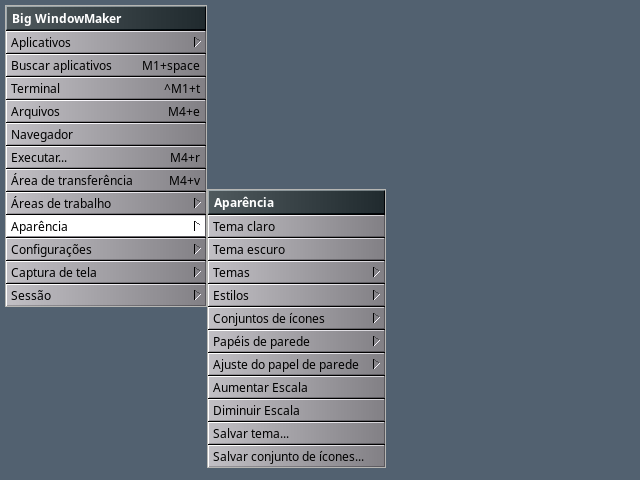
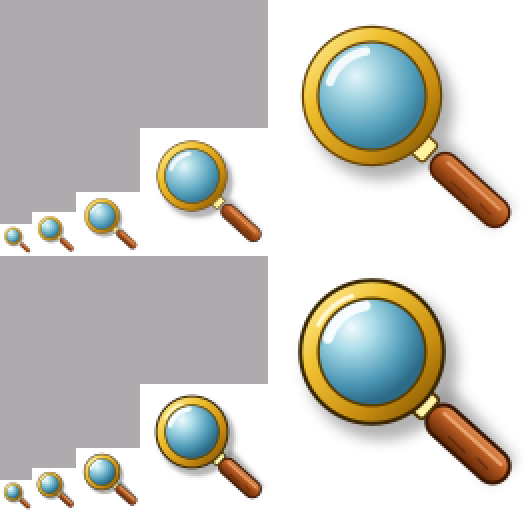

# Menu Configurações, Lupa e ampliação da tela

Missão de novembro de 2026 (rodada 2, agente "menus"). Menu raiz das duas
sessões (X11: `data/GNUstep/Defaults/WMRootMenu*`; Wayland:
`data/wlmaker/RootMenu.plist*`), pt_BR e inglês sincronizados, e a migração
dos menus das contas existentes.

## Problema

Relatado na sessão real do usuário (09/11):

1. **Preferências do Dock com Abas** não aparecia no Configurações do
   Wayland, apesar da marca `~/.config/big-wm/migrations/tabbed-dock-menu-wayland`.
2. **Lupa** no Wayland era a ação `OutputMagnify` (muda a escala da saída e
   rearranja as janelas: não é lupa); no X11 é o `wmagnify`.
3. **Monitores** ainda era o `arandr` no menu X11 dele.
4. Configurações misturado com Aparência (Dockapps, Tela de bloqueio e
   Organização de janelas estavam em Aparência), nomes diferentes dos
   programas ("Window Maker", "Volume", "Programas"), faltavam rede,
   impressão, Bluetooth e hardware.

## Causa

- No Wayland o `~/.config/wlmaker/RootMenu.plist` é **convertido** do
  `~/GNUstep/Defaults/WMRootMenu` pelo `big-wm-wprefs-sync` sempre que a
  conversão muda (menu do WPrefs editado, programa novo instalado, versão
  nova do conversor). As migrações do WMRootMenu só rodavam num login X11; a
  do Wayland punha o item direto no RootMenu.plist convertido, gravava a
  marca, e a conversão seguinte (no mesmo login, logo depois do
  `big-wm-firstrun`) refazia o arquivo a partir do WMRootMenu sem o item. Na
  conta do usuário: `RootMenu.plist.bak-20261109-030841` tem o item (o
  `big-wm-wprefs-sync` guardou o arquivo "editado à mão") e o RootMenu.plist
  novo, não.
- O conversor trocava `wmagnify` por `OutputMagnify` e `arandr` pelo
  `wdisplays` (quando faltava o Big WM Display Resolution).

## Arquivos

- `data/GNUstep/Defaults/WMRootMenu`, `WMRootMenu.pt_BR`,
  `data/wlmaker/RootMenu.plist`, `RootMenu.plist.pt_BR` — menus padrão.
- `session/lib/big-wm-menu-migrate` — migrações estruturais (novo).
- `session/bin/big-wm-firstrun` — `setup_wmrootmenu` (migrações do
  WMRootMenu nas duas sessões), `migrate_settings_menu`,
  `migrate_tabbed_dock_menu`, `migrate_app_launchers`,
  `wayland_menu_converted`, listas de hash dos menus antigos.
- `session/bin/big-wm-wprefs-sync` — conversão de `wmagnify`, `big-wm-zoom`,
  `arandr`, `big-wm-locate-pointer`; tema gerado acompanha o tema do pacote.
- `session/bin/big-wm-zoom`, `session/zoom/big-wm-picom-zoom.c` — Aumentar
  e Diminuir Escala no X11 (ver [zoom-acessibilidade.md](zoom-acessibilidade.md)).
- `data/wlmaker/Theme.plist`, `Theme-Dark.plist` — itens de menu de 224 px
  (eram 200: "Configurações avançadas de rede" e "Mosaico automático:
  ligar/desligar" saíam cortados).
- `themes/icons/svg/magnify.svg` — `big-wm-magnify`.
- `tests/run.sh`, `tests/wprefs/test_wprefs_sync.py`.

## Solução

### Configurações (X11 e Wayland, pt_BR e inglês)

| Item (pt_BR) | Item (inglês) | X11 | Wayland |
|---|---|---|---|
| Organização de janelas ▸ | Window organization ▸ | `wmake-zones …` | ação `Zones …` |
| Tela de bloqueio... | Lock screen... | `big-wm-lock-settings` | igual |
| Dockapps ▸ | Dockapps ▸ | `big-wm-appmenu --dockapps` | `--wlmaker --dockapps` |
| Preferências do Dock com Abas | Tabbed Dock preferences | `big-wm-tabbed-dock --preferences` | igual |
| Monitores | Displays | `big-wm-display-resolution` | igual |
| Configurações avançadas de rede | Advanced network settings | `nm-connection-editor` | igual |
| Configurações da impressão | Print settings | `system-config-printer` | igual |
| Gerenciador de impressão | Print manager | `xdg-open http://localhost:631/` (o `cups.desktop`) | igual |
| Controle de Volume | Volume control | `pavucontrol` | igual |
| Gerenciador de Bluetooth | Bluetooth manager | `blueman-manager` | igual |
| Gerenciamento de Hardware | Hardware management | `big-driver-manager` (biglinux-driver-manager) | igual |
| WindowMaker (WPrefs) | WindowMaker (WPrefs) | `WPrefs` | igual (XWayland) |
| Adicionar/remover programas | Add/remove software | `pamac-manager` | igual |
| Configurações do BigLinux | BigLinux settings | `biglinux-settings` (big-system-config) | igual |
| Lupa | Magnifier | `wmagnify` | ação `ZoomIn` |
| Localizar o ponteiro ao sacudir | Shake to find the pointer | `big-wm-locate-pointer --toggle` | — (só X11) |

Decisões:

- **Organização de janelas × Organizador de janelas:** os dois nomes são o
  wmake-zones. O submenu "Organização de janelas" (ligar/desligar zonas e
  mosaico, escolher zona, layout, organizar, restaurar, Editar zonas...,
  Preferências...) já abre o organizador (`wmake-zones-prefs`, cujo .desktop
  se chama "Organização de janelas") em *Preferências...*: um item só, sem
  repetir o programa. Ele saiu de Aparência e continua também em Áreas de
  trabalho, como antes.
- **Configurações da impressão × Gerenciador de impressão:** programas
  diferentes — o `system-config-printer` (impressoras, filas) e a página de
  administração do CUPS (`cups.desktop`, "Gerenciador de impressão", abre o
  navegador em `localhost:631`). Os dois ficam.
- **Gerenciamento de Hardware:** o `big-driver-manager`
  (`br.com.biglinux.drivermanager.desktop`, que já se chama assim). O Big
  Hardware Info é informação, não gerenciamento: fica em Aplicativos.
- **Adicionar/remover programas:** o `pamac-manager` (pamac-gtk), o nome do
  .desktop dele. O `big-pkg-installer` instala pacotes .deb/.rpm soltos e
  é `NoDisplay`: não é um gerenciador de programas.
- **Ordem:** a pedida — organização da área de trabalho (zonas, bloqueio,
  dockapps, Dock com Abas), aparelhos (monitores, rede, impressão, volume,
  Bluetooth, hardware), sistema (WPrefs, programas, BigLinux) e, no fim, a
  acessibilidade que já estava ali (Lupa, Localizar o ponteiro).
- No Wayland saíram "Ampliar a tela", "Reduzir a tela" e "Salvar o estado
  dos monitores" (`OutputMagnify`/`OutputReduce`/`OutputSaveState`: escala
  da saída, que o Monitores faz com confirmação e perfis). O atalho
  Ctrl+Shift+Page_Up do Config.plist fica.
- Os atalhos de teclado existentes não mudaram (nenhum item do Configurações
  tem atalho).

### Aparência, Lupa e ampliação

- **Aumentar Escala / Diminuir Escala** (Zoom in / Zoom out) em Aparência,
  depois do papel de parede: a ampliação global do Ctrl+Alt+rolagem, um
  passo por clique. X11: `big-wm-zoom in|out`, que fala com o plugin do picom
  pela seleção `_BIG_WM_ZOOM_S0` (sem o plugin, avisa). Wayland: as ações
  `ZoomIn`/`ZoomOut` do wlmaker direto no item do menu. Ctrl+Alt+rolagem e
  Ctrl+Alt+0 continuam.
- **Lupa** no X11 volta a ser o `wmagnify` (janela com a área em volta do
  ponteiro, ícone `big-wm-magnify` no Window Maker).
- **Lupa no Wayland:** não há lupa em janela. O `wmagnify` pelo XWayland
  mostra só preto, também sobre uma janela X11 (laboratório:
  [captura](screenshots/menu-configuracoes/wayland-wmagnify-xwayland.png)),
  e um cliente Wayland não sabe onde está o ponteiro nem pode capturar a tela
  em volta dele sem protocolos que o wlmaker não oferece a ele. A melhor
  alternativa honesta é a ampliação de tela inteira do compositor: a Lupa do
  Wayland é `ZoomIn` (amplia em volta do ponteiro; Diminuir Escala ou
  Ctrl+Alt+0 voltam). Nunca mais `OutputMagnify`.
- O ícone `big-wm-magnify` (a lupa do `Magnify.tiff` do Window Maker) ganhou
  contorno escuro e lente mais contrastada para ler em 16–24 px; vale para a
  janela do `wmagnify`, os avisos do `big-wm-zoom`, a Acessibilidade das
  Boas-vindas, kmag/xmag e a busca de arquivos (Catfish). O ícone do
  lançador (Buscar aplicativos) não é a lupa.

### Contas existentes (migração no `big-wm-firstrun`)

- **Menus padrão sem edição** (todas as versões do histórico do git, X11 e
  Wayland, pt_BR e inglês — os hashes estão nas listas do
  `migrate_menu_default` e do `migrate_wayland_menu`) dão lugar aos novos.
- **Menus editados:** `big-wm-menu-migrate settings-2026-11` lê o menu como
  property list, com a posição de cada item no texto, e troca só os filhos
  de Configurações e de Aparência; o resto do arquivo fica byte a byte
  (itens do usuário, comentários, formatação do WPrefs). Num menu editado:
  - Organização de janelas, Tela de bloqueio e Dockapps saem de Aparência
    para Configurações (se já estavam em Configurações, só saem de
    Aparência);
  - os rótulos **padrão** antigos são renomeados (Window Maker, Volume,
    Programas/Software, Ajustes gerais, Lock Screen..., BigLinux Settings);
    um rótulo escolhido pelo usuário fica;
  - os itens novos entram só com o programa instalado
    (`nm-connection-editor`, `system-config-printer`, `xdg-open`,
    `blueman-manager`, `big-driver-manager`);
  - no wlmaker (formato próprio): sai a escala da saída, entra a Lupa
    (`ZoomIn`), só se o wlmaker tem a ampliação;
  - os itens padrão ficam na ordem nova; um item do usuário fica logo depois
    do item que o precedia;
  - Aparência ganha Aumentar/Diminuir Escala antes de "Salvar tema...".
  Uma vez por menu (marca `settings-menu-2026-11-{x11,wayland}`): o que o
  usuário tirar ou reordenar depois fica.
- **Preferências do Dock com Abas:** `big-wm-menu-migrate add-tabbed` põe o
  item no lugar da ordem nova; a marca (`tabbed-dock-menu-x11` para o
  WMRootMenu, `-wayland` para o RootMenu.plist no formato próprio) só entra
  quando o item está no menu.
- **As migrações do WMRootMenu rodam também no login Wayland**
  (`setup_wmrootmenu`, chamado pelo `setup_wprefs_defaults`): o
  `big-wm-wprefs-sync` que vem logo depois leva o resultado ao menu do
  wlmaker. Um RootMenu.plist **convertido** (cabeçalho "convertido do menu
  do Window Maker") não é mais mexido direto — seria guardado como "editado
  à mão" e refeito. Na conta do usuário, o próximo login (Wayland ou X11)
  põe o Dock com Abas e o Configurações novo no WMRootMenu, troca o ARandR
  pelo Big WM Display Resolution, e o menu do wlmaker sai igual ao padrão
  (o WMRootMenu dele fica igual ao padrão novo: volta o RootMenu.plist do
  pacote).
- **Um wlmaker sem a ampliação** (anterior ao 24 do Big WindowMaker) recusa
  um menu com `ZoomIn`: o firstrun tira esses itens do RootMenu.plist
  (`big-wm-menu-migrate strip-zoom`), a migração não os põe e o conversor
  não os gera.
- **Tema do wlmaker gerado** (aparência personalizada no WPrefs): o
  `big-wm-wprefs-sync` guarda o hash do tema padrão e refaz o Theme.plist
  gerado quando o pacote traz um tema novo (aqui, os menus de 224 px).

## Testes feitos

- `tests/run.sh` (todos passam menos o `big-wm-env.sh: GTK_THEME/GTK2_RC_FILES
  herdados`, que falha igual na base `feat/missao-integracao`):
  - cada versão padrão antiga do histórico (X11/Wayland, pt_BR/inglês) é
    trocada pela nova;
  - menu editado (padrão de 6804286 sem o Dock com Abas, com "Meu mixer"
    depois do Volume e "Meu tema" no fim de Aparência), X11 e Wayland, pt_BR
    e inglês: o resultado é exatamente o padrão novo com os dois itens do
    usuário no lugar; idempotente; marcas;
  - itens tirados depois não voltam; sem os programas, os itens novos não
    entram;
  - a conta do relato (WMRootMenu editado com ARandR, menu convertido, marca
    `tabbed-dock-menu-wayland` posta, item ausente): login Wayland +
    `big-wm-wprefs-sync` → o menu do wlmaker tem Dock com Abas, Bluetooth,
    Monitores pelo Display Resolution, Lupa `ZoomIn`, Aumentar Escala, sem
    `OutputMagnify`, sem `.bak` novo;
  - wlmaker sem a ampliação: nenhum Zoom no menu migrado nem no padrão;
  - `big-wm-zoom in/out/reset` com Xvfb + picom + plugin;
  - conversão do `big-wm-wprefs-sync` (`test_menu`), tema gerado que segue o
    tema do pacote (`test_generated_theme_follows_new_package_theme`).
- Laboratório (`mklab.sh menus`, big-wm instalado do worktree num fake root):
  - X11 com uma **cópia** do WMRootMenu real do usuário: Configurações e
    Aparência novos ([x11-configuracoes](screenshots/menu-configuracoes/x11-configuracoes.png),
    [x11-aparencia](screenshots/menu-configuracoes/x11-aparencia.png));
    picom com o plugin: *Aumentar Escala* pelo menu amplia ×1,25 e
    *Diminuir Escala* volta ([antes e depois](screenshots/menu-configuracoes/x11-aumentar-escala-antes-depois.png));
  - Wayland (wlmaker 25 aninhado) com cópias do WMRootMenu, do RootMenu.plist
    convertido, do estado do `big-wm-wprefs-sync` e da marca do usuário:
    Configurações com o Dock com Abas ([wayland-configuracoes](screenshots/menu-configuracoes/wayland-configuracoes.png)),
    Aparência ([wayland-aparencia](screenshots/menu-configuracoes/wayland-aparencia.png)),
    *Aumentar Escala* amplia (cursor de software, menu maior) e *Diminuir
    Escala* volta ([antes e depois](screenshots/menu-configuracoes/wayland-aumentar-escala-antes-depois.png)).

## Resultado

Configurações igual nas duas sessões e nos dois idiomas, com os nomes dos
programas; Aparência só com aparência e a ampliação; a Lupa abre a lupa no
X11 e amplia a tela no Wayland; contas existentes recebem tudo no próximo
login, em qualquer sessão, sem perder o que o usuário mudou.

## Limitações

- Um menu do WPrefs sem o submenu "Configurações"/"Settings" (apagado ou
  renomeado) não é migrado; um menu em outro idioma também não.
- Num WMRootMenu editado, o menu do wlmaker é sempre o convertido (o formato
  próprio do wlmaker, com as ações `Zones`, só vale enquanto o WMRootMenu é
  o padrão).
- O ícone do `wmagnify` em contas antigas só muda se o usuário tirar a
  entrada `magnify.Magnify` do WMWindowAttributes (contas novas já vêm com
  ele).

## Próximos passos

- Uma lupa em janela no Wayland exigiria um protocolo do wlmaker que dê a
  um cliente a imagem em volta do ponteiro (como o de observação do
  ponteiro do `wlmeyes`).
