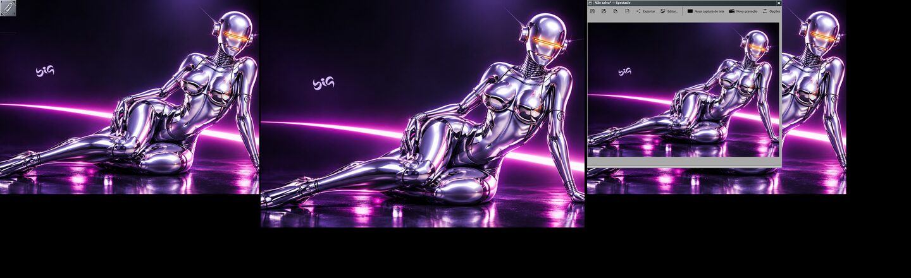
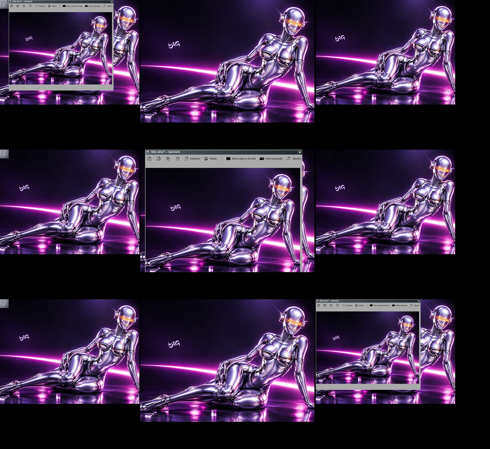
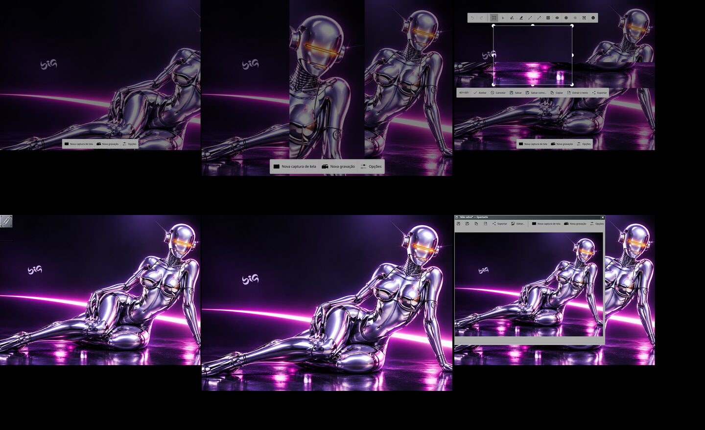
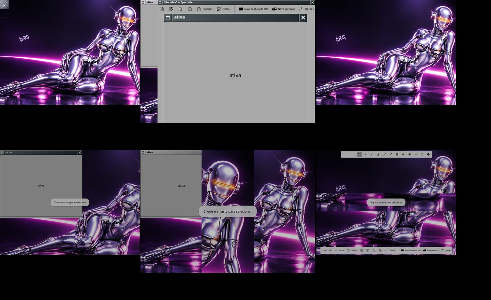
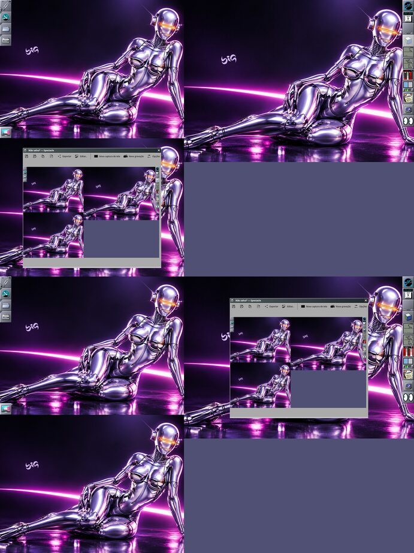
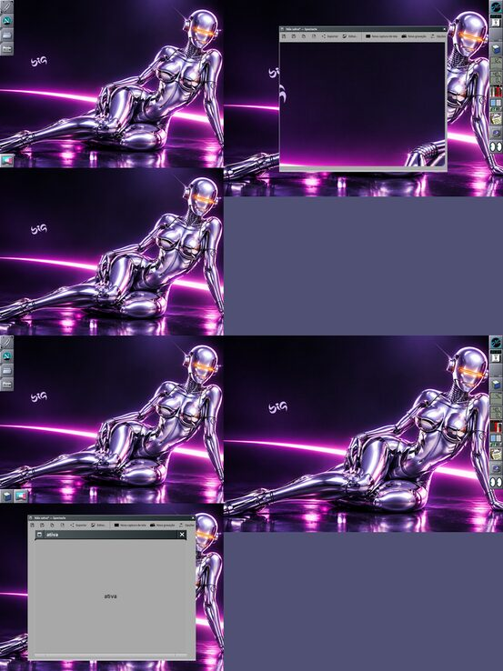

# Spectacle com vários monitores: abrir onde está o ponteiro

Rodada 2 da missão de novembro (09/11/2026), agente "telas".

## Problema

Com vários monitores, a janela do Spectacle (o visualizador que aparece
depois da captura) abria sempre no primeiro monitor da esquerda, e não no
monitor onde estava o ponteiro.

## Três coisas diferentes

- **Onde a janela aparece**: decisão do gerenciador de janelas. É o que
  foi corrigido.
- **Qual monitor é capturado** (tela inteira, monitor atual) e **a região
  selecionada**: decisão do Spectacle e do `big-wm-kwin-screenshot`
  (Wayland) / do X (X11). Não foram alterados.

## Investigação

- `big-wm-screenshot` só chama `spectacle --fullscreen | --activewindow |
  --region`; nenhum argumento de posição. No Wayland o Spectacle captura
  pelo `big-wm-kwin-screenshot` (interface `org.kde.KWin.ScreenShot2`).
- O visualizador do Spectacle 6.7 é uma janela normal, sem pai
  (`WM_TRANSIENT_FOR` ausente / `xdg_toplevel` sem `parent`), que **não pede
  posição**: no X11 `WM_NORMAL_HINTS` só tem `USSize` e gravidade `Static`;
  no Wayland o protocolo nem permite. Então é a política do gerenciador
  que escolhe o monitor. Na sessão real o Spectacle roda nativo Wayland
  (`QT_QPA_PLATFORM=wayland;xcb`), mas o caminho XWayland cai na mesma
  função.
- **X11 (Window Maker)**: `PlaceWindow` usa a cabeça do ponteiro
  (`wGetHeadForPointerLocation`). Testado no Xorg com o driver dummy e três
  saídas RandR (uma abaixo da outra e uma 1280×900): o Spectacle abre
  centrado na cabeça do ponteiro em tela inteira, região e janela ativa.
  Nada a corrigir. (No Xvfb com `xrandr --setmonitor` o Window Maker vê uma
  cabeça só, porque lê as CRTCs, não os "monitores" do RandR 1.5: use o
  dummy, `big-wm-display-resolution/tests/lab/xdummy.sh`.)
- **Wayland (wlmaker)**: `_wlmtk_workspace_place_window`
  (`src/toolkit/workspace.c`) escolhe a saída pelo pai, pela posição pedida
  ou pelo ponteiro — e o ponteiro vinha de
  `window_container.super_element.last_pointer_motion_event`. Esse
  contêiner só recebe o movimento enquanto nenhum elemento acima dele pega
  o ponteiro: sobre o Dock, o Clip, um painel, um menu, uma janela em tela
  cheia (as sobreposições da seleção de região do Spectacle!) ou quando a
  área de trabalho atual mudou sem o ponteiro passar por janelas, a posição
  fica velha — em outro monitor — ou é `NAN`, e aí
  `wlmtk_desktop_get_usable_area(NULL)` usa a **primeira saída** do layout.

## Causa

Posição do ponteiro velha (ou inexistente) para a política de colocação do
wlmaker; o recurso para a primeira saída é o "sempre no monitor da
esquerda".

## Solução (wlmaker, branch `fix/telas-spectacle-placement`)

`_wlmtk_workspace_pointer_position()` lê a última posição do ponteiro do
**elemento da área de trabalho** (`wlmtk_desktop_element`), que é o
elemento raiz e recebe todo movimento, em coordenadas do layout; só sem
ela usa a do contêiner de janelas. Mudança pequena e localizada em
`_wlmtk_workspace_place_window` (o campo `exact` da dica, da sessão
principal, continua igual). A janela é colocada uma vez, no mapeamento:
nada de mover depois (sem cintilação). Continua dentro da área útil da
saída (fora do Dock e dos painéis), centrada ou "smart" conforme a política.

## Decisões

- Corrigido na política do gerenciador, não no Spectacle nem no
  `big-wm-screenshot`: o protocolo não deixa o app escolher a posição no
  Wayland, e no X11 o Window Maker já fazia o certo.
- Nenhum atraso nem `move` depois de mapear.
- O alvo da captura não mudou.

## Testes feitos

- Unitário (wlmaker `ctest`, 29/29): `workspace.placement_pointer_output`
  — três saídas (uma escala 1,5, uma ABAIXO da primeira), um painel no lado
  direito da segunda que pega o ponteiro: com o ponteiro sobre o painel a
  janela vai para a área útil da segunda saída (antes: primeira); depois
  para a de baixo e de volta à primeira. Conferido que o teste falha sem a
  correção.
- Laboratório Wayland (wlmaker do worktree, 3 saídas do backend x11:
  X11-1 1024×768 em (0,0), X11-2 1280×900 escala 1,5 em (1024,0), X11-3
  1024×768 em (0,768), abaixo; ponteiro exato com o `vptr`, porque o
  ponteiro absoluto do backend x11 com várias saídas cai no lugar errado):
  - antes: ponteiro sobre o Clip na X11-1 depois de passar pela X11-3 → o
    Spectacle abriu na X11-3;
    
  - depois, tela inteira com o ponteiro no Clip (X11-1), na X11-2 (escala
    1,5) e na X11-3 (abaixo): abre em cada uma;
    
  - região: seleção arrastada na X11-3 → o visualizador abre na X11-3;
    
  - janela ativa (X11-2) e modo interativo/sem argumento (barra do
    Spectacle na saída do ponteiro);
    
  - Spectacle via XWayland (`QT_QPA_PLATFORM=xcb`): mesma colocação.
- Laboratório X11 (Xorg dummy, Window Maker instalado, 3 saídas RandR,
  uma abaixo): tela inteira, região e janela ativa abrem na cabeça do
  ponteiro.
  
  

## Resultado

Wayland: o Spectacle (e qualquer janela nova sem pai e sem posição) abre
no monitor do ponteiro, mesmo com o ponteiro sobre o Dock, o Clip, menus
ou sobreposições em tela cheia. X11: já era assim.

## Limitações

- Se a janela é maior que a área útil da saída (o Spectacle restaura o
  tamanho salvo, 770×665, numa saída lógica de 853×600), ela fica no canto
  superior esquerdo da área útil e passa da borda de baixo: o tamanho é do
  cliente.
- Antes do primeiro movimento do ponteiro na sessão não há posição: a
  primeira saída continua sendo o recurso.
- Observado no laboratório e **não** alterado (alvo da captura): com
  saídas de escalas diferentes e uma abaixo da outra, a imagem de fundo das
  sobreposições de região do Spectacle não coincide com cada tela (a
  captura `CaptureWorkspace` do `big-wm-kwin-screenshot` montada pelo
  Spectacle). Vale investigar à parte.

## Próximos passos

- Validar na sessão real com os monitores do usuário depois de instalar o
  wlmaker com a correção (e relogar: o processo antigo continua rodando).
- Levar a correção ao upstream do wlmaker.
