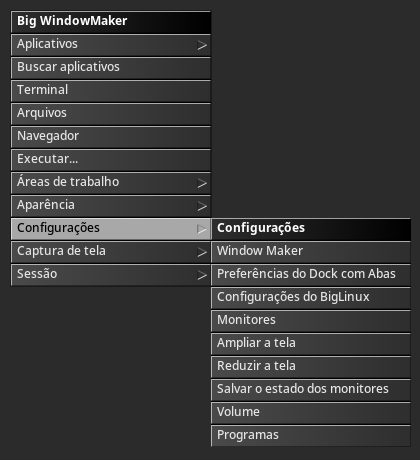
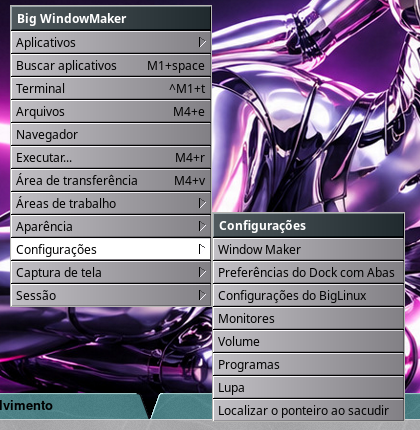
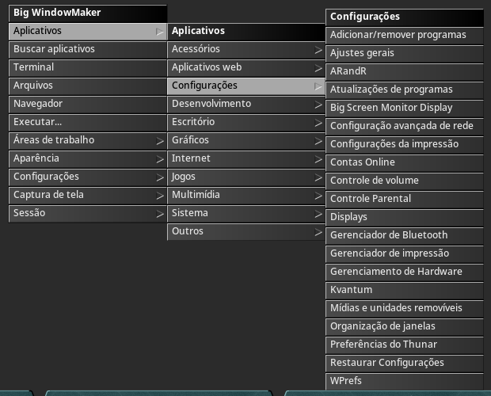
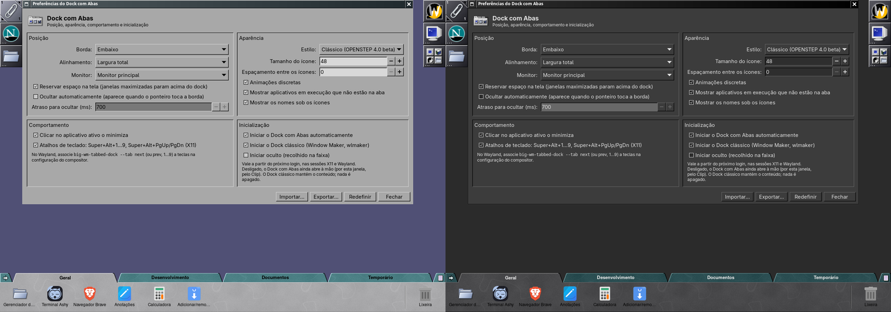
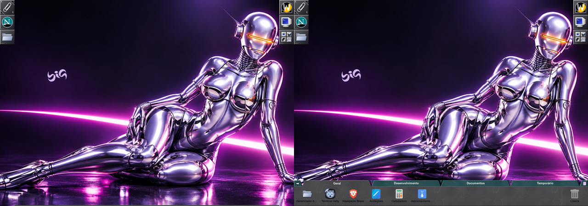
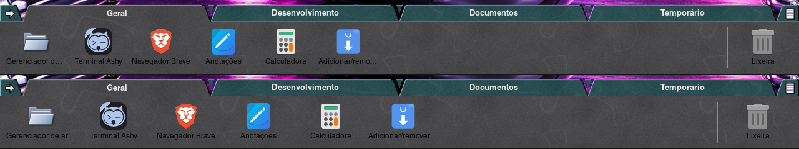

# Dock com Abas: preferências e inicialização

Rodada de 2026-11-09. Uso geral do dock em
[tabbed-dock/uso-e-configuracao.md](https://github.com/big-windowmaker/tabbed-dock/blob/main/docs/uso-e-configuracao.md).

## Problema

- As preferências só apareciam em *Menu Principal > Aplicativos >
  Configurações* (gerado do `.desktop`), longe das outras configurações
  da sessão, e com o ícone genérico `preferences-desktop`.
- Não havia como dizer "não iniciar o Dock com Abas no login" sem entender
  os quatro modos de "Docks na sessão" (`--dock-mode`).
- Faltavam opções: iniciar oculto, atraso da ocultação automática,
  espaçamento entre os ícones.

## Solução

### Menu

*Menu Principal > Configurações > Preferências do Dock com Abas*
(`big-wm-tabbed-dock --preferences`), logo abaixo de "Window Maker", nas duas
sessões e nos dois idiomas (`data/GNUstep/Defaults/WMRootMenu*`,
`data/wlmaker/RootMenu.plist*`).

- Menus padrão de versões anteriores sem edição: o `big-wm-firstrun` os
  troca pelos novos (sha256 dos quatro modelos atuais acrescentados às listas
  de `migrate_menu_default` e `migrate_wayland_menu`).
- Menus editados: `migrate_tabbed_dock_menu` acrescenta a linha uma vez,
  abaixo do "Window Maker", só com o `big-wm-tabbed-dock` instalado; a marca
  `~/.config/big-wm/migrations/tabbed-dock-menu-{x11,wayland}` impede que ela
  volte se o usuário a tirar.
- Sem repetição: o `.desktop` tem `X-BigWM-RootMenu=true` e o
  `big-wm-appmenu` não o lista mais em *Aplicativos > Configurações*
  (`CACHE_VERSION` 3). O Buscar aplicativos continua mostrando.

| Wayland | X11 |
|---|---|
|  |  |

### Ícone

O `themes/icons/svg/tabbed-dock.svg` (tema Window Maker em SVG, já no
`big-wm-themes` como `BigWindowMaker/scalable/apps/big-wm-tabbed-dock.svg`)
passa a ser instalado pelo pacote do dock também em
`/usr/share/icons/hicolor/scalable/apps/big-wm-tabbed-dock.svg`: o hicolor é
o último recurso de qualquer tema, então `Icon=big-wm-tabbed-dock` funciona
com o bigicons-papient ou outro. Usado nos dois `.desktop`, no ícone da
janela e num cabeçalho no estilo do WPrefs (ícone, nome, resumo). Sem o
ícone instalado (dock compilado fora da árvore), volta ao
`preferences-desktop`. No X11 o appicon continua com o
`big-wm-tabbed-dock.png` do `WMWindowAttributes`.

### Janela

| Opção | Onde | Chave (`dock.conf`) | Situação |
|---|---|---|---|
| Iniciar o Dock com Abas automaticamente | Inicialização | override em `~/.config/autostart` | **nova** (era parte de "Docks na sessão") |
| Iniciar o Dock clássico | Inicialização | `DisableDock` (X11) + override do wlmdock | já existia como rádio; agora caixa |
| Iniciar oculto (recolhido na faixa) | Inicialização | `StartHidden` | **nova** |
| Atraso para ocultar (ms, 0–5000) | Posição | `HideDelay` (700) | **nova**; só com Ocultar automaticamente |
| Espaçamento entre os ícones (px, 0–32) | Aparência | `IconSpacing` (0) | **nova** |
| Borda (posição), alinhamento, monitor | Posição | já existiam | — |
| Sempre visível / ocultação automática | Posição | `AutoHide` | já existia (desligado = sempre visível) |
| Reservar espaço | Posição | `ReserveSpace` | já existia |
| Tamanho dos ícones, estilo, nomes | Aparência | já existiam | — |
| Abas | o próprio dock (menu das abas) | — | já existia; não duplicado aqui |
| Restaurar padrões | botão Redefinir | — | já existia; vale para as opções novas |

As duas caixas de Inicialização são os quatro modos do `--dock-mode`
(`btd-coexist`), sem segundo mecanismo: desligar escreve
`~/.config/autostart/big-wm-tabbed-dock.desktop` com `Hidden=true` e
`X-Big-Tabbed-Dock-Managed=true`; religar o apaga e **devolve o arquivo do
próprio usuário** que tinha sido guardado como `*.user-backup` (novo). O
arquivo do sistema (`/etc/xdg/autostart`, `OnlyShowIn=WindowMaker;wlmaker;`)
não muda: Plasma, GNOME e XFCE nunca iniciam o dock. As duas sessões usam o
mesmo XDG autostart (`big-wm-session.target`), e o `GApplication` garante um
processo só: uma segunda chamada (autostart, menu, Clip) vai para o dock que
já roda.

Desligado, o dock ainda abre à mão: o item do menu (abre o dock e as
preferências), o lançador do Clip no X11 ou `big-wm-tabbed-dock`. Aberto
assim, ele não recolhe mesmo com "Iniciar oculto".

As janelas GTK do próprio dock acompanham a troca claro/escuro também no
Wayland, onde o gtk-nocsd fixaria o tema (ver
[tema-claro-escuro.md](tema-claro-escuro.md)).

## Arquivos

- `tabbed-dock/src/ui/btd-prefs.c` (seção Inicialização, cabeçalho, atraso,
  espaçamento), `btd-dock.c` (atraso, espaçamento, `btd_dock_start_hidden`,
  relê o tema GTK), `btd-app.c` (recolhe só no início automático)
- `tabbed-dock/src/core/btd-config.[ch]` (chaves validadas),
  `btd-coexist.c` (devolve o `*.user-backup`)
- `tabbed-dock/data/*.desktop.in`, `data/meson.build` (ícone no hicolor),
  `po/pt_BR.po`
- `data/GNUstep/Defaults/WMRootMenu*`, `data/wlmaker/RootMenu.plist*`,
  `session/bin/big-wm-firstrun`, `session/bin/big-wm-appmenu`

## Testes

- `meson test`: 7/7 (novo `/config/startup-and-spacing`: ida e volta,
  valores fora da faixa e lixo voltam ao padrão; `/coexist/modes`: desligar e
  religar devolve o arquivo do usuário, só o override do dock com abas muda).
- `tests/run.sh`: todas as verificações; novos: menus padrão antigos
  trocados (X11 e Wayland), linha acrescentada uma vez a menus editados nas
  duas sessões e não recolocada depois de tirada, `big-wm-appmenu` sem a
  entrada e Buscar aplicativos com ela, caminho instalado do ícone.
- Laboratório (Xvfb + wlmaker aninhado; Xvfb + Window Maker), "login" com o
  `systemd-xdg-autostart-generator` de verdade (as unidades do XDG autostart
  geradas a partir do `/etc/xdg/autostart` e do HOME do laboratório, com a
  condição `OnlyShowIn`):
  - menu Configurações e clique no item, nas duas sessões; Aplicativos >
    Configurações sem repetição;
  - caixa "Iniciar o Dock com Abas automaticamente" desligada pela janela →
    novo login sem dock (nenhuma unidade gerada); aberto à mão pelo menu;
    religada com "Iniciar oculto" → novo login com o dock recolhido
    (`--print-state`: `hidden=1`), que abre ao tocar a borda; o mesmo no
    X11 com `--dock-mode`;
  - autostart chamado de novo e o binário aberto à mão: um processo só;
  - espaçamento 0 e 16.

## Limitações

- O menu raiz do Window Maker e do wlmaker não mostra ícones nos itens: o
  ícone aparece no `.desktop` (Buscar aplicativos), na janela e no appicon.
- "Iniciar o Dock clássico" no X11 depende do `wdwrite` (Window Maker); sem
  ele aparece o erro e a caixa mostra o estado real.
- A entrada do menu existe nos menus padrão mesmo sem o pacote
  `big-wm-tabbed-dock` (como as do wmake-zones); a migração de menus
  editados só a acrescenta com o dock instalado.
