# Big Tabbed Dock

Dock horizontal **com abas** para o Big WindowMaker, nas duas sessões: Window
Maker (X11) e wlmaker (Wayland). Recria, com interpretação moderna, a
"prateleira com abas" que a NeXT experimentou numa versão de pré-lançamento do
OPENSTEP 4.0 (fim de 1995) e abandonou antes do 4.0 final.

<p align="center">
  
</p>

> **Capturas reais**, feitas pelos testes automatizados: X11 = Xvfb + Window
> Maker 0.96 com a configuração do Big WindowMaker; Wayland = wlmaker (branch
> `big-wm/protocols`) no backend headless com renderização por software.
> Nenhuma é montagem. A VM de testes do projeto **não** foi usada (ver
> [testes.md](testes.md)).

## O que faz

- **Abas**: Geral, Desenvolvimento, Documentos e Temporário (identificadores
  fixos `general`, `developer`, `documents`, `temporary`; nomes traduzidos).
  Criar, renomear, excluir (as criadas), reordenar (arrastando a aba ou pelo
  menu), restaurar o padrão. Sem limite de quatro.
- **Atalhos** de aplicativos (`.desktop`, inclusive Flatpak e AppImage
  registrados), AppImages soltos, documentos e pastas; separadores; ícone e
  rótulo próprios por item.
- **Em execução**: indicador sob o ícone (um "pino" por janela, até três),
  ladrilho destacado para o aplicativo ativo, seção à direita com aplicativos
  abertos que não estão na aba (arraste para fixar).
- **Clique**: abre; se já está aberto, ativa a janela; de novo, minimiza
  (configurável); com várias janelas, alterna entre elas. Botão do meio ou
  Shift+clique: nova instância. Rolagem sobre um aplicativo: alterna janelas;
  sobre o resto: troca de aba.
- **Arrastar**: itens entre abas (mover; Ctrl = copiar), reordenar, fixar um
  aplicativo em execução; arquivos e pastas do gerenciador de arquivos (X11);
  arquivos sobre o ícone de um aplicativo abrem com ele. Abas abrem "por mola"
  quando o arrasto para sobre elas. **Tirar um atalho nunca apaga o arquivo.**
- **Teclado**: `Super+Alt+1…9`, `Super+Alt+PgUp/PgDn` (X11, captura global);
  no Wayland, `big-wm-tabbed-dock --tab next|prev|N` num atalho do compositor.
- **Posição**: de ponta a ponta na borda inferior (padrão, como a prateleira
  do OPENSTEP 4.0 beta) ou em cima; também centro, esquerda ou direita, com
  a largura do conteúdo; monitor escolhido; reserva de espaço opcional; ocultar
  automaticamente; nunca fora da tela após mudança de monitores.
- **Estilos**: Clássico (padrão: a prateleira do OPENSTEP 4.0 beta — corpo de
  mármore, abas trapezoidais dividindo a largura, a selecionada clara e as
  outras verde-azuladas, seta à esquerda que recolhe a prateleira, documento à
  direita que cria uma aba, ícones com o nome embaixo), Ladrilhos do Window
  Maker (o visual anterior, com os ladrilhos do tema BigLinux) e Moderno
  (plano e escuro).
- **Coexistência**: só o Dock clássico, só o dock com abas, os dois ou nenhum,
  sem tocar no conteúdo do Dock clássico.

## Capturas reais

Todas feitas pelos testes de sessão em contêiner (ver [testes.md](testes.md));
idioma pt_BR, papel de parede e temas do Big WindowMaker.

| | |
|---|---|
| 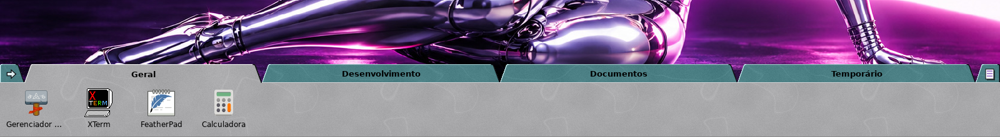 X11, aba Geral (Dock clássico à direita) |  Wayland, indicadores de execução |
| 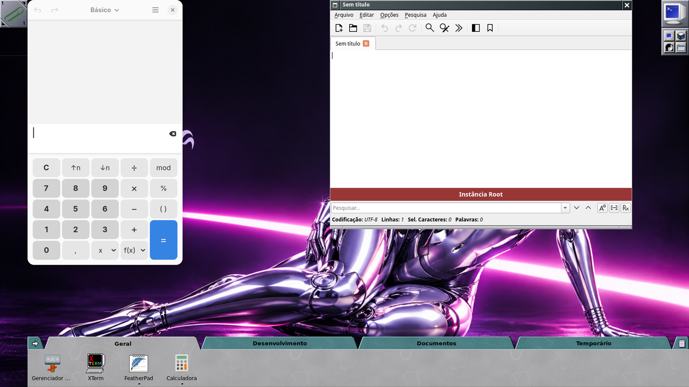 Wayland: dock com abas + `wlmdock` | 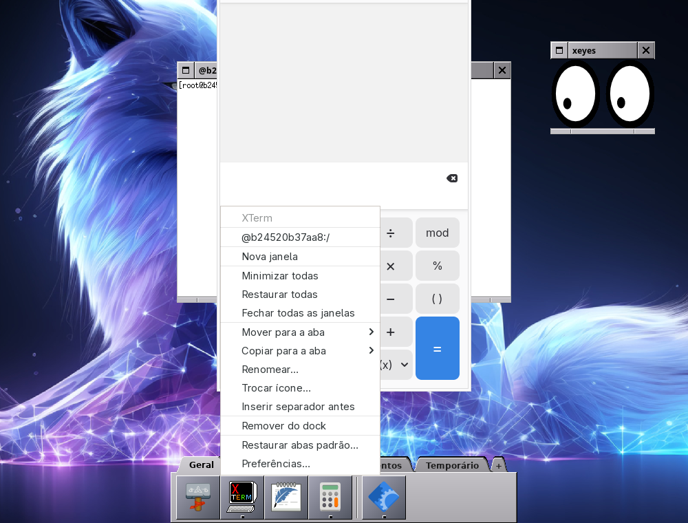 X11: menu de um aplicativo com duas janelas |
|  X11: arquivo e pasta soltos (XDND) na aba Temporário | 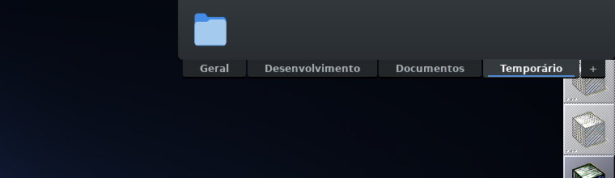 Estilo Moderno, borda superior, à direita |
| 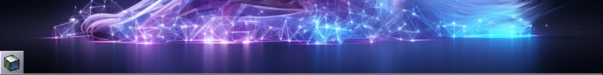 Largura total com auto-ocultar | 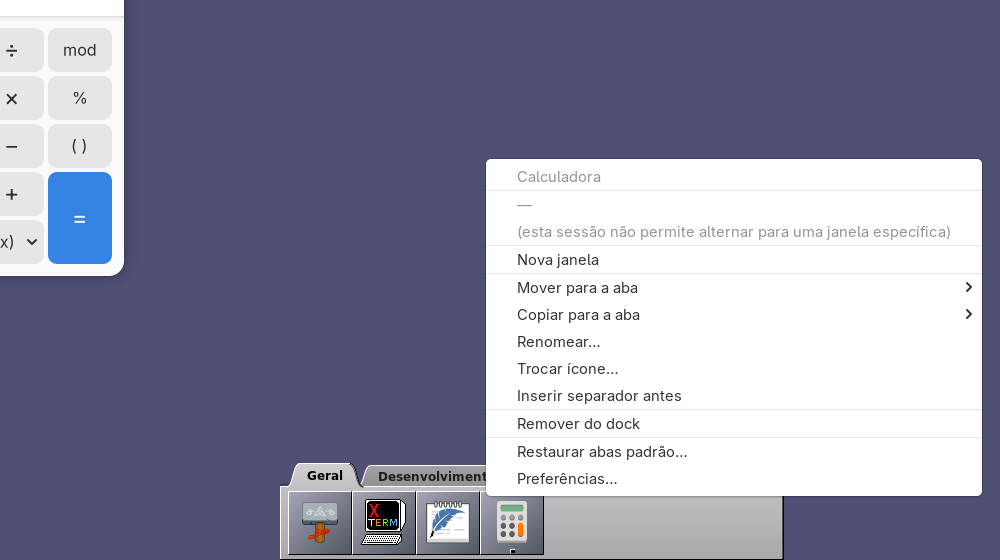 Wayland sem wlr-foreign-toplevel: menu em vez de duplicar a janela |
| 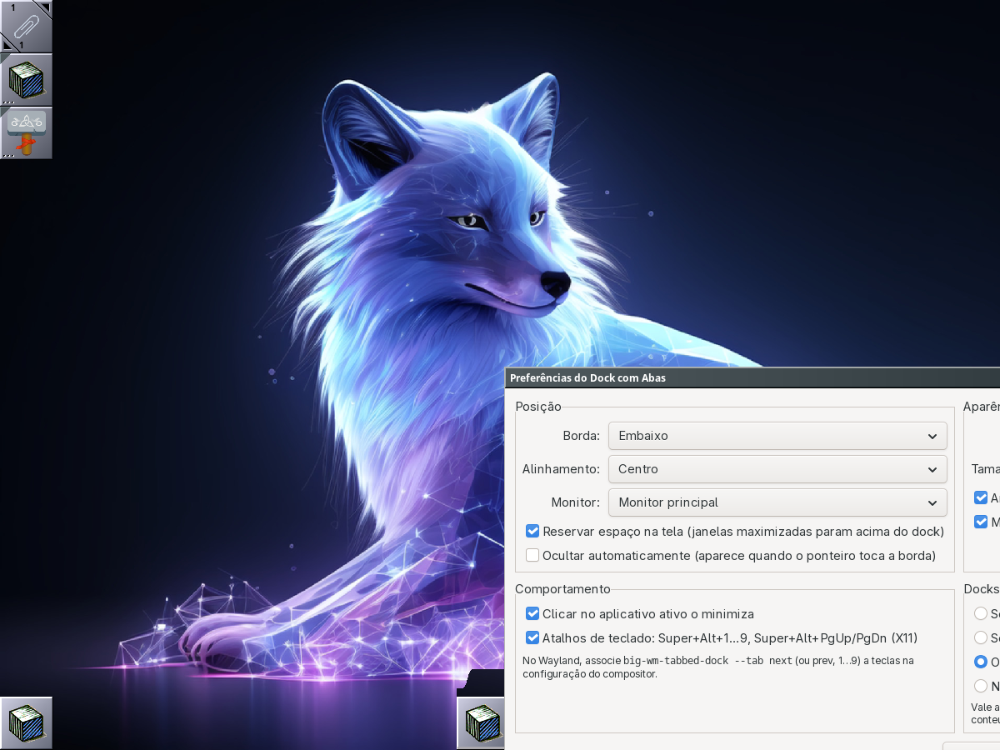 Preferências (X11) | 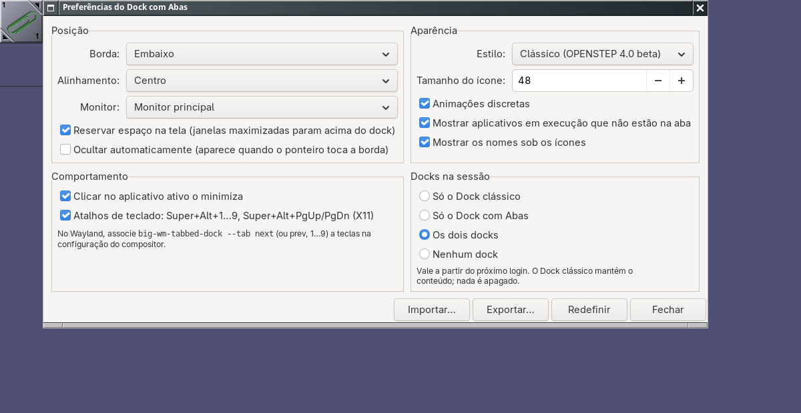 Preferências (Wayland) |
| 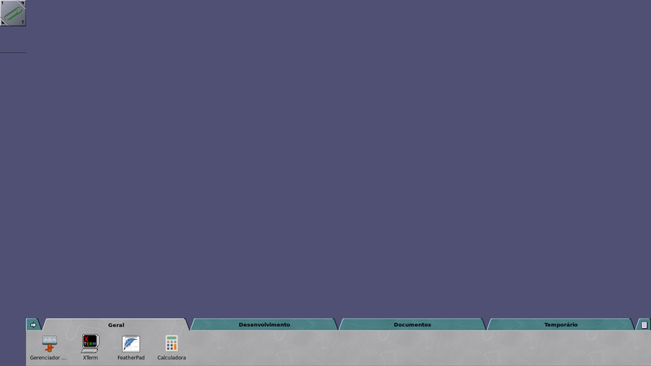 Wayland: dock na 2ª saída (`Monitor=HEADLESS-2`) | 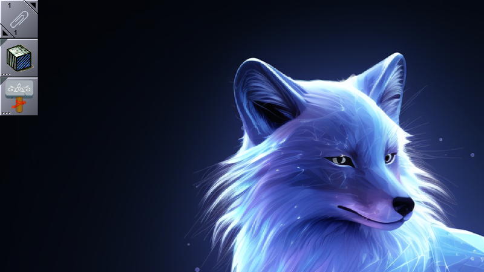 X11 com `GDK_SCALE=2` |
| 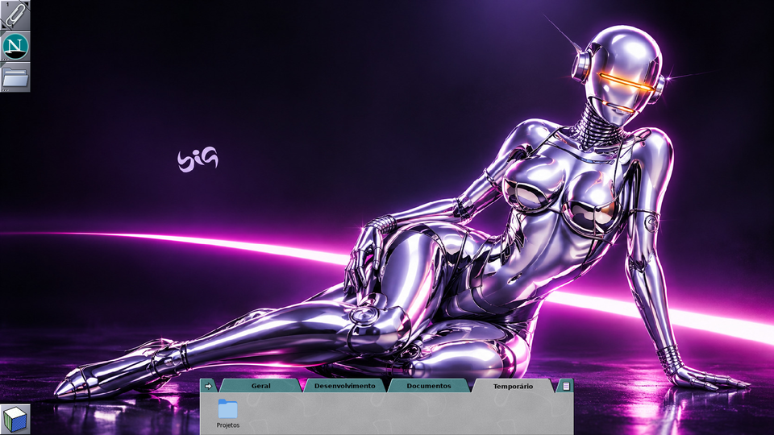 `--dock-mode=tabbed`: Window Maker sem o Dock clássico | 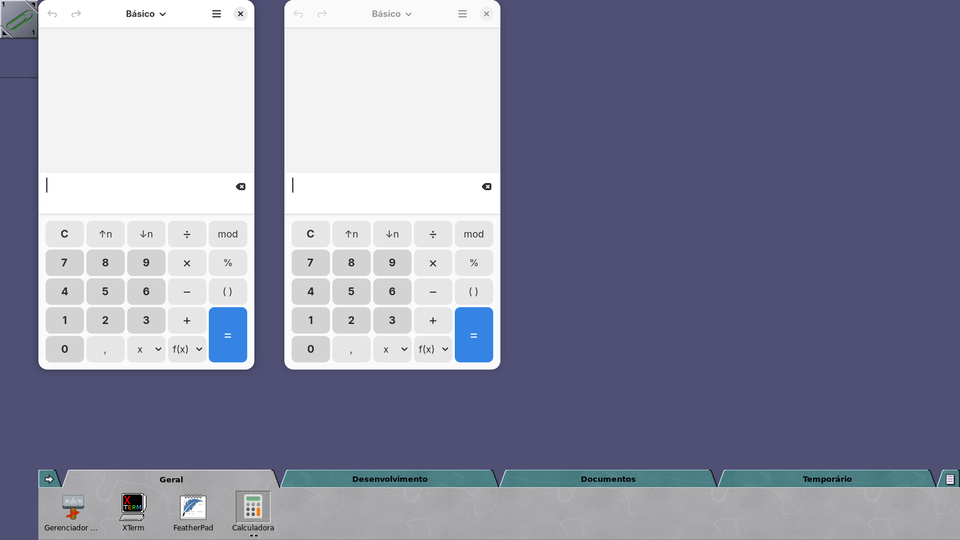 wlmaker + propostas 0042–0044: duas janelas, alternância |
| 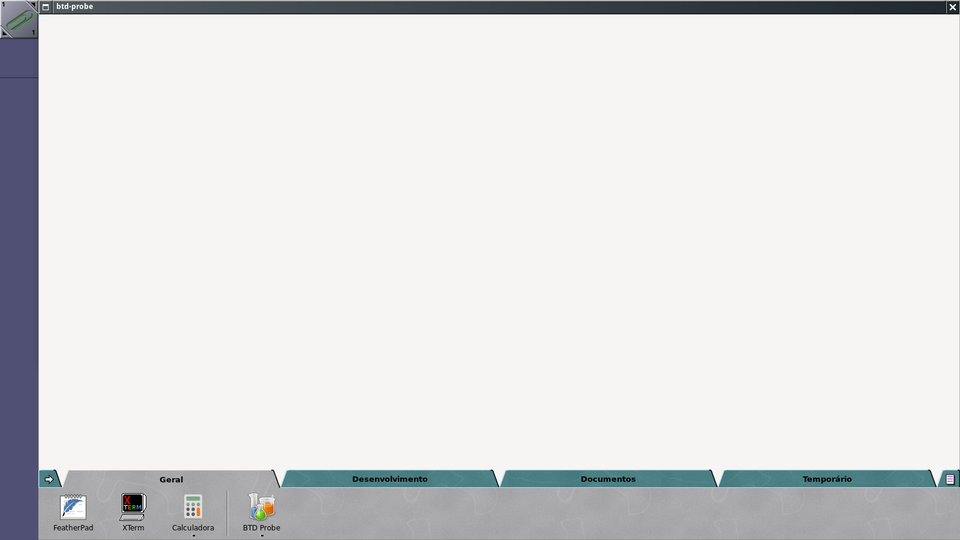 Regressão do wlmaker `f11a08a`: janela maximizada passa por baixo do dock (proposta 0044 corrige) | 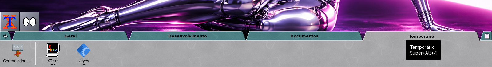 X11 depois de arrastar um item para outra aba |

## Documentação

| Documento | Conteúdo |
|---|---|
| [referencias.md](referencias.md) | Pesquisa histórica: fatos documentados × interpretação; GWorkspace TabbedShelf e licença |
| [arquitetura.md](arquitetura.md) | Arquitetura, decisões (C + GTK 3, medido), segurança, desempenho |
| [x11-wayland.md](x11-wayland.md) | Diferenças entre as sessões, limitações honestas e o que falta no wlmaker |
| [uso-e-configuracao.md](uso-e-configuracao.md) | Compilar, instalar, configurar, linha de comando, coexistência, reverter |
| [testes.md](testes.md) | Como testar, resultados reais, medições antes/depois e método |
| [propostas/](propostas/) | Patches propostos para o wlmaker e diffs para pacotes/ISO (não aplicados) |

## Uso rápido

```sh
big-wm-tabbed-dock                 # inicia (o autostart já faz isso no login)
big-wm-tabbed-dock --preferences   # preferências
big-wm-tabbed-dock --tab next      # próxima aba (para atalhos do compositor)
big-wm-tabbed-dock --dock-mode=status|classic|tabbed|both|none
```
