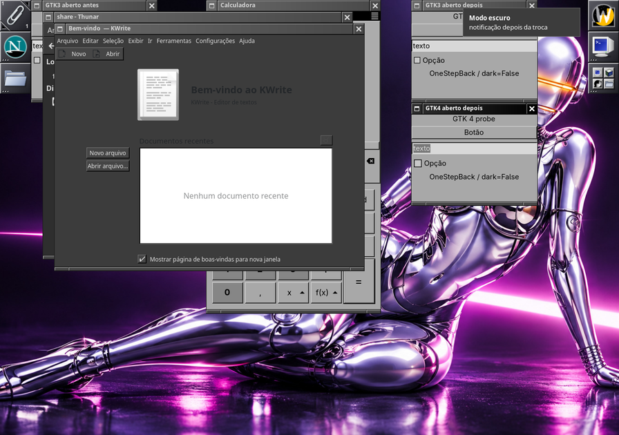
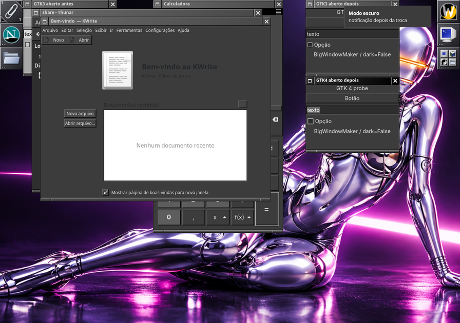
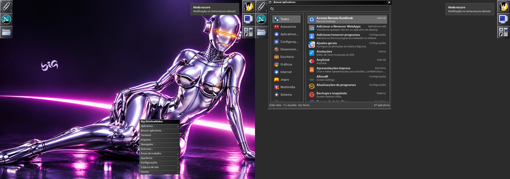
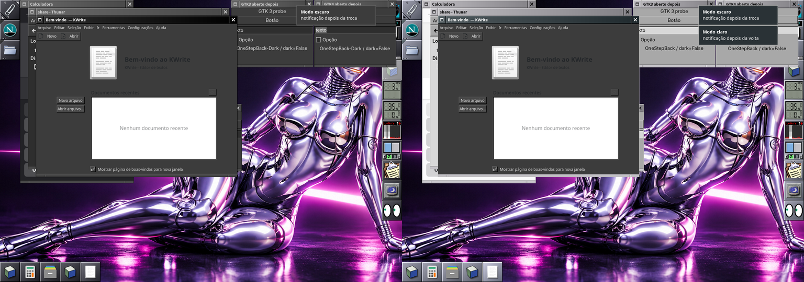

# Tema claro e escuro: troca consistente nas duas sessões

Rodada de 2026-11-09 (missão Big WindowMaker). Complementa
[aparencia.md](aparencia.md) (o que cada modo muda) e
[theme-flicker-investigation.md](theme-flicker-investigation.md) (o
`settings.ini` que fazia o GTK piscar).

## Problema

*Aparência > Tema escuro* não deixava a sessão Wayland inteira escura:

- aplicativos GTK 3 e GTK 4 abertos pelo menu raiz, pelos lançadores do Dock
  ou por atalhos saíam **claros** depois da troca;
- o Thunar e outros aplicativos ativados pelo D-Bus saíam **escuros**;
- a calculadora (libadwaita) ficava **misturada**: folha de estilo clara
  forçada com o `color-scheme` escuro (fundo escuro, botões claros).

## Causa

O `big-wm-env.sh` exportava no login `GTK_THEME=OneStepBack` (ou
`OneStepBack-Dark`). O `GTK_THEME` vale mais que qualquer configuração e é
herdado: o do wlmaker (menu raiz, Dock, teclas) ficava o do login para sempre.
O `big-wm-theme` trocava o do systemd `--user` e o da ativação do D-Bus, por
isso o Thunar do D-Bus saía no modo novo e o resto no antigo. O libadwaita com
`GTK_THEME` usa a folha do tema em vez da dele, mas pinta as cores do
`color-scheme`: com o nome claro e o esquema escuro, a mistura.

No X11 o problema não aparecia porque, desde 2026-11-01, com o `xsettingsd`
o tema vai pelo XSETTINGS (`Net/ThemeName`), sem `GTK_THEME`.

Achado no laboratório: o **gtk-nocsd** (barra de título do gerenciador de
janelas nos aplicativos GTK) fixa o `gtk-theme-name` no valor do `GTK_THEME`
quando a primeira janela é criada (ele intercepta `g_object_set`). Com o
`GTK_THEME` definido, uma janela GTK 3 aberta nunca relê o tema, nem com o
XSETTINGS nem com o gsettings. Por isso o X11 continua sem `GTK_THEME`.

## Solução

**Nome estável.** No Wayland (e no X11 sem o `xsettingsd`) o `GTK_THEME` é
sempre `BigWindowMaker`. `~/.local/share/themes/BigWindowMaker` é um link
para `/usr/share/themes/OneStepBack` ou `OneStepBack-Dark`, que o
`big-wm-theme` troca de uma vez (link novo + `rename`). O GTK procura os temas
primeiro em `$XDG_DATA_HOME/themes`. O nome nunca fica velho em nenhum
ambiente (wlmaker, systemd `--user`, D-Bus, Dock com Abas, terminais): tudo o
que abre depois da troca sai no modo novo, venha de onde vier.

| Peça | Arquivo | O que faz |
|---|---|---|
| link e nome | `session/lib/big-wm-theme.sh` | `big_wm_gtk_theme_link [modo]`, `big_wm_session_gtk_theme`, `big_wm_gtk_theme_managed`; um diretório ou link do usuário com o mesmo nome fica, e aí o `GTK_THEME` volta a ser o nome do par |
| ambiente | `session/lib/big-wm-env.sh` | `GTK_THEME=BigWindowMaker` no Wayland; X11 com `xsettingsd` sem `GTK_THEME` (`BIGWM_GTK_THEME=1` força); `GTK2_RC_FILES` pelo link nas duas; um `GTK_THEME`/`GTK2_RC_FILES` herdado que já é nosso (sessão anterior) é refeito, outro é do usuário |
| troca | `session/bin/big-wm-theme` | link antes do arquivo do modo, depois os avisos: `gtk-theme` do gsettings, `Net/ThemeName`, `color-scheme`; sessão aberta antes desta versão (`GTK_THEME=OneStepBack*` no systemd/D-Bus) passa ao nome estável |
| quem abre aplicativos | `big-wm-open`, `big-wm-launcher` | `OneStepBack*` herdado vira `BigWindowMaker` |
| sistema | `data/themes/BigWindowMaker` (`/usr/share/themes`) | o claro, para quem não tem o link (root, instalador do live) |
| Dock com Abas | `tabbed-dock/src/ui/btd-dock.c` | as janelas GTK do próprio dock (preferências, diálogos) relêem o tema na troca: ida e volta do `gtk-theme-name` por `g_object_set_property`, que o gtk-nocsd não intercepta |
| papel de parede | `session/bin/big-wm-wallpaper` | só troca o `swaybg` desta sessão (ver abaixo) |

## Componente por componente

| Componente | X11 | Wayland | Aberto antes da troca |
|---|---|---|---|
| Decoração, menus, Dock, Clip | estilo `BigWindowMaker[-Dark]` | `Theme[-Dark].plist` + reload | muda na hora |
| Dockapps (ladrilhos) | estilo do Window Maker | tema do wlmaker | ladrilho na hora; desenho do dockapp não |
| Dock com Abas | `~/.config/big-wm/theme` | idem | na hora, também as preferências |
| GTK 3 | XSETTINGS | `BigWindowMaker` | X11: na hora. Wayland: **não** (gtk-nocsd), só ao reabrir |
| GTK 4 sem libadwaita | XSETTINGS | `BigWindowMaker` | X11: na hora. Wayland: ao reabrir |
| libadwaita | Adwaita + `color-scheme` | `BigWindowMaker` (OneStepBack com as classes do libadwaita) | na hora (o `color-scheme` faz relê-lo) |
| GTK 2 | gtkrc do link | gtkrc do link | ao reabrir |
| Qt 5/6, QML (Kvantum) | `kvantum.kvconfig` | idem | ao reabrir (o Kvantum não relê) |
| Portal (`org.freedesktop.appearance color-scheme`) | `xdg-desktop-portal-gtk` lê o dconf | idem | na hora (Firefox, Chromium, Qt pelo portal) |
| dunst | `dunstctl reload` | idem | na hora |
| rofi (Buscar aplicativos) | `big-wm-dark.rasi` | idem | na próxima abertura |
| Thunar (daemon), Pamac, apps BigLinux | GTK 3/libadwaita, acima | acima | Thunar em segundo plano: `thunar -q` |
| D-Bus, systemd `--user` | sem `GTK_THEME` | `BigWindowMaker` | — |

No X11 o libadwaita continua com o Adwaita (claro/escuro pelo
`color-scheme`): dar o `GTK_THEME` ao X11 deixaria o GTK 3 aberto parado
(gtk-nocsd). É a diferença que fica entre as duas sessões.

## Escolhas do usuário

- `GTK_THEME` próprio (environment.d, `~/.xprofile`) ou `BIGWM_GTK_THEME=0`:
  nada muda.
- `~/.local/share/themes/BigWindowMaker` que não seja o nosso link (um
  diretório ou link para outro tema): fica; o `GTK_THEME` volta ao nome do par.
- `gtk-theme`, `icon-theme`, Kvantum, estilo do Window Maker, `ThemeFile` e
  `dunstrc` escolhidos pelo usuário: como antes, só o par claro/escuro é
  trocado.

## Papel de parede apagado por outra sessão

Achado durante os testes: o `big-wm-wallpaper` matava **todos** os `swaybg`
do usuário ao trocar o papel de parede. Uma sessão aninhada (os
laboratórios dos agentes) apagava o papel de parede da sessão real: no
journal, `big-wm-swaybg-2551-1794193873.service` da sessão do usuário terminou
às 01:21:48 de 2026-11-09, com um laboratório aberto. Agora só o `swaybg` com o
mesmo `WAYLAND_DISPLAY` e `XDG_RUNTIME_DIR` é trocado. Na sessão do usuário,
*Aparência > Papéis de parede* (ou `big-wm-wallpaper --restore`) devolve o
papel de parede.

## Testes

- `tests/run.sh` (todas as verificações passaram): link nos dois modos, ida e
  volta, idempotência; `GTK_THEME` da sessão aberta passa ao nome estável;
  herdado `OneStepBack-Dark` + `GTK2_RC_FILES` refeitos; `GTK_THEME` do
  usuário e diretório `BigWindowMaker` do usuário intocados; X11 com
  `xsettingsd` sem `GTK_THEME` e com o link; `BIGWM_GTK_THEME=0/1`. Os testes
  usam `XDG_DATA_HOME` próprio (nada vai para a conta de quem roda).
- Laboratório (`~/.cache/big-wm-lab-tema`): Xvfb + wlmaker aninhado (e
  Xvfb + Window Maker para o X11), D-Bus próprio com dconf, portal e Thunar
  ativados por ele, systemctl falso só para o ambiente. Sessão como a real
  (`startbigwm-wayland`/`startbigwm` com o código do worktree), aplicativos
  com o ambiente exato do wlmaker ou do wmaker (`/proc/PID/environ`), troca
  claro → escuro → claro e mais quatro alternâncias. Antes (código
  instalado) e depois, nas duas sessões: GTK 3 e GTK 4 (janelas de teste),
  gnome-calculator, Thunar pelo D-Bus, KWrite, notify-send, menu raiz,
  Buscar aplicativos e Dock com Abas.
- `swaybg`: um `swaybg` de outra sessão (mesmo `WAYLAND_DISPLAY`, outro
  `XDG_RUNTIME_DIR`) sobreviveu ao `big-wm-wallpaper --restore`; o desta
  sessão foi trocado.

## Limitações e próximos passos

- Wayland: janela GTK 3 ou GTK 4 (sem libadwaita) **já aberta** só muda ao
  reabrir (gtk-nocsd). Caminho possível: o gtk-nocsd deixar de fixar o
  `gtk-theme-name` quando o valor vem do `GTK_THEME` (patch no pacote) ou um
  módulo GTK que faça a ida e volta que o Dock com Abas faz.
- Qt/Kvantum já aberto só muda ao reabrir; aplicativos KDE (KWrite) pintam
  algumas áreas com o esquema de cores do `kdeglobals` (o da conta, também
  usado pelo Plasma): a lista "Documentos recentes" fica branca no escuro.
  Não mexemos no `kdeglobals` para não alterar o Plasma.
- Instalador do live: o `calamares-biglinux_polkit` passa ao root o nome do
  `GTK_THEME` da sessão; com o nome estável, o root recebe o
  `/usr/share/themes/BigWindowMaker` (claro). Para o instalador seguir o
  escuro, o script deve resolver o link (`readlink -f
  ~/.local/share/themes/BigWindowMaker` → `OneStepBack-Dark`) antes do `sudo`
  (repositório biglinux-livecd).
- Plain GTK 4 no Wayland não lê o `gtk-theme` do gsettings (GTK 4.22): nada
  a fazer além do nome estável.
