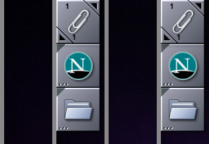

# Gráficos em máquinas virtuais

Sintoma relatado: "no VirtualBox, QEMU e Virt-Manager os gráficos ficam
falhando". Na sessão X11, pedaços de janelas somem ou ficam para trás: os
ladrilhos do Clip e os ícones aparecem cortados, e o painel Informações deixa
restos na tela depois de arrastado ou fechado.

## Causa (verificada)

O picom 13 (`backend = "xrender"`, `use-damage = true`) num **servidor X sem
aceleração 2D** perde o desenho das janelas que o servidor pinta uma vez só,
pelo fundo da janela: ladrilhos do Dock e do Clip, ícones, barras de título
do Window Maker. Quando outra janela passa por cima e sai, o picom repinta só a
área alterada e põe ali o papel de parede no lugar do ladrilho. Nada repinta
de novo até a próxima repintura total.

O que decide é o servidor X ter ou não aceleração 2D, não o hipervisor:

| Servidor X | Aceleração 2D | Defeito com `use-damage` |
|---|---|---|
| modesetting sem glamor (VirtIO 2D, QXL, VMSVGA sem 3D) | não | sim |
| Xvfb (host, sem VM) | não | sim |
| modesetting com glamor (VirtIO + VirGL) | sim | não |

Sem glamor, o Xorg recusa o llvmpipe ("Refusing to try glamor on llvmpipe")
e o provedor RandR anuncia só `Sink Output` (`cap: 0x2`). Com glamor, ele
anuncia também `Source Offload`/`Sink Offload` (`cap: 0xf`).

Hipóteses descartadas por experimento:
- **vsync:** com `vsync = false` o defeito continua (3/3).
- **o servidor pintando o fundo da raiz:** com a raiz em vermelho, os buracos
  continuam mostrando o papel de parede, que vem do picom.
- **conteúdo perdido:** o conteúdo das janelas está certo, porque uma
  repintura total (`--no-use-damage`, ou `big-wm-x11-repaint --once`) mostra
  tudo.

## Correção

`session/zoom/big-wm-picom` (o picom da sessão X11) passa `--no-use-damage`
quando `xrandr --listproviders` não mostra nenhum provedor, ou mostra o
`modesetting` sem as capacidades de offload. Nos demais casos (glamor, intel,
amdgpu, nouveau, nvidia), nada muda.

A opção vai na linha de comando porque o `picom.conf` é copiado para a conta
no primeiro login: só mudar o arquivo não chegaria às contas existentes.

Para forçar um dos modos, use `BIG_WM_PICOM_USE_DAMAGE=on|off` (`on` passa `--use-damage`). Um
`--use-damage`/`--no-use-damage` passado ao script também é respeitado.

O `big-wm-doctor` ganhou o item **Gráficos**:
- hipervisor, driver DRM e render nodes;
- no X11, a aceleração 2D e um aviso se o picom estiver com `use-damage`
  num servidor sem aceleração;
- no Wayland, o renderizador do wlmaker, com a dica de 3D do hospedeiro
  quando é pixman numa VM.

O Wayland não precisou de mudança. O wlmaker (patch 0100) escolhe o pixman
quando o GLES2 seria por software. O `startbigwm-wayland` tenta de novo uma
vez só (VMSVGA sem 3D, em que o wlroots recusa o llvmpipe), sem laço.

## Matriz (17/11/2026, ISO de 16/11, VMs transitórias no libvirt)

O estresse abre 5 xterms, move cada um 8 vezes e fecha todos. Depois, compara
a coluna do Clip com a referência (pixels diferentes, `-fuzz 8%`), em 3
rodadas.

| Vídeo | Sessão | Antes | Depois |
|---|---|---|---|
| VirtIO 2D + SPICE | X11 | **falhou** (41–45 % da coluna, 3/3) | passou (0, 3/3) |
| VirtIO 2D + SPICE | X11, painel Informações arrastado e fechado | **falhou** (156 px) | passou (0) |
| VirtIO 2D + SPICE | Wayland (pixman) | passou (0, 3/3) | sem mudança |
| VirtIO + VirGL (egl-headless) | X11 (glamor) | passou (0, 3/3) | passou, sem `--no-use-damage` |
| VirtIO + VirGL (egl-headless) | Wayland (GLES2 virgl) | passou (0, 3/3) | sem mudança |
| QXL + SPICE | X11 | **falhou** (18–44 %, 3/3) | passou (0, 3/3) |
| QXL + SPICE | Wayland (pixman) | passou (0, 3/3) | sem mudança |
| Xvfb no host (sem VM) | X11 | **falhou** (3/3) | passou com `--no-use-damage` (0, 3/3) |
| VirtIO 2D, uso contínuo (~18 min, 10 rodadas de estresse + painel) | X11 | — | passou (0 em 10/10; mesmo picom, sem erros nem coredump) |

Não testado:
- **VirtualBox:** não está instalado no hospedeiro. Pela análise, o VMSVGA sem
  3D usa o modesetting sem glamor, porque a ISO não traz o driver vmware do
  Xorg; a correção então vale para ele.
- **Visualizadores no hospedeiro** (virt-viewer, remote-viewer): as capturas
  são do framebuffer do convidado (`virsh screenshot`) ou do VNC do
  egl-headless.
- **Sistema instalado:** é o mesmo script de sessão da live.
- **Hardware real com X11.**

## Custo

O custo foi medido no VirtIO 2D em repouso, por 60 s, com os dockapps
animando, em dois pares A/B. Picom + Xorg passaram de 14–15 para 31–33 ticks
(cerca de 0,3 % de um núcleo). Só acontece em servidores sem aceleração.

## Reproduzir

O laboratório de VM está descrito em `docs/wayland-test-lab.md`. Na sessão X11
da VM:

```sh
systemctl --user set-environment BIG_WM_PICOM_USE_DAMAGE=on   # comportamento antigo
systemctl --user restart app-picom@autostart.service
for i in 1 2 3 4 5; do xterm -e sleep 60 & done; sleep 2
for w in $(xdotool search --class XTerm); do xdotool windowmove $w 0 0; done
pkill -f 'xterm -e sleep 60'   # o Clip fica cortado
systemctl --user unset-environment BIG_WM_PICOM_USE_DAMAGE
systemctl --user restart app-picom@autostart.service             # de volta ao automático
```

Para verificar a escolha: `xrandr --listproviders`, `pgrep -a picom` e
`big-wm-doctor`.

## Reverter

Exporte `BIG_WM_PICOM_USE_DAMAGE=on` na sessão (por exemplo em
`~/.config/environment.d/`). Outra opção é reinstalar o `big-wm-session`
anterior.

## Para quem usa VM / For VM users

- **virt-manager/QEMU:** em Vídeo, use **Virtio** com **Aceleração 3D**, e em
  Tela SPICE marque **OpenGL** (só com o visualizador local). Sem 3D funciona
  também: a tela é desenhada pelo processador.
- **VirtualBox:** use o controlador **VMSVGA**. A **aceleração 3D** é opcional.

*English:* in virt-manager use Video **Virtio** with **3D acceleration** and
**OpenGL** on the SPICE display (local viewer only). In VirtualBox use
**VMSVGA**; 3D is optional. Without 3D the session still draws correctly, in
software.


