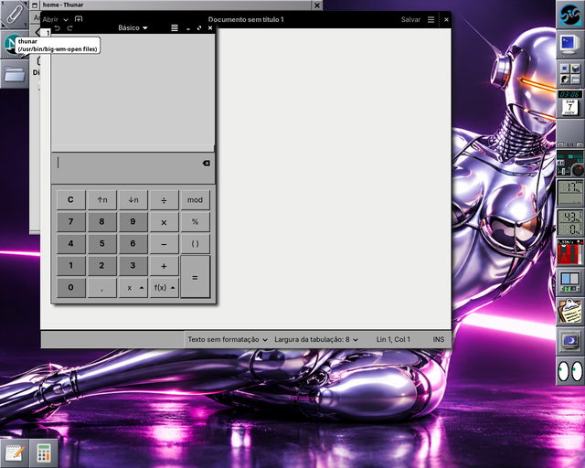
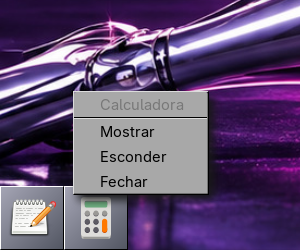

# Ícones dos aplicativos (appicons) no Wayland

No Window Maker, cada aplicativo aberto que não está no Dock nem no Clip
ganha um ícone (appicon) numa fileira a partir do canto de baixo, à
esquerda. O wlmaker não tem isso; na sessão Wayland do Big WindowMaker o
`big-wm-appicons` (do projeto `tabbed-dock`, iniciado pelo autostart
`big-wm-wayland-appicons.desktop`) faz o papel:

- um ladrilho por aplicativo (as janelas agrupadas como no Dock com abas),
  com o ícone do `WMWindowAttributes` ou o do `.desktop`;
- abaixo das janelas (camada `bottom` do layer shell), na área útil (acima
  de um painel com zona exclusiva, como o Dock com abas);
- **duplo clique**: mostra o aplicativo (restaura e traz as janelas);
- **clique direito**: menu Mostrar, Esconder, Fechar (abre para cima);
- escondido (todas as janelas minimizadas): o ícone fica esmaecido;
- quem tem lançador no Dock ou no Clip (`AppID` no `State.plist`) aparece
  lá, não aqui; muda junto quando o `State.plist` muda;
- modo escuro do Big WindowMaker (`~/.config/big-wm/theme`), ao vivo.

No X11 o programa sai na hora: o Window Maker desenha os próprios appicons.

As janelas vêm do `zwlr_foreign_toplevel_manager_v1` do wlmaker. Corrigido
junto: o rastreador do Dock com abas contava cada janela duas vezes no
wlmaker (a lista `ext_foreign_toplevel_list_v1` mandava as janelas que já
vinham pelo protocolo wlr antes de parar).

Limitações: não há miniaturas (miniwindows) de janelas minimizadas, como
no Window Maker; arrastar um appicon para o Dock/Clip ainda não acopla.
