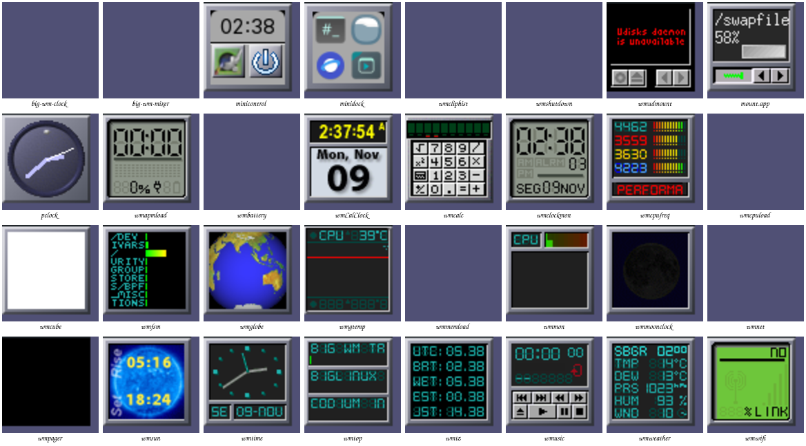
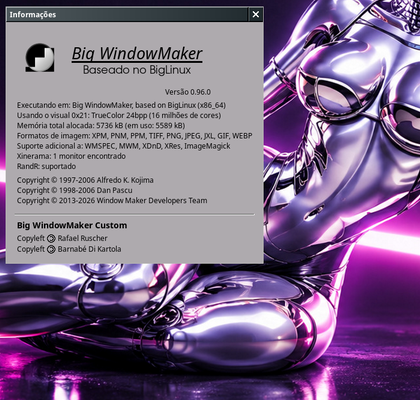
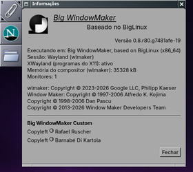

# Dockapps na sessão Wayland (wlmaker)

Referência: o Dock da sessão X11 (Window Maker). Na sessão Wayland os
mesmos programas rodam pelo XWayland e o wlmaker põe a janela de ícone de
cada um num ladrilho do Dock ou do Clip, como o Window Maker faz no X11.

Capturas reais (laboratório: Xvfb 1280x1024, Window Maker do pacote na
esquerda; wlmaker do ramo `big-wm/missao-2026-11` aninhado, XWayland, na
direita). A diferença de valores (CPU, rede, hora) é só o momento da captura.

## O que vai no Dock

Padrão do `big-wm-dockapps` (sem `~/.config/big-wm/dockapps`), na ordem do
Dock do X11 (`Dock.Dockapps` do `State.plist`; o wlmaker põe cada um na sua
posição, qualquer que seja a ordem em que os programas sobem):

| X11 (Window Maker)   | Wayland                          | Sem XWayland / sem o programa |
|----------------------|----------------------------------|-------------------------------|
| wmclock (big-wm-clock) | o mesmo, pelo XWayland         | wlmcalclock, wlmclock         |
| wmsystemtray         | big-wm-tray                      | —                             |
| wmix (big-wm-mixer)  | o mesmo, pelo XWayland           | wlmmixer                      |
| wmcpuload            | o mesmo                          | wlmcpugraph                   |
| wmmemload            | o mesmo                          | wlmmemgraph                   |
| wmnet                | `wmnet -w`                       | wlmnetgraph                   |
| wmake-zones          | wmake-zones-wl                   | —                             |
| wmcliphist           | o mesmo (GTK com `GDK_BACKEND=x11`) | —                          |
| wmshutdown           | o mesmo (GTK com `GDK_BACKEND=x11`) | —                          |
| wmeyes               | `wlmeyes --dockapp`              | —                             |

Os outros ficam no menu Aparência > Dockapps do Wayland, que tem os mesmos
dockapps do catálogo do X11 (tabela abaixo); o item "Sobre os dockapps do
X11" explica os que lá viram o equivalente do Wayland e o wmpager.

## Auditoria: catálogo do X11 no Wayland (novembro de 2026)

Laboratório `mklab.sh dockapps`: wlmaker do ramo `fix/wmcliphist-menu-2026-11`
aninhado em Xvfb, XWayland (também no modo preguiçoso da sessão real), cada
dockapp sozinho; o log do wlmaker diz se virou ladrilho ("X11 dock-app ...
Shown/Mapped") e as capturas mostram o que ele desenha. Sem barramento do
sistema e com systemctl/loginctl bloqueados: nada que dependa do logind, do
UDisks ou do UPower roda no laboratório (e nenhum botão de desligar foi
clicado). Tudo que é X11 depende do XWayland (`DISPLAY`); sem ele o menu só
mostra os nativos `wlm*`.

| Dockapp | X11 | Wayland | Como funciona no Wayland | Limitação | Evidência |
|---|---|---|---|---|---|
| wmclock (big-wm-clock) | sim | sim | XWayland, ladrilho; clique abre o calendário | — | Dock padrão, captura do Dock |
| wmCalClock | sim | sim | XWayland | — | ladrilho (auditoria) |
| wmtime | sim | sim | XWayland | os cliques rodam os comandos configurados com o ambiente da sessão | ladrilho, cliques sem erro |
| wmclockmon | sim | sim | XWayland | — | ladrilho, cliques |
| wmtz | sim | sim | XWayland; o menu interno (clique) abre no próprio ladrilho | — | captura do menu interno |
| pclock | sim | sim | XWayland | — | ladrilho |
| minicontrol | sim | sim | XWayland, GTK com `GDK_BACKEND=x11`; o relógio abre a janela dele | WPrefs é do X11; desligar/reiniciar usam o systemctl (não testados no laboratório) | ladrilho, janela no log |
| wmcpuload | sim | sim | XWayland | — | Dock padrão |
| wmcube | sim | sim | XWayland | — | ladrilho |
| wmcpufreq | sim | sim | XWayland | só com driver cpufreq (o menu esconde sem ele) | ladrilho |
| wmmon | sim | sim | XWayland | — | ladrilho |
| wmtop | sim | sim | XWayland; esquerdo alterna CPU/memória | — | ladrilho |
| wmmemload | sim | sim | XWayland | — | Dock padrão |
| wmfsm | sim | sim | XWayland | — | ladrilho |
| wmgtemp | sim | sim | XWayland | só com sensores (o menu esconde sem eles) | ladrilho |
| wmnet | sim | sim | XWayland, com `-w` | — | Dock padrão |
| wmwifi | sim | sim | XWayland | — | ladrilho |
| wmbattery | sim | sim | XWayland | só com bateria (sai sem UPower/ACPI); não testado no laboratório | log (sem bateria) |
| wmapmload | sim | sim | XWayland | só com bateria (o menu esconde sem ela) | ladrilho |
| wmix (big-wm-mixer) | sim | sim | XWayland | no laboratório aborta sem o PipeWire | Dock padrão (sessão real) |
| wmusic | sim | sim | XWayland; duplo clique roda `big-wm-open music` | — | ladrilho; aspas do `-c` preservadas |
| wmweather | sim | sim | XWayland, METAR por HTTPS | precisa de rede | ladrilho com dados |
| wmsun | sim | sim | XWayland | — | ladrilho |
| wmmoonclock | sim | sim | XWayland | — | ladrilho |
| wmglobe | sim | sim | XWayland | — | ladrilho |
| wmsystemtray | sim | big-wm-tray | bandeja SNI nativa (adotada pelo wlmaker) | o wmsystemtray só veria ícones XEmbed de programas X11 | menu |
| wmcliphist | sim | sim | XWayland, GTK; menus como overlay acima do Dock | ver `wmcliphist-wayland.md` | testes de menu e área de transferência |
| wmcalc | sim | sim | XWayland | — | ladrilho |
| wmpager | sim | não | — | as áreas de trabalho do wlmaker não chegam aos clientes X11 (sem EWMH no XWayland): ele não teria o que mostrar | ladrilho preto, "couldn't determine current workspace" |
| minidock | sim | sim | XWayland, GTK; os botões usam `big-wm-open`, que tira o `GDK_BACKEND=x11` (o Thunar abriu nativo no Wayland) | — | captura, processo sem `GDK_BACKEND` |
| wmudmount | sim | sim | XWayland, GTK | precisa do UDisks (barramento do sistema): no laboratório "Udisks daemon is unavailable" | ladrilho |
| mount.app | sim | sim | XWayland | montar depende das permissões do fstab | ladrilho |
| wmshutdown | sim | sim | XWayland, GTK; diálogo como janela comum | usa o logind: só conferido pelo código, nunca clicado | captura do diálogo (antes) |
| wmake-zones | sim | wmake-zones-wl | nativo Wayland | o do X11 depende do Window Maker | menu |
| wmeyes | sim | wlmeyes --dockapp | nativo, protocolo de observação do wlmaker | o do XWayland só vê o ponteiro sobre janelas X11 | captura dos olhos |

Os de GTK (wmcliphist, wmshutdown, minidock, minicontrol, wmudmount) abrem
com `GDK_BACKEND=x11 BIG_WM_DOCKAPP_X11=1`; os outros sem `GDK_BACKEND`, para
os programas que eles abrem não herdarem o backend X11.

Um nativo acoplado antes (`Order`/`Dock` do `Dockapps.plist`) não roda ao
lado do dockapp do X11 que o substituiu; os tirados (`Removed`) continuam
de fora, pelo nome do ladrilho (o WM_CLASS: `wmclock`, `wmix`...).

## Como funciona (wlmaker)

- **Ladrilho**: a regra do Window Maker (WM_HINTS em WithdrawnState, ou
  classe `DockApp`); a janela de ícone vira o conteúdo do ladrilho, sem
  janela. Os dockapps wmgeneral (ícone filho do líder) mostram o líder.
- **Forma (X Shape)**: o recorte da janela de ícone é respeitado; o
  ladrilho aparece em volta (bordas redondas do wmclock, wmcliphist, wmix).
  O wlroots recorta a superfície a um retângulo; cada retângulo da forma é
  uma cópia recortada da mesma superfície.
- **Menus e dicas** sem janela-mãe (override-redirect, como o menu do
  wmcliphist): acima de tudo, inclusive do Dock, onde o programa os pôs,
  sem decoração. Um menu segura o ponteiro como a captura (grab) do X11: o
  clique fora vai só para o programa dele, uma vez, e o fecha. Um clique
  no dockapp é uma captura implícita, como no X11: com o botão segurado o
  ponteiro continua com ele (senão o Xwayland soltaria o botão ao trocar de
  superfície e o menu do GTK fecharia na hora; ver `wmcliphist-wayland.md`),
  e o menu recebe o teclado enquanto está aberto.

- **Diálogos** (o "Shutdown confirmation" do wmshutdown) são janelas
  comuns, decoradas, como no X11.

## Limitações conhecidas

- **wmeyes**: o XWayland só sabe onde está o ponteiro quando ele está sobre
  uma janela X11; os olhos do wmeyes ficariam parados. Não há como dar ao
  XWayland a posição global sem injetar eventos, o que não se faz. O
  `wlmeyes --dockapp` desenha o wmeyes pixel a pixel e segue o ponteiro pela
  tela pelo protocolo de observação de entrada do wlmaker (a posição é
  relativa à própria superfície do cliente).

  

- **Laboratório**: sem o socket do PipeWire no diretório de execução, o
  wmix aborta numa asserção da ALSA (`mixer_alsa_set_channel`); numa sessão
  de verdade o socket existe. O wmshutdown do laboratório roda sem o
  barramento do sistema (nunca desliga a máquina dos testes).
- O XWayland precisa estar ativo (`DISPLAY` no ambiente da sessão); sem
  ele, os nativos `wlm*`.

## Testes

- `tests/run.sh` (6a1b): padrão com e sem XWayland, acoplados e tirados,
  sem duplicar a função; menu Dockapps do Wayland com e sem XWayland.
- wlmaker: testes de unidade (11 binários, todos passando); conferência
  visual no laboratório descrito em `wayland-test-lab.md`.

## Sobre o Big WindowMaker (painel de informações)

No X11, um duplo clique no ladrilho principal do Dock (ou Sessão > Sobre,
no menu) abre o Info Panel do Window Maker com os créditos da edição. No
Wayland o mesmo duplo clique roda o `Dock.InfoCommand` do `State.plist`
(`big-wm-about`; o firstrun o acrescenta uma vez a um State.plist antigo),
e o menu Sessão ganhou o item Sobre. O painel mostra o nome da edição, o
sistema, a sessão, o XWayland, a memória do compositor, os avisos de
copyright (wlmaker e Window Maker) e os créditos do Big WindowMaker Custom.

 

O painel tem as medidas, as fontes, o espaçamento e a barra de título do
X11 (só o título e o X: o `WindowAttributes` padrão tira o botão de
miniaturizar do `big-wm-about`, e uma janela de tamanho fixo não tem a
barra de redimensionar). As linhas do sistema dizem o equivalente do
Wayland, e há uma linha de copyright a mais, a do wlmaker.

Limitação: no Wayland o cliente não escolhe onde a janela abre; o painel
fica onde o wlmaker põe as janelas novas, não no centro como no X11.
