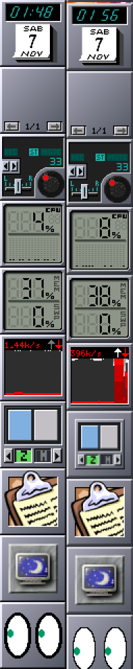
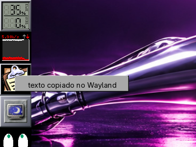
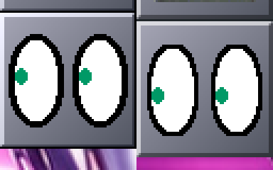

# Dockapps na sessão Wayland (wlmaker)

Referência: o Dock da sessão X11 (Window Maker). Na sessão Wayland os
mesmos programas rodam pelo XWayland e o wlmaker põe a janela de ícone de
cada um num ladrilho do Dock ou do Clip, como o Window Maker faz no X11.

Capturas reais (laboratório: Xvfb 1280x1024, Window Maker do pacote na
esquerda; wlmaker do ramo `big-wm/missao-2026-11` aninhado, XWayland, na
direita). A diferença de valores (CPU, rede, hora) é só o momento da captura.

## O que vai no Dock

Padrão do `big-wm-dockapps` (sem `~/.config/big-wm/dockapps`), na ordem do
Dock do X11 (`Dock.Dockapps` do `State.plist`; o wlmaker põe cada um na sua
posição, qualquer que seja a ordem em que os programas sobem):

| X11 (Window Maker)   | Wayland                          | Sem XWayland / sem o programa |
|----------------------|----------------------------------|-------------------------------|
| wmclock (big-wm-clock) | o mesmo, pelo XWayland         | wlmcalclock, wlmclock         |
| wmsystemtray         | big-wm-tray                      | —                             |
| wmix (big-wm-mixer)  | o mesmo, pelo XWayland           | wlmmixer                      |
| wmcpuload            | o mesmo                          | wlmcpugraph                   |
| wmmemload            | o mesmo                          | wlmmemgraph                   |
| wmnet                | `wmnet -w`                       | wlmnetgraph                   |
| wmake-zones          | wmake-zones-wl                   | —                             |
| wmcliphist           | o mesmo (GTK com `GDK_BACKEND=x11`) | —                          |
| wmshutdown           | o mesmo (GTK com `GDK_BACKEND=x11`) | —                          |
| wmeyes               | `wlmeyes --dockapp`              | —                             |

Os outros conferidos no laboratório ficam no menu Aparência > Dockapps do
Wayland: wmcube, wmfsm, wmgtemp, wmglobe. Os demais dockapps do X11 não
foram conferidos no Wayland; o item "Sobre os dockapps do X11" os lista.

Um nativo acoplado antes (`Order`/`Dock` do `Dockapps.plist`) não roda ao
lado do dockapp do X11 que o substituiu; os tirados (`Removed`) continuam
de fora, pelo nome do ladrilho (o WM_CLASS: `wmclock`, `wmix`...).

## Como funciona (wlmaker)

- **Ladrilho**: a regra do Window Maker (WM_HINTS em WithdrawnState, ou
  classe `DockApp`); a janela de ícone vira o conteúdo do ladrilho, sem
  janela. Os dockapps wmgeneral (ícone filho do líder) mostram o líder.
- **Forma (X Shape)**: o recorte da janela de ícone é respeitado; o
  ladrilho aparece em volta (bordas redondas do wmclock, wmcliphist, wmix).
  O wlroots recorta a superfície a um retângulo; cada retângulo da forma é
  uma cópia recortada da mesma superfície.
- **Menus e dicas** sem janela-mãe (override-redirect, como o menu do
  wmcliphist): acima de tudo, inclusive do Dock, onde o programa os pôs,
  sem decoração. Um menu segura o ponteiro como a captura (grab) do X11: o
  clique fora vai só para o programa dele, uma vez, e o fecha.

- **Diálogos** (o "Shutdown confirmation" do wmshutdown) são janelas
  comuns, decoradas, como no X11.

## Limitações conhecidas

- **wmeyes**: o XWayland só sabe onde está o ponteiro quando ele está sobre
  uma janela X11; os olhos do wmeyes ficariam parados. Não há como dar ao
  XWayland a posição global sem injetar eventos, o que não se faz. O
  `wlmeyes --dockapp` desenha o wmeyes pixel a pixel e segue o ponteiro pela
  tela pelo protocolo de observação de entrada do wlmaker (a posição é
  relativa à própria superfície do cliente).

  

- **Laboratório**: sem o socket do PipeWire no diretório de execução, o
  wmix aborta numa asserção da ALSA (`mixer_alsa_set_channel`); numa sessão
  de verdade o socket existe. O wmshutdown do laboratório roda sem o
  barramento do sistema (nunca desliga a máquina dos testes).
- O XWayland precisa estar ativo (`DISPLAY` no ambiente da sessão); sem
  ele, os nativos `wlm*`.

## Testes

- `tests/run.sh` (6a1b): padrão com e sem XWayland, acoplados e tirados,
  sem duplicar a função; menu Dockapps do Wayland com e sem XWayland.
- wlmaker: testes de unidade (11 binários, todos passando); conferência
  visual no laboratório descrito em `wayland-test-lab.md`.
