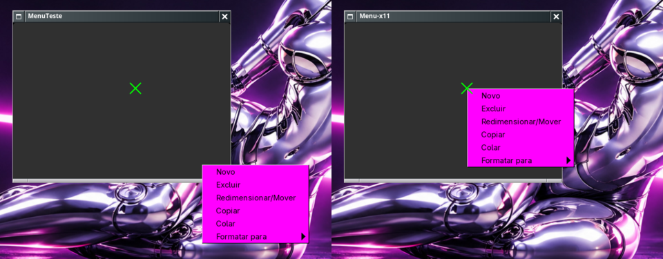

# Menus e popups fora do lugar no Wayland — auditoria e correção

Data: 11/11/2026. Correção no wlmaker (patch 0147 do pacote, wlmaker 34);
teste de regressão em `tests/integration/wayland-popups.sh`.

À esquerda, wlmaker 33: aplicativo GTK pelo XWayland, janela arrastada,
clique direito em 601,450 — o menu abre em 731,599 (o sintoma do GParted).
À direita, wlmaker 34: o menu abre em 603,452 (2 px do GTK).

## Sintomas

- Menus de contexto de aplicativos X11 (XWayland) — o do GParted (Novo,
  Excluir, Redimensionar/Mover, … Formatar para) — longe do ponteiro,
  embaixo à direita, tanto mais longe quanto mais a janela estava longe de
  0,0.
- Menus de aplicativos Wayland nativos (Thunar, Kate) deslocados pela
  sombra do menu e cortados na borda da saída em vez de inverter.

## Causas

1. **XWayland, menus com pai** (`xwl_surface.c`). Um menu
   *override-redirect* com `WM_TRANSIENT_FOR` fica dentro do contêiner da
   janela-mãe; a posição do elemento deve ser a posição de raiz do menu
   menos a da mãe. O código subtraía também a posição anterior do próprio
   menu. No upstream isso não aparecia, porque o X achava que toda janela
   estava em 0,0; desde que o X passou a saber a posição real das janelas
   (correção de geometria do XWayland do Big WindowMaker, aa91c3e), o erro
   ficou do tamanho da posição da janela.
2. **XWayland, janela posta pelo workspace** (zonas, cascata): o X não era
   avisado da posição depois do mapeamento, e as coordenadas de raiz do
   ponteiro (de onde o GTK calcula o menu) ficavam erradas.
3. **xdg_popup, sombra** (`xdg_popup.c`): a superfície do popup não
   descontava a geometria da janela (a sombra do menu), que o
   `xdg_positioner` não conta.
4. **xdg_popup, borda da saída**: nenhum `unconstrain`; o menu passava da
   borda. Agora `wlr_xdg_popup_unconstrain_from_box` com a caixa da saída
   em coordenadas da janela de topo, e o menu inverte.

Não houve deslocamento fixo, exceção por aplicativo, troca de backend nem
script de reposição. As molduras do Window Maker continuam em todas as
janelas; nenhum popup ganhou moldura.

## Arquivos

wlmaker (`src/xwl_surface.c`, `src/xdg_popup.c`, `src/xdg_popup.h`,
`src/xdg_toplevel.c`, `src/layer_panel.c`, `src/icon_manager.c`) →
`packages/wlmaker/0147-popups-XWayland-menus-and-xdg_popups-open-where-the-app-asked.patch`.
Teste unitário `xwl_surface` `test_nested` estendido (falha no código
antigo, passa no novo).

## Desempenho

Só eventos (configuração, commit, mapeamento); nenhum *polling*, nenhum
temporizador.
