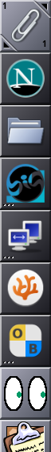
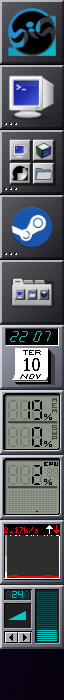
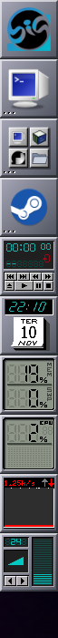

# 02 — Reprodução

## Sessão real (22:07–22:10)

Tema `light` desde 21:53, mas:

- Clip: o ladrilho do próprio Clip (o clipe) **claro**; os lançadores
  `firefox`, `thunar`, `org.bigwindowmaker.Welcome`,
  `org.bigwindowmaker.DisplayResolution` (o `org.bigwindowmaker.Display` do
  pedido), `codium-insiders` e `onboard` **escuros**; os dockapps X11 no fim
  da coluna, claros.
- WMDock: ladrilho principal, `org.communitybig.ashyterm` (o AppID real; o
  pedido diz `communitibig`), `rofi` e `steam` **escuros**; os dockapps X11,
  escuros também.

Mandar à mão, ao processo do WMDock, o SIGHUP que o wlmaker deveria ter
mandado deixou-o claro na hora:

## Laboratório (wlmaker 31 instalado, aninhado)

| wlmdock | escuro | claro | escuro | claro | `comm` |
|---|---|---|---|---|---|
| antigo | troca | **preso** | preso | preso | `exe` |
| novo (0145) | troca | troca | troca | troca | `wlmdock` |

Medida: cor do ladrilho de um lançador do Clip e de um do Dock
(84 escuro, 155 claro).
