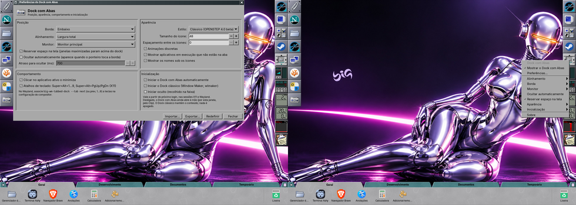

# 09 — Dock com Abas

Testado no laboratório, com o controlador e a barra (Wayland nativa,
layer-shell, `wlr-foreign-toplevel`) depois de três trocas de tema:

| Ação | Resultado |
|---|---|
| ▶ (4×) | Direita → Centro → Esquerda → Largura total → Direita |
| ◀ (2×) | ao contrário |
| ▲ / ▼ | borda em cima / embaixo (cinco vezes seguidas, com o Dock movendo) |
| duplo clique no ícone | abre "Preferências do Dock com Abas" |
| botão direito | menu (Mostrar, Preferências, Alinhamento, Borda, Monitor, Ocultar, Reservar espaço, Aparência, Inicialização, Sobre) |
| barra encerrada e iniciada de novo com o controlador aberto | o controlador volta a comandá-la (nome do D-Bus vigiado, sem polling) |
| tema claro ↔ escuro | barra e controlador trocam na hora (monitor de arquivo em `~/.config/big-wm/theme`) |

Nenhuma mudança de código foi necessária no repositório `tabbed-dock`; o
registro do caso está no `docs/17-controlador-wayland.md` dele.
