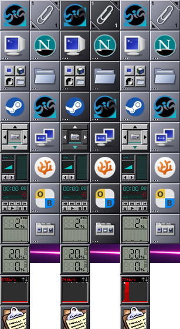

# 12 — Wayland

- Laboratório (wlmaker aninhado, XWayland `:2`), com o State.plist e o
  Dockapps.plist reais e os ícones do usuário: claro → escuro → claro com
  todos os lançadores do Clip e do Dock, o controlador, os dockapps X11 e a
  barra acompanhando.

- Combinações: wlmaker 31 + wlmdock antigo (preso a partir da 2ª troca),
  wlmaker 31 + wlmdock novo (todas), wlmaker 32 + wlmdock antigo (todas,
  pelo executável), wlmaker 32 + wlmdock novo (todas).
- Sessão real: wlmdock novos (unidades reiniciadas), quatro trocas;
  os dois recomeçaram na última e mantiveram o nome. A captura da tela real
  depois da correção ficou pendente: a tela bloqueou por inatividade às
  22:17 (o grim mostra o gtklock).
- wlmaker: `ctest` 30/30 no pacote -32 (com `LANG=C.UTF-8`; ver 14).
