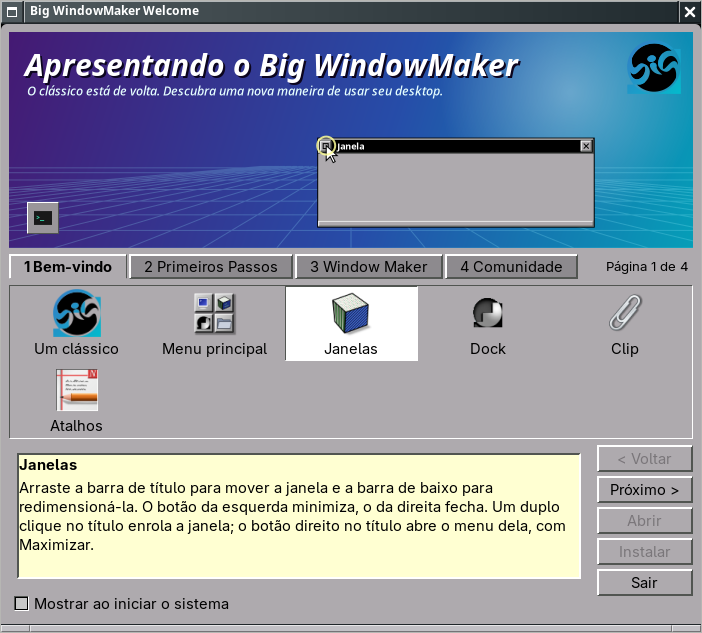
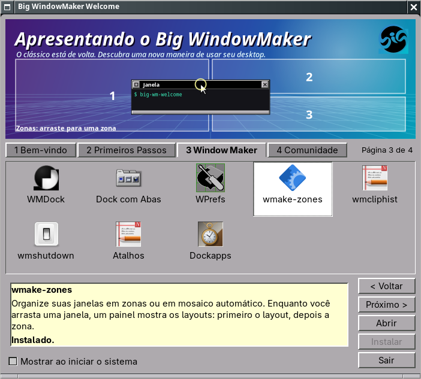
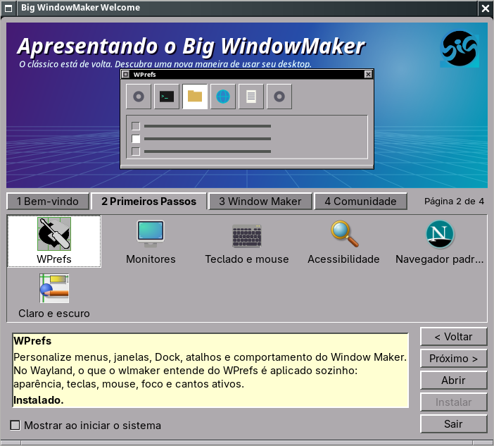
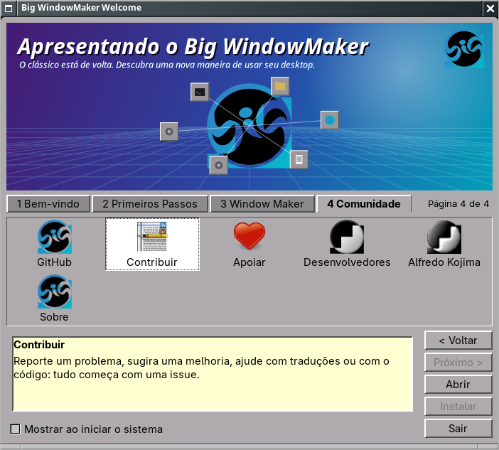
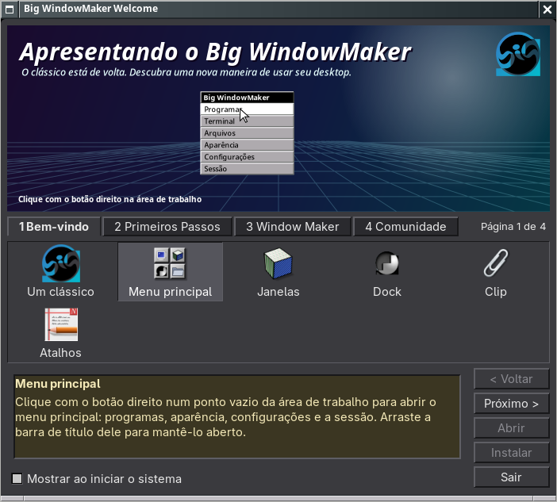

# Big WindowMaker Welcome (`big-wm-welcome`)

"Apresentando o Big WindowMaker": o tutorial do primeiro login, com a cara de
um programa de apresentação dos anos 90 (inspiração no *Introducing OS/2*) e
a identidade do Window Maker, NeXTSTEP e OPENSTEP. Ensina o básico (menu,
janelas, Dock, Clip, atalhos), abre as configurações essenciais e apresenta as
ferramentas e a comunidade. Funciona nas sessões X11 e Wayland.

| Página 1 (Wayland) | Página 3 (Wayland) |
|---|---|
|  |  |
| **Página 2** | **Página 4** |
|  |  |

Capturas reais do laboratório (wlmaker aninhado num Xvfb, `docs/wayland-test-lab.md`).

## Decisões

- **Python + GTK 3 (PyGObject)**, como o `big-wm-about`: o GTK 3 aceita o CSS
  que desenha os relevos do OPENSTEP com precisão; nada de libadwaita, Electron
  ou navegador embutido. A ilustração e as demonstrações são desenhadas com
  cairo (sem imagens além do logo oficial e dos ícones clássicos do Window
  Maker em `/usr/share/WindowMaker/Icons`).
- **Nenhum código do BigLinux Welcome** (GPL-3.0); só as ideias (páginas
  declarativas, detecção de programas, instalação revisada). O Big WindowMaker
  é GPL-2.0-or-later.
- **Instalar** não tem código privilegiado: abre `pamac-manager --install
  PACOTE`, que mostra o que será instalado, pede a senha (Polkit), mostra o
  progresso e confere o resultado. O botão só aparece com um pacote conhecido
  e o Pamac presente.
- **Atalhos** vêm da configuração real: `~/.config/wlmaker/Config.plist`
  (KeyBindings) no Wayland; o domínio `WindowMaker` e os `SHORTCUT` do
  `WMRootMenu` no X11. O que não está configurado não aparece (o "Super+V" do
  wmcliphist só se existir).
- **Nada desliga a máquina**: o wmshutdown só é explicado (teste automático
  garante que nenhum tópico chama systemctl, shutdown etc.).

## Arquivos

| Arquivo | Papel |
|---|---|
| `welcome/big-wm-welcome` | comando; `--autostart` decide sem abrir o GTK |
| `welcome/bigwmwelcome/system.py` | sessão, plist, atalhos, programas, preferências (sem GTK) |
| `welcome/bigwmwelcome/pages.py` | as quatro páginas e seus tópicos (declarativo) |
| `welcome/bigwmwelcome/art.py` | ilustração e demonstrações (cairo) |
| `welcome/bigwmwelcome/ui.py` | a janela, o CSS claro/escuro, os diálogos |
| `welcome/po/` | gettext; textos em inglês, tradução pt_BR completa |
| `welcome/data/org.bigwindowmaker.Welcome.desktop` | menu Aplicativos |
| `welcome/data/big-wm-welcome-autostart.desktop` | `/etc/xdg/autostart/big-wm-welcome.desktop` |
| `tests/welcome/test_welcome.py` | 14 testes (também no `tests/run.sh`) |

Instalado em `/usr/bin/big-wm-welcome`, `/usr/share/big-wm/welcome/`,
`/usr/share/locale/*/LC_MESSAGES/big-wm-welcome.mo`; pacote `big-wm-welcome`
(`pkgbuild/PKGBUILD`, `make install-welcome`). Preferências em
`~/.config/big-wm/welcome.conf`.

## Layout

1. Barra de título do Window Maker/wlmaker (decoração do servidor, sem barra
   desenhada dentro).
2. Ilustração: céu roxo-ciano, grade em perspectiva, título "Apresentando o
   Big WindowMaker", logo; a demonstração do tópico escolhido.
3. Quatro abas clássicas e "Página N de 4".
4. Grade compacta de ícones clássicos.
5. Painel amarelo-claro de instruções (no escuro, amarelo escuro), com o estado
   do item; botões 3D à direita: Voltar, Próximo, Abrir (Copiar no Pix),
   Instalar, Sair; "Mostrar ao iniciar o sistema".

Teclado: Alt+←/→ páginas, Tab percorre, Enter num ícone executa a ação, F1
volta à explicação da página, Ctrl+Q sai, Esc fecha os diálogos.

## Páginas

| Página | Tópicos (ação) |
|---|---|
| 1 Bem-vindo | Um clássico, Menu principal, Janelas, Dock, Clip (demonstrações); Atalhos (lista real) |
| 2 Primeiros Passos | WPrefs; Monitores (ARandR no X11, wdisplays no Wayland); Teclado e mouse (WPrefs); Acessibilidade (localizar o ponteiro e Onboard no X11, tema escuro); Navegador padrão (`xdg-settings`); Claro e escuro (`big-wm-theme`) |
| 3 Conheça o WindowMaker | WMDock; Dock com Abas (`--preferences`); WPrefs; wmake-zones (`wmake-zones-prefs`); wmcliphist; wmshutdown; Atalhos; Dockapps (galeria dos instalados) |
| 4 Comunidade e Sobre | GitHub; Contribuir (nova issue); Apoiar (copia a chave Pix); Desenvolvedores; Alfredo Kojima (homenagem); Sobre |

Idioma e layout do teclado não têm ferramenta gráfica no Big WindowMaker:
seguem o sistema (`localectl`, escolhidos na instalação); a página diz isso em
vez de mostrar um botão sem efeito.

## X11 e Wayland

A sessão é Wayland quando `WAYLAND_DISPLAY` aponta para um socket existente;
senão X11. Mesmo conceito nas duas; muda o programa: monitores (ARandR /
wdisplays), acessibilidade (localizar o ponteiro e Onboard só no X11). No
Wayland o WPrefs abre pelo XWayland e o `big-wm-wprefs-sync` leva ao wlmaker o
que ele entende; o tópico avisa isso.

O app ID / WM_CLASS é `org.bigwindowmaker.Welcome` (o do arquivo .desktop):
Dock, appicons e Alt+Tab acham o ícone. Uma instância só (GtkApplication).

## Primeiro login

O autostart (`big-wm-welcome --autostart`, XDG, `OnlyShowIn=WindowMaker;wlmaker`)
abre na primeira vez e grava `seen`; depois, só com "Mostrar ao iniciar o
sistema" marcado. Na imagem live nunca abre sozinho (o instalador fica na
frente); fica no menu. O `big-wm-firstrun` não é tocado. Os menus padrão
ganharam "Boas-vindas" ao lado de Sobre (o menu Aplicativos já o lista).

## Testes e medições

- `tests/welcome` (14): sessão, plist com comentários, atalhos reais das duas
  sessões, preferências e primeiro login, nomes seguros para o navegador,
  nenhum tópico desliga, todas as cenas desenhadas em dois tamanhos.
- Laboratório (wlmaker aninhado e Window Maker no Xvfb): as quatro páginas,
  diálogo de atalhos (X11), cópia do Pix conferida com `wl-paste`, autostart
  (1º login abre, 2º não, com a opção marcada abre), instância única, tema
  escuro, 640x480 (janela 616x432, ilustração compacta, rolagem) e 800x600.
- Medido no laboratório Wayland: janela em ~0,3 s; RSS 81 MB (34 MB anônimos);
  CPU 3,2% com a demonstração animando (15 quadros/s, fundo em cache), 0% parado
  (a demonstração para depois de três voltas e quando a janela não está ativa).

Não testado: escala fracionária e vários monitores reais; leitor de tela.
