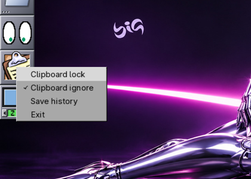
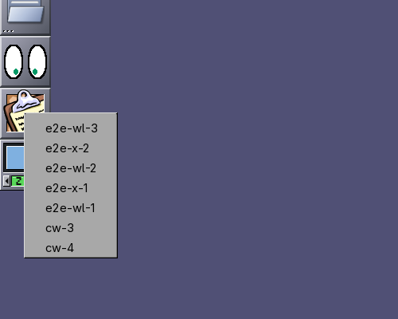

# wmcliphist na sessão Wayland (wlmaker + XWayland)

## Problema

No Wayland o ladrilho do `wmcliphist` aparecia, mas o menu (botão direito:
Clipboard lock/ignore, Save history, Exit; botão esquerdo: o histórico)
quase nunca abria. No X11 funcionava. Além disso, escolher um item do
histórico não mudava o que o Ctrl+V cola nos aplicativos Wayland, e as
cópias feitas em aplicativos Wayland não apareciam no menu.

## Causa

### Menu que fecha sozinho

O menu é um `GtkMenu` (GTK 3, backend X11 no XWayland): no ButtonPress o
GTK mapeia uma janela override-redirect e faz um grab de ponteiro e de
teclado no servidor X. O wlmaker mostra essa janela como *overlay* (acima
do Dock) e, ao mapear, segurava o ponteiro para ela
(`_xwl_surface_overlay_grab`).

Isso acontecia com o botão **ainda apertado**. O foco do ponteiro do
Wayland saía da superfície do ladrilho para a do menu, e o Xwayland, ao
receber `wl_pointer.enter` com botões apertados, solta esses botões
(`pointer_handle_enter` em `xwayland-input.c`), e só depois de gerar os
eventos de cruzamento (`CheckMotion`). O GTK recebe Enter nos itens (que
zeram o `activate_time` do `GtkMenuShell`) e em seguida o ButtonRelease:
para ele é um "aperta-arrasta-solta" sem item, e o menu fecha
(`gtk_menu_shell_button_release`, `deactivate = TRUE`).

Um toque rápido (o release chega antes do mapa) funcionava; um clique
normal de um usuário (o botão fica uns 100 ms apertado, ou o mouse mexe
1 px) não. Por isso o laboratório com `xdotool click` não mostrava o
problema. Reproduzido com o botão segurado 150 ms ou com tremida de 1 px
(rastreio dos eventos do GDK por `LD_PRELOAD` em `gdk_event_handler_set`).

Não tem relação com várias telas nem com a escala (conferido com 1, 2 e 3
saídas e escala 1,5). Também não é regressão dos patches do wmcliphist.

### Área de transferência

O wlroots só deixa um cliente X11 ler ou escrever a área de transferência
do Wayland quando uma janela do XWayland tem o foco do teclado
(`xwm->focus_surface`, em `xwayland/selection/{incoming,outgoing}.c`). Um
dockapp nunca tem o foco: o `wmcliphist` não via as cópias do Wayland e o
que ele publicava ficava só no CLIPBOARD do X11. Pior: quando a ponte do
compositor ficava dona do CLIPBOARD (uma cópia Wayland) e não respondia, o
wmcliphist achava que o aplicativo tinha fechado e republicava o último
item, e a cada recarga do menu (SIGUSR2) ele virava dono do CLIPBOARD
(`auto_take_up` em `process_item`) e publicava o primeiro item, trocando a
cópia que o usuário acabara de fazer.

## Solução

### wlmaker (branch `fix/wmcliphist-menu-2026-11`)

- `src/icon_manager.c`: um clique no conteúdo de um dockapp X11 é um grab
  implícito, como no X11: o ladrilho fica com o ponteiro (o movimento vai
  para a superfície X11, também fora do ladrilho, em coordenadas da
  superfície) até o ponteiro se mexer depois de todos os botões soltos. O
  Xwayland entrega os eventos a quem fez o grab no X (o menu).
- `src/xwl_surface.c` (mudança localizada nas funções do overlay): o grab
  do menu espera o mesmo movimento depois da soltura; o menu recebe o
  foco do teclado (Esc, setas, Enter, como o grab do GTK no X11) e o
  devolve à superfície anterior quando some, a menos que outra coisa tenha
  pegado o foco nesse meio tempo.
- Cherry-pick de `2ac7086` (outra sessão): `wlr_xwayland_set_seat()`. Sem
  ele não há ponte nenhuma de seleção entre X11 e Wayland; é correto
  (o wlroots guarda o seat e o aplica quando o XWM fica pronto, também no
  modo preguiçoso). O `de57e2e` (pipes dos subprocessos com close-on-exec
  e fechados ao fim) não tem relação com o menu, mas é correto e
  necessário: no host o wlmaker estava com 407 descritores após 1h25 de
  sessão (limite 1024).

### wmcliphist (`packages/big-dockapps/wmcliphist-wayland-clipboard.patch`)

- O item escolhido (ou retomado quando o aplicativo que copiou fecha) vai
  também para a área de transferência do Wayland, por
  `big-wm-clipboard --copy` (wl-copy; o conteúdo num pipe, nunca na linha
  de comando).
- Sem resposta da ponte (TARGETS negado, `n_atoms <= 0`) no Wayland: não
  retoma a seleção.
- O histórico carregado do banco (início, SIGUSR2) não retoma a seleção no
  Wayland.
- Sem `WAYLAND_DISPLAY` (sessão X11) nada muda.

### big-wm (branch `fix/dockapps-catalog-2026-11`)

- `big-wm-clipboard --copy`; uma cópia gravada pelo vigia do Wayland
  (`wl-paste --watch`, `CLIPBOARD_STATE` no ambiente) avisa o wmcliphist
  da mesma sessão (SIGUSR2, filtrado pelo `XDG_RUNTIME_DIR`), que recarrega
  o menu do banco: as cópias de aplicativos Wayland aparecem no menu.
  Mecanismo específico, sem dar foco a ninguém e sem injetar eventos.

Histórico, favoritos (cadeado = botão direito no item), limpeza
(`--clear` + SIGUSR2) e persistência (`clipboard.db`) continuam os mesmos.

## Testes (laboratório `mklab.sh dockapps`, wlmaker do worktree)

- Matriz de cliques no ladrilho (`rc.sh`): antes, `slow` (botão segurado
  150 ms), `move` e `slowmove` deixavam o menu desmapeado; depois, todos
  abrem.
- `menu-test.sh` (abre com toque, segurado e tremido; fecha clicando fora;
  escolhe item; segurar-arrastar-soltar no item; botão esquerdo abre o
  histórico), 2 saídas, XWayland preguiçoso: 8 rodadas, 88 verificações,
  0 falhas (`menu-test-2out.log`). Escala 1,5: 3 rodadas, 33 verificações,
  0 falhas (`menu-test-scale15.log`).
- Esc fecha o menu e o teclado volta ao xterm que tinha o foco (o texto
  digitado depois chegou ao xterm).
- Área de transferência, em sequência Wayland/X11/Wayland/X11/Wayland:
  o Wayland sempre fica com a última cópia; todas no banco e no menu;
  escolher `e2e-x-1` no menu põe `e2e-x-1` no `wl-paste`; botão direito
  no item grava o favorito no banco.
- `ctest` do wlmaker: 29/29. `tests/run.sh` do big-wm: tudo ok.

## Limitações

- O Esc e as setas só chegam ao menu se alguma janela tiver o foco do
  teclado no wlmaker (o caminho das teclas passa pelo elemento com foco);
  sem janela nenhuma aberta, feche clicando fora.
- "Clipboard lock/ignore" só vale para cópias de aplicativos X11: as do
  Wayland não passam pelo wmcliphist.
- Um aplicativo X11 só cola a cópia de um aplicativo Wayland quando ele
  próprio tem o foco (regra do wlroots; vale para todos, não só para o
  wmcliphist).

## Próximos passos

- Teste na sessão real com mouse físico depois de instalar o wlmaker e o
  big-dockapps novos.
- Opcional: entregar as teclas ao foco do seat quando nenhum elemento as
  aceita (Esc sem janela ativa).
